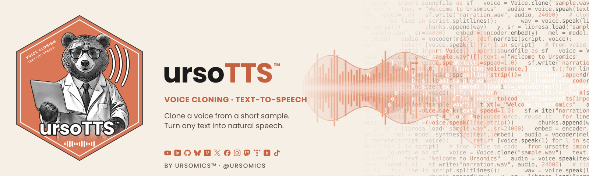
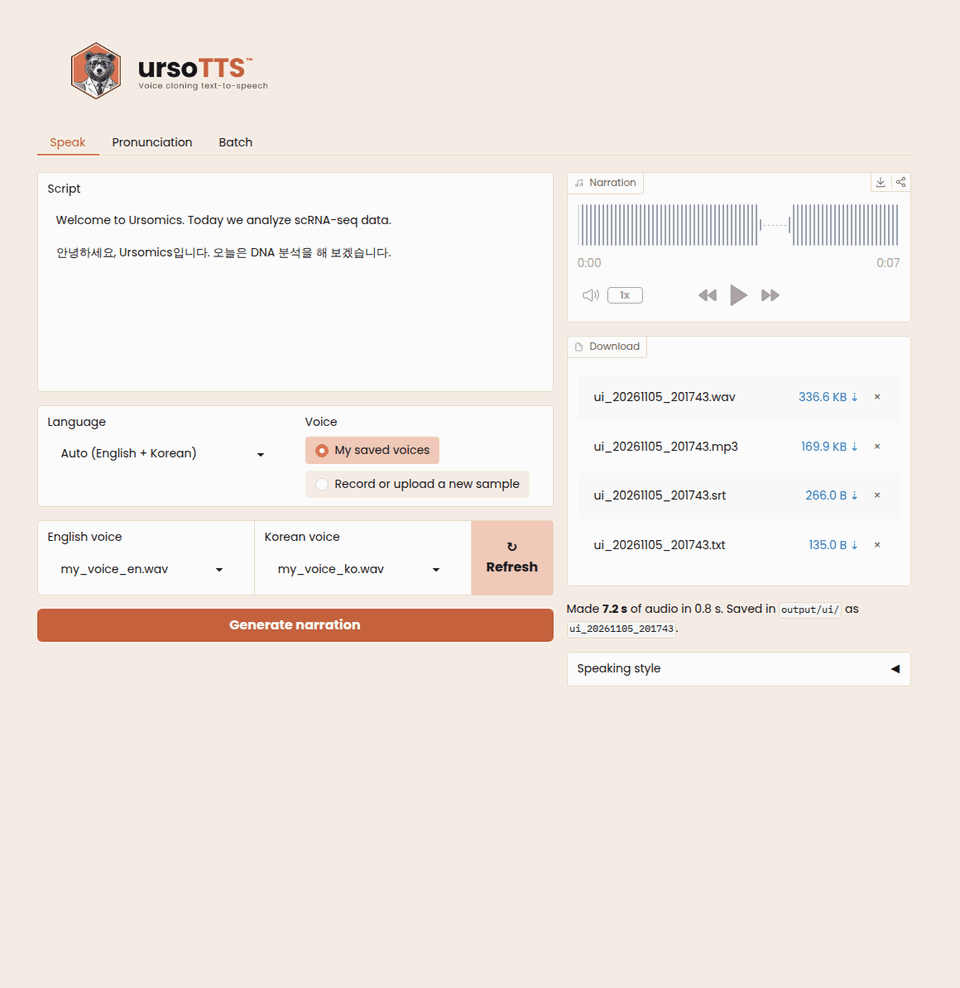
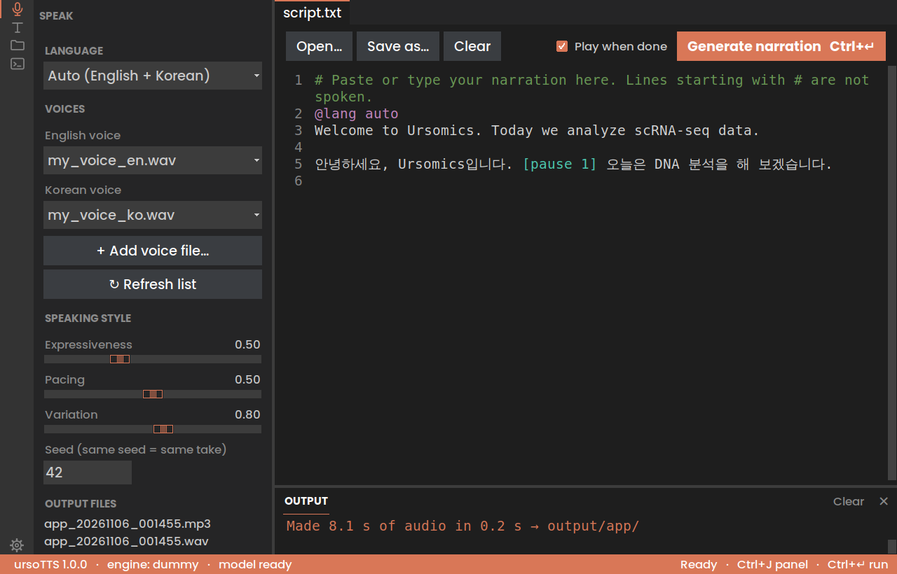
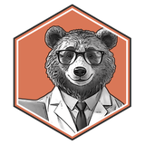

<p align="center">
  <a href="README.md">English</a> · <b>한국어</b>
</p>

<p align="center">
  <picture>
    <source media="(prefers-color-scheme: dark)" srcset="docs/brand/readme_banner_dark_1600x480.png">
    
  </picture>
</p>

<p align="center">
  <b>내 목소리를, 몇 번이고 다시.</b><br>
  영상 크리에이터를 위한 보이스 클로닝 내레이션 도구. Claude Code로 만들었습니다.
</p>

<p align="center">
  
  
  
  
</p>

<p align="center">
  <a href="#빠른-시작">빠른 시작</a> ·
  <a href="#사용법">웹 UI</a> ·
  <a href="#발음">발음</a> ·
  <a href="docs/MANUAL.ko.md">매뉴얼</a>
</p>

---

**ursoTTS™: 영상 크리에이터를 위한 보이스 클로닝 일괄 내레이션.** 대본을 일반 텍스트 파일로 쓰고, 목소리를 한 번만 녹음하면, 모든 영상의 내레이션(WAV + MP3 + 자막)이 완성됩니다. 오픈소스 모델로 내 컴퓨터에서 실행되므로 글자 수 단위 요금이 없습니다. 데스크톱 앱, 브라우저의 간단한 웹 페이지, 명령줄 어디서든 쓸 수 있습니다.

[@ursomics](https://youtube.com/@ursomics) 생물정보학 영상 시리즈(영어 + 한국어)를 위해 만들었고, Claude Code로 개발했습니다.

📖 **처음이신가요? [매뉴얼](docs/MANUAL.ko.md)을 읽어 보세요.** Claude Code(VS Code, 데스크톱 앱, CLI)로 설치하는 법, 웹 UI, 터미널 명령어, 대본 쓰는 법, 발음 고치는 법을 다룹니다.

<p align="center">
  
  <br><sub><b>Speak</b>: 내 목소리로 내레이션 생성 · <b>Pronunciation</b>: 표기를 귀로 비교 · <b>Batch</b>: 폴더 전체 생성</sub>
</p>

## 왜 ursoTTS인가

클라우드 보이스 클로닝 서비스는 글자 수만큼 요금을 받습니다. 영상 수백 편짜리 시리즈라면 금방 큰 비용이 됩니다. ursoTTS는 [Chatterbox](https://github.com/resemble-ai/chatterbox)(Resemble AI, MIT 라이선스)를 내 컴퓨터에서 실행합니다. 설치가 끝나면 영상이 늘어나도 드는 것은 GPU 사용 시간뿐입니다.

## 주요 기능

- **웹 UI.** 텍스트를 붙여 넣고, 브라우저에서 목소리 샘플을 녹음하거나 올리고, 슬라이더로 말투를 조정한 뒤 결과를 내려받습니다.
- **일괄(batch) 모드.** 대본 폴더를 지정하면 대본마다 내레이션 하나씩을 만듭니다.
- **두 언어 지원.** 영어와 한국어를 **문장마다** 감지하므로 한국어·영어가 섞인 대본도 됩니다. 언어마다 다른 목소리 샘플을 쓸 수 있습니다.
- **똑똑한 재생성.** 대본의 텍스트나 설정이 바뀐 경우에만 다시 만들고, 그때도 바뀐 문장만 새로 생성합니다. 10분짜리 대본의 오타 하나는 몇 초 만에 고쳐집니다.
- **자막 포함.** 내레이션 타이밍에 맞춘 `.srt` 파일이 함께 나오며, 원래 표기를 그대로 유지합니다(발음용 표기가 아니라 `scRNA-seq`).
- **매끄러운 약어.** `DNA`, `ATP` 같은 대문자 약어를 글자마다 자연스럽게 읽습니다. 영어는 `D.N.A.`, 한국어는 `디엔에이`. `config.yaml`에서 `spell_acronyms: false`로 끌 수 있습니다.
- **전문 용어의 정확한 발음.** 유전자 이름과 도구 이름을 어떻게 읽을지 정할 수 있습니다(`CD8: C.D. eight`, `NANOG: NAN.og`, `GATA6: 가타식스`). 영어와 한국어로 생물정보학 용어 약 60개가 기본으로 들어 있습니다.
- **발음 실험실.** 웹 UI에서 까다로운 단어의 여러 표기를 직접 들어 비교하고, 가장 좋은 것을 저장합니다.
- **쉼 조절.** 대본 어디에나 `[pause 1.5]`를 쓰면 됩니다. 빈 줄은 문단 사이 쉼이 됩니다.
- **유튜브용 MP3.** 음량을 -14 LUFS로 맞춰 내보냅니다.
- **같은 결과 재현.** seed를 고정하면 다시 만들어도 같은 말투가 나옵니다.
- **테스트 엔진.** `--engine dummy`로 GPU 없이 대본과 타이밍을 확인합니다.

## 활용 예

- **유튜브 튜토리얼과 강의:** 화면 녹화와 슬라이드에 내 목소리로 내레이션을 입힙니다.
- **논문 요약과 저널 클럽:** 논문을 짧은 영상이나 오디오 요약으로 만듭니다.
- **온라인 강좌와 실험실 교육:** e-러닝 모듈, 프로토콜·SOP 안내, 새 연구원 교육 자료.
- **발표:** 슬라이드 음성 해설, 학회 발표 녹화, 포스터 소개 영상, 참석하지 못하는 랩 미팅 발표.
- **발표 연습:** 발표 대본을 미리 들어 보고 시간을 확인합니다.
- **팟캐스트와 오디오 버전:** 블로그 글, 뉴스레터, 내가 쓴 글을 오디오로 바꿉니다.
- **두 언어 콘텐츠:** 같은 화면으로 영어판과 한국어판을 만듭니다.
- **짧은 영상:** 유튜브 쇼츠, 인스타그램 릴스, 틱톡 내레이션.
- **제품·앱 소개:** 데모 영상, 사용 안내, 업데이트 소개.
- **접근성:** 문서의 오디오 버전과, 읽으며 보는 사람을 위한 자막.

내 목소리, 또는 허락받은 목소리만 클로닝하세요.

## 앱 내려받기 (Python 필요 없음)

[최신 릴리스](https://github.com/ursomics/ursotts/releases/latest)에서 내 컴퓨터용 설치 파일을 받으세요:

| 컴퓨터 | 파일 | 설치 |
|---|---|---|
| **Mac** (Apple Silicon) | `ursoTTS-1.0.0-mac-arm64.dmg` | 열고 **ursoTTS**를 **응용 프로그램(Applications)** 으로 끌어다 놓기 |
| **Windows** (64비트) | `ursoTTS-1.0.0-windows-setup.exe` | 실행하고 안내 따르기 |

- **처음 열 때:** 아직 유료 개발자 인증서로 서명되지 않아 처음 한 번 확인을 묻습니다. Mac: ursoTTS를 오른쪽 클릭 → **열기** → **열기**. Windows: **추가 정보** → **실행**.
- **첫 내레이션**을 만들 때 목소리 모델(몇 GB)을 한 번 내려받으므로, 처음에는 인터넷 연결이 필요합니다.
- 내 파일은 홈 폴더의 **`ursoTTS`** 폴더에 있습니다. 목소리 샘플은 `voices/`, 대본은 `scripts/`에 넣고, 결과는 `output/`에서 찾으세요.

명령줄이나 웹 UI를 쓰려면 아래 빠른 시작대로 소스에서 설치하세요.

## 빠른 시작

프로젝트 이름은 **ursoTTS**이고, 입력하는 명령어는 `ursotts`입니다.

macOS(Apple Silicon)와 Python 3.13에서 테스트했습니다. Python 3.10 이상이면 됩니다.

```bash
# 1. 프로젝트 받기: ursotts.zip을 풀거나, 다음을 실행합니다
#      git clone https://github.com/<you>/ursotts.git
#    "ursotts" 폴더는 iCloud, OneDrive, Dropbox가 동기화하지 않는 곳
#    (예: ~/Projects/)에 두세요. 용량이 큰 .venv와 캐시 폴더를 동기화하면
#    동기화가 느려지고 환경이 망가질 수 있습니다.
#    그다음 폴더 안으로 들어갑니다. ursotts 명령은 항상 여기서 실행하세요.
#    현재 폴더의 config.yaml(목소리 설정)을 읽기 때문입니다:
cd ~/Projects/ursotts

# 2. 가상환경을 만들고 전체(CLI + 웹 UI)를 설치합니다
python3.13 -m venv .venv
source .venv/bin/activate        # 새 터미널을 열 때마다 실행
pip install -e ".[all]"

# 3. voices/에 목소리 샘플을 넣고(아래 참고) 설치를 확인합니다
ursotts check
```

처음 실제로 실행할 때 Hugging Face에서 Chatterbox 모델 가중치(몇 GB)를 내려받습니다.

## 사용법

### 브라우저에서

```bash
ursotts ui
```

**http://127.0.0.1:7860** 이 열립니다. 내 컴퓨터에서만 실행되므로 아무것도 외부로 업로드되지 않습니다.

시스템의 라이트/다크 모드를 따라갑니다.

- **Speak 탭:** 대본을 붙여 넣고, 언어와 언어별 저장된 목소리를 고른 뒤 **Generate narration**을 누릅니다. 새 목소리를 쓰려면 *Record or upload a new sample*을 고르고 10~30초 녹음한 뒤 **Save to my voices**로 저장하세요. **Speaking style**에서 표현력, 속도, 변화를 조정합니다. 결과는 `output/ui/`에 저장됩니다.
- **Pronunciation 탭:** 한 단어의 여러 표기를 나란히 듣고 가장 좋은 것을 저장합니다.
- **Batch 탭:** 대본 폴더와 출력 폴더를 고르거나 새로 만든 뒤 전체를 만듭니다. `ursotts batch`와 같습니다.

탭마다 쓰는 법은 [매뉴얼](docs/MANUAL.ko.md#6-웹-ui-사용하기)에 단계별로 있습니다.

### 데스크톱 앱으로

<p align="center"></p>

```bash
ursotts app
```

같은 Speak, Pronunciation, Batch 기능을 VS Code Dark 스타일의 일반 창에서 씁니다. 액티비티 바, 크기 조절되는 사이드바, 줄 번호가 있는 대본 편집기, 실시간 기록이 보이는 OUTPUT 패널이 있습니다. 내장된 **Claude Code** 화면에서 말로 요청해 앱의 모양과 기능을 바꿀 수 있고, 한 번에 되돌릴 수도 있습니다. [매뉴얼](docs/MANUAL.ko.md#7-ursotts-데스크톱-앱-쓰기)을 참고하세요.

### 터미널에서

```bash
ursotts preview scripts/02_intro_ko.txt   # 나뉜 덩어리, 언어, 쉼 확인 (소리 없음)
ursotts say "Hello from Ursomics." -o output/hello.wav
ursotts batch scripts output              # scripts/의 모든 대본 생성
```

대본 `name.txt` 하나마다 `batch`가 만드는 파일:

```
output/name.wav   output/name.mp3   output/name.srt   output/batch_report.json
```

`batch`를 다시 실행하면 텍스트와 설정이 바뀌지 않은 대본은 건너뜁니다. 전부 다시 만들려면 `--force`를 붙이세요. 문장 캐시 덕분에 그래도 빠릅니다.

## 내 목소리 샘플 녹음하기

녹음 파일을 `voices/`에 넣고 `config.yaml`에 적습니다:

```yaml
voices:
  en: voices/my_voice_en.wav
  ko: voices/my_voice_ko.wav
```

좋은 클론을 위한 팁:
- 영상과 같은 말투로 **10~30초** 동안 자연스럽게 말하세요.
- 조용한 방에서, 음악 없이, 한 사람만, 마이크와의 거리를 일정하게 유지하세요.
- 언어마다 샘플을 하나씩 녹음하세요. 한국어는 한국어 녹음으로 클로닝해야 가장 자연스럽습니다.
- WAV가 가장 좋고, MP3도 됩니다.

목록에 있는 샘플이 없으면 ursoTTS는 실행을 거부합니다. 그래서 실수로 다른 사람 목소리로 일괄 생성할 일이 없습니다.

## 발음

대문자 약어는 자동으로 철자를 풀어 읽습니다. `DNA`는 영어로 `D.N.A.`, 한국어로 `디엔에이`가 됩니다. 나머지는 `pronunciations.yaml`에 적습니다:

```yaml
en:
  CD8: C.D. eight         # 글자: 대문자 하나마다 점
  NANOG: {say: NAN.og, like: "NAN as in man, og as in dog"}   # 점은 음절을 한 단어로 연결
  RNA-seq: R.N.A. seek
ko:
  GATA6: 가타식스          # 한국어: 한글로 읽는 법을 적습니다
```

한영 혼합 대본이라면 맨 위에 `@lang ko`를 쓰세요. 영어 용어가 많은 한국어 문장도 한국어 목소리와 `ko:` 사전으로 일정하게 읽힙니다([한영 혼합 대본의 발음](docs/MANUAL.ko.md#한영-혼합-대본의-발음)).

유전자 이름이 가득한 테스트 대본이 `examples/`에 있습니다. 소리를 Claude에게 설명하는 방법을 포함한 전체 안내는 [매뉴얼](docs/MANUAL.ko.md#93-발음-고치기)을 보세요.

## 스크립트 형식

```text
# #으로 시작하는 줄은 메모이며 읽지 않습니다.
@lang auto            (선택: 파일 전체를 en / ko로 고정)

Welcome to Ursomics. Today we run scRNA-seq QC with Claude Code.

먼저 데이터를 불러옵니다. [pause 0.8] 그다음 미토콘드리아 비율을 확인합니다.
```

## 목소리 조정 (`config.yaml`)

| 설정 | 웹 UI 이름 | 효과 |
|---|---|---|
| `exaggeration` | Expressiveness | 0.3 = 차분한 강의, 0.5 = 기본, 0.7 이상 = 생동감 |
| `cfg_weight` | Pacing | 낮을수록(~0.3) 느리고 또박또박 |
| `temperature` | Variation | 높을수록 말투가 다양해짐 |
| `seed` | Seed | 바꾸면 같은 텍스트의 다른 버전이 나옴 |
| `max_chars` | — | 덩어리가 작을수록 긴 대본에서 말투가 안정적 |

## 하드웨어

| 환경 | 참고 |
|---|---|
| NVIDIA GPU (CUDA) | 가장 빠름 |
| Apple Silicon Mac | 됨(`mps`), 더 느림 |
| CPU만 | 되지만 느림. 짧은 클립에는 충분 |
| 클라우드 GPU (RunPod, Colab 등) | 시간 단위로 빌려 한 번에 많은 대본을 생성 |

## 책임 있는 사용

**내 목소리**, 또는 명시적으로 허락받은 목소리만 클로닝하세요. Chatterbox는 생성한 오디오에 들리지 않는 워터마크를 넣습니다. 지우지 말아 주세요. `ursotts ui --share`는 임시 공개 링크를 만드니, 의도한 경우에만 쓰세요.

## 기여하기

환영하는 기여 아이디어:

- [ ] 대체 백엔드로 CosyVoice2 엔진(Apache 2.0)
- [ ] 대화·인터뷰를 위한 줄 단위 목소리 전환
- [ ] 자동 감지 언어 추가(현재 영어와 한국어)

새 엔진은 `ursotts/engine.py`의 `BaseEngine`을 상속하기만 하면 됩니다. pull request를 열기 전에 `ursotts batch scripts output --engine dummy`로 전체 과정이 잘 되는지 확인해 주세요.

## 라이선스

MIT © 2026 Ursus (@ursomics). Chatterbox는 © Resemble AI, MIT 라이선스입니다.

`docs/brand/`의 ursoTTS 이름, 로고, 곰 그림은 © 2026 Ursus (@ursomics)이며 MIT 라이선스 대상이 아닙니다.

Anthropic과 제휴하거나 Anthropic의 보증을 받은 프로젝트가 아닙니다. Claude와 Claude Code는 Anthropic의 상표입니다.

---

<p align="center">
  <br>
  <sub>Made with  by <a href="https://github.com/ursomics">ursomics@GitHub</a> · <a href="https://ursomics.com">ursomics.com</a> · <a href="https://youtube.com/@ursomics">@ursomics</a></sub>
</p>

함께 들어 있는 **Poppins** 글꼴은 © The Poppins Project Authors이며, SIL Open Font License 1.1을 따릅니다(`ursotts/assets/fonts/OFL.txt`).
