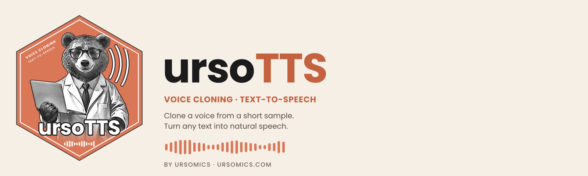
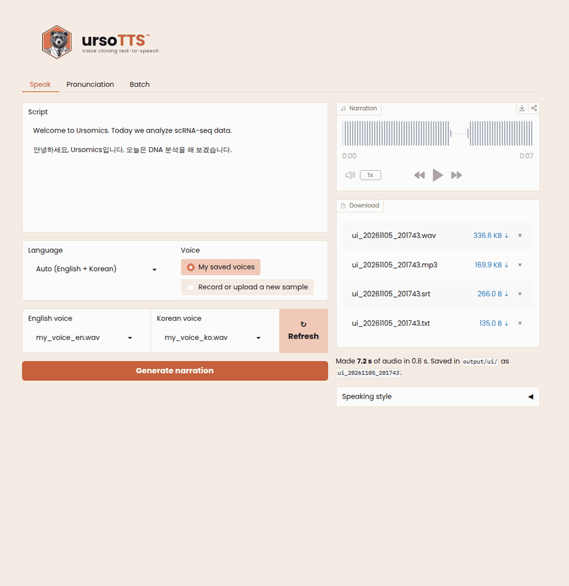
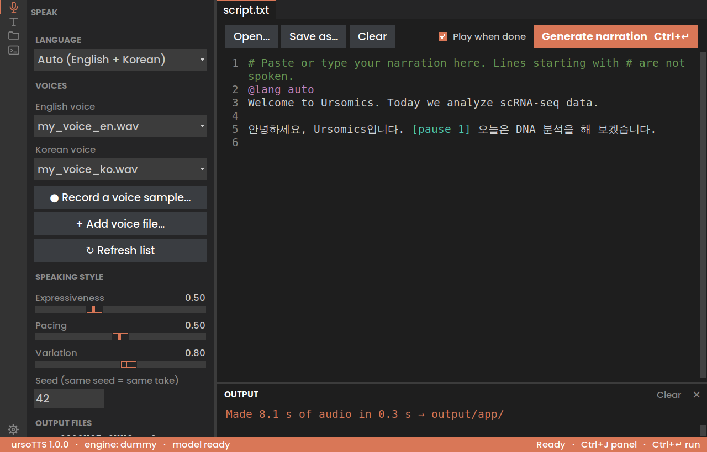

<p align="center">
  <b>English</b> · <a href="README.ko.md">한국어</a>
</p>

<p align="center">
  <picture>
    <source media="(prefers-color-scheme: dark)" srcset="docs/brand/readme_banner_dark_1600x480.png">
    
  </picture>
</p>

<p align="center">
  <b>Your own voice, on repeat.</b><br>
  Voice-cloned narration for video creators, built with Claude Code.
</p>

<p align="center">
  
  
  
  
</p>

<p align="center">
  <a href="#quick-start">Quick start</a> ·
  <a href="#use-it">Web UI</a> ·
  <a href="#pronunciation">Pronunciation</a> ·
  <a href="docs/MANUAL.md">Manual</a>
</p>

---

**ursoTTS™: batch voice-cloned narration for video creators.** Write your scripts as plain text files, record your voice once, and get finished narration (WAV + MP3 + subtitles) for every video. It runs on your own machine with open-source models, so there are no per-character credits. Use it as a desktop app, from a simple web page in your browser, or from the command line.

Built for the [@ursomics](https://youtube.com/@ursomics) bioinformatics video series (English + Korean), and developed with Claude Code.

📖 **New here? Read the [manual](docs/MANUAL.md).** It covers setup with Claude Code (VS Code, the desktop app or the CLI), the web UI, terminal commands, writing scripts and fixing pronunciation.

<p align="center">
  
  <br><sub><b>Speak</b>: generate narration in your voice · <b>Pronunciation</b>: compare spellings by ear · <b>Batch</b>: render a whole folder</sub>
</p>

## Why

Cloud voice-cloning services charge per character. That adds up quickly across a series of hundreds of videos. ursoTTS uses [Chatterbox](https://github.com/resemble-ai/chatterbox) (MIT-licensed, by Resemble AI) locally. After setup, each extra video costs only GPU time.

## Features

- **Web UI.** Paste text, record or upload a voice sample in the browser, adjust the speaking style with sliders, and download the result.
- **Batch mode.** Point it at a folder of scripts and get one narration per script.
- **Bilingual.** It detects English and Korean **per sentence**, so mixed Korean-English scripts work. Each language can use its own voice sample.
- **Smart re-rendering.** A script is redone only when its text or the settings change, and even then only the changed sentences are generated again. Fixing a typo in a 10-minute script takes seconds.
- **Subtitles included.** An `.srt` file is timed to the narration and keeps your original spelling (`scRNA-seq`, not the phonetic version).
- **Smooth abbreviations.** All-caps words like `DNA` or `ATP` are spelled letter by letter, smoothly and naturally (`D.N.A.`). Turn this off with `spell_acronyms: false` in `config.yaml`.
- **Exact pronunciation for jargon.** Define how gene names and tools sound (`CD8: C.D. eight`, `NANOG: NAN.og`). Ships with about 60 bioinformatics terms.
- **Pronunciation lab.** Compare versions of a tricky word by ear in the web UI and save the best one.
- **Pause control.** Write `[pause 1.5]` anywhere in a script. Blank lines become paragraph pauses.
- **YouTube-ready MP3s.** Exports are loudness-normalized to -14 LUFS.
- **Reproducible takes.** A fixed seed gives the same take on every re-run.
- **Test engine.** `--engine dummy` checks your scripts and timing without a GPU.

## What you can use it for

- **YouTube tutorials and lectures:** narrate screen recordings and slides in your own voice.
- **Paper summaries and journal clubs:** short videos or audio summaries of articles.
- **Online courses and lab training:** e-learning modules, protocol and SOP walkthroughs, onboarding for new lab members.
- **Presentations:** voice-over for slides, recorded conference talks, poster pitches, or a lab meeting you can't attend.
- **Rehearsal:** hear your talk script before presenting and check its timing.
- **Podcasts and audio versions:** turn blog posts, newsletters or your own writing into audio.
- **Bilingual content:** English and Korean versions of the same video from one set of visuals.
- **Short-form video:** narration for YouTube Shorts, Instagram Reels and TikTok.
- **Product and app demos:** demo videos, walkthroughs and release announcements.
- **Accessibility:** audio versions of documents, with subtitles for viewers who read along.

Only clone your own voice, or a voice you have permission to use.

## Download the app (no Python needed)

Get the installer for your computer from the [latest release](https://github.com/ursomics/ursotts/releases/latest):

| Computer | File | Install |
|---|---|---|
| **Mac** (Apple Silicon) | `ursoTTS-1.0.0-mac-arm64.dmg` | Open it and drag **ursoTTS** into **Applications** |
| **Windows** (64-bit) | `ursoTTS-1.0.0-windows-setup.exe` | Run it and follow the steps |

- **First open:** the app isn't signed with a paid developer certificate yet, so your computer asks for confirmation once. **Mac:** click **Done** on the warning, open **System Settings → Privacy & Security**, scroll to **Security**, and click **Open Anyway** (on older macOS: right-click ursoTTS → **Open** → **Open**). **Windows:** **More info** → **Run anyway**.
- **First narration** downloads the voice model (a few GB) once, so you need an internet connection the first time.
- Your files live in a **`ursoTTS`** folder in your home folder: put voice samples in `voices/`, scripts in `scripts/`, and find results in `output/`.

Prefer the command line or the web UI? Install from source with the quick start below.

## Quick start

The project is called **ursoTTS**; the command you type is `ursotts`.

Tested on macOS (Apple Silicon) with Python 3.13. Python 3.10 or newer works.

```bash
# 1. Get the project: unzip ursotts.zip, or run
#      git clone https://github.com/<you>/ursotts.git
#    Keep the "ursotts" folder somewhere that is NOT synced by iCloud,
#    OneDrive or Dropbox (for example ~/Projects/). Syncing the large
#    .venv and cache folders slows sync down and can break the environment.
#    Then go into the folder. Run every ursotts command from here, because
#    it reads config.yaml (your voice settings) from the current folder:
cd ~/Projects/ursotts

# 2. Create a virtual environment and install everything (CLI + web UI)
python3.13 -m venv .venv
source .venv/bin/activate        # do this in every new terminal
pip install -e ".[all]"

# 3. Add your voice samples to voices/ (see below), then check the setup
ursotts check
```

The first real run downloads the Chatterbox model weights from Hugging Face, which takes a few GB.

## Use it

### In the browser

```bash
ursotts ui
```

This opens **http://127.0.0.1:7860**. It runs only on your computer, so nothing is uploaded anywhere.

It follows your system's light or dark mode.

- **Speak tab:** paste a script, choose a language and a saved voice for each language, and click **Generate narration**. To use a new voice, choose *Record or upload a new sample*, record 10–30 seconds, and keep it with **Save to my voices**. Adjust expressiveness, pacing and variation under **Speaking style**. Results are saved in `output/ui/`.
- **Pronunciation tab:** hear several spellings of a word side by side and save the best one.
- **Batch tab:** choose a scripts folder and an output folder (or create a new one), then render them all, the same as `ursotts batch`.

A step-by-step guide to every tab is in the [manual](docs/MANUAL.md#6-using-the-web-ui).

### As a desktop app

<p align="center"></p>

```bash
ursotts app
```

The same Speak, Pronunciation and Batch features in a native window styled like VS Code Dark: activity bar, resizable sidebar, script editor with line numbers, and an OUTPUT panel with the live log. A built-in **Claude Code** view lets you restyle or extend the app by asking in plain words, with one-click Undo. See the [manual](docs/MANUAL.md#7-using-the-ursotts-desktop-app).

### From the terminal

```bash
ursotts preview scripts/02_intro_ko.txt   # see chunks, languages and pauses (no audio)
ursotts say "Hello from Ursomics." -o output/hello.wav
ursotts batch scripts output              # render every script in scripts/
```

For each script `name.txt`, `batch` writes:

```
output/name.wav   output/name.mp3   output/name.srt   output/batch_report.json
```

Running `batch` again skips scripts whose text and settings haven't changed. Add `--force` to redo everything; the sentence cache keeps that fast.

## Record your voice sample

Put your recordings in `voices/` and list them in `config.yaml`:

```yaml
voices:
  en: voices/my_voice_en.wav
  ko: voices/my_voice_ko.wav
```

Tips for a good clone:
- Record **10–30 seconds** of natural speech in the same style as your videos.
- Use a quiet room, no music, one speaker, and keep the mic at a steady distance.
- Record one sample per language; your Korean sounds best when cloned from your Korean.
- WAV is the best format; MP3 also works.

ursoTTS refuses to run when a listed sample is missing, so you never render a batch in someone else's voice by accident.

## Pronunciation

All-caps abbreviations are spelled automatically: `DNA` becomes `D.N.A.`. Everything else goes in `pronunciations.yaml`:

```yaml
en:
  CD8: C.D. eight         # letters: each capital followed by a dot
  NANOG: {say: NAN.og, like: "NAN as in man, og as in dog"}   # dots join syllables
  RNA-seq: R.N.A. seek
```

Test scripts full of gene names are in `examples/`. See the [manual](docs/MANUAL.md#93-fix-pronunciation) for the full guide, including how to describe a sound to Claude.

## Script format

```text
# Lines starting with # are notes - not spoken.
@lang auto            (optional: force en / ko for the whole file)

Welcome to Ursomics. Today we run scRNA-seq QC with Claude Code.

First we load the data. [pause 0.8] Then we check the mitochondrial fraction.
```

## Tuning the voice (`config.yaml`)

| Setting | Web UI label | Effect |
|---|---|---|
| `exaggeration` | Expressiveness | 0.3 = calm lecture, 0.5 = default, 0.7+ = animated |
| `cfg_weight` | Pacing | lower (~0.3) = slower, more deliberate |
| `temperature` | Variation | higher = more varied speech |
| `seed` | Seed | change it to get a different take of the same text |
| `max_chars` | — | smaller chunks = more stable speech on long scripts |

## Hardware

| Setup | Notes |
|---|---|
| NVIDIA GPU (CUDA) | Fastest. |
| Apple Silicon Mac | Works (`mps`), slower. |
| CPU only | Works, but slow; fine for short clips. |
| Cloud GPU (RunPod, Colab, etc.) | Rent by the hour and batch many scripts per session. |

## Use responsibly

Only clone **your own voice** or a voice you have explicit permission to use. Chatterbox embeds an imperceptible watermark in generated audio; please don't remove it. `ursotts ui --share` creates a temporary public link, so only use it when you mean to.

## Contributing

Ideas that would make good contributions:

- [ ] A CosyVoice2 engine (Apache 2.0) as an alternative backend
- [ ] Per-line voice switching for dialogues and interviews
- [ ] More languages in auto-detection (currently English and Korean)

New engines only need to subclass `BaseEngine` in `ursotts/engine.py`. Before opening a pull request, run `ursotts batch scripts output --engine dummy` to check that the full pipeline still works.

## License

MIT © 2026 Ursus (@ursomics). Chatterbox is © Resemble AI, MIT License.

The ursoTTS name, logo and bear artwork in `docs/brand/` are © 2026 Ursus (@ursomics) and are not covered by the MIT license.

Not affiliated with or endorsed by Anthropic. Claude and Claude Code are trademarks of Anthropic.

---

<p align="center">
  <br>
  <sub>Made with  by <a href="https://github.com/ursomics">ursomics@GitHub</a> · <a href="https://ursomics.com">ursomics.com</a> · <a href="https://youtube.com/@ursomics">@ursomics</a></sub>
</p>

The bundled **Poppins** font is © The Poppins Project Authors, under the SIL Open Font License 1.1 (`ursotts/assets/fonts/OFL.txt`).
