<p align="center">
  <a href="MANUAL.md">English</a> · <b>한국어</b>
</p>

<p align="center">
  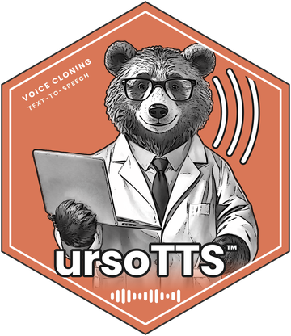
</p>

<h1 align="center">ursoTTS™ 매뉴얼</h1>

<p align="center">
  <b>빈 폴더에서 완성된 내레이션까지, 한 단계씩.</b><br>
  <sub>보이스 클로닝 · 텍스트 음성 변환 · 영어와 한국어</sub>
</p>

---

이 매뉴얼은 빈 폴더에서 시작해 실제 영상에 쓸 내레이션을 완성하기까지 안내합니다. 프로그래밍 경험이 없어도 됩니다. 코드가 필요한 단계에서는 **Claude Code**에게 맡기는 방법을 보여 줍니다.

> **📖 이 매뉴얼 읽는 법**
>
> - **가장 쉬운 방법:** [GitHub에서](https://github.com/ursomics/ursotts/blob/main/docs/MANUAL.ko.md) 읽으세요. 모든 것이 의도한 대로 보입니다.
> - **내 컴퓨터에서:** **VS Code**로 열고 **Cmd+Shift+V**(Windows: **Ctrl+Shift+V**)를 누르면 미리 보기가 열립니다. **Cmd+K** 다음 **V**를 누르면 나란히 볼 수 있습니다. 스크린샷이 보이도록 `ursotts` 폴더 안에서 여세요.
> - **다른 앱:** Typora(읽기와 편집을 한 화면에서), Obsidian(무료), QLMarkdown(무료, Finder에서 파일을 선택하고 **Space**).
> - 라이트/다크 배너나 일부 가운데 정렬 같은 몇 가지는 GitHub에서만 정확히 보입니다.

## 두 가지 상자

| 코드 블록 표시 | 내용 | 입력 위치 |
|---|---|---|
| `bash` 표시 | 터미널 명령어 | `ursotts` 폴더에서 일반 터미널 프롬프트(`%`)나 VS Code 터미널(**Ctrl+~**)에 입력합니다. Claude 세션 안에는 입력하지 않습니다 |
| 표시 없음 | Claude에게 보내는 프롬프트 또는 참고용 출력 예시 | Claude Code 채팅창(VS Code 패널, Claude Desktop 앱 또는 Claude Code CLI) |

- `bash` 표시는 글자 색만 정합니다. Mac 터미널은 **zsh**를 쓰며, 명령어는 똑같이 작동합니다.
- **Claude Code CLI**도 터미널 창에서 실행되지만, `claude`를 입력해 시작하는 Claude와의 채팅입니다. 거기서 명령어를 입력하면 Claude에게 보내는 메시지가 됩니다. 일반 프롬프트로 돌아가려면 먼저 `/exit`를 입력하세요.

## 활용 예

- **유튜브 튜토리얼과 강의:** 화면 녹화와 슬라이드에 내 목소리로 내레이션을 입힙니다.
- **논문 요약과 저널 클럽:** 논문을 짧은 영상이나 오디오 요약으로 만듭니다.
- **온라인 강좌와 실험실 교육:** e-러닝 모듈, 프로토콜·SOP 안내, 새 연구원 교육 자료.
- **발표:** 슬라이드 음성 해설, 학회 발표 녹화, 포스터 소개 영상, 참석하지 못하는 랩 미팅 발표.
- **발표 연습:** 발표 대본을 미리 들어 보고 시간을 확인합니다.
- **팟캐스트와 오디오 버전:** 블로그 글, 뉴스레터, 내가 쓴 글을 오디오로 바꿉니다.
- **두 언어 콘텐츠:** 같은 화면으로 영어판과 한국어판을 만듭니다.
- **짧은 영상:** 유튜브 쇼츠, 인스타그램 릴스, 틱톡 내레이션.
- **제품·앱 소개:** 데모 영상, 사용 안내, 업데이트 소개.
- **접근성:** 문서의 오디오 버전과, 읽으며 보는 사람을 위한 자막.

내 목소리, 또는 허락받은 목소리만 클로닝하세요.

## 목차

1. [준비물](#1-준비물)
2. [프로젝트를 컴퓨터에 받기](#2-프로젝트를-컴퓨터에-받기)
3. [ursoTTS를 쓰는 방법](#3-ursotts를-쓰는-방법)
4. [VS Code와 Claude Desktop 앱에서 Claude Code 쓰기](#4-vs-code와-claude-desktop-앱에서-claude-code-쓰기)
5. [Claude Code CLI 쓰기](#5-claude-code-cli-쓰기)
6. [웹 UI 사용하기](#6-웹-ui-사용하기)
7. [ursoTTS 데스크톱 앱 쓰기](#7-ursotts-데스크톱-앱-쓰기)
8. [터미널에서 명령어 쓰기](#8-터미널에서-명령어-쓰기)
9. [내레이션 만들기](#9-내레이션-만들기)
10. [문제 해결](#10-문제-해결)

---

## 1. 준비물

| 항목 | 참고 |
|---|---|
| 컴퓨터 | Apple Silicon Mac이나 NVIDIA GPU가 있는 PC가 가장 좋습니다. CPU만으로도 되지만 느립니다. |
| Python 3.10 이상 | Python 3.13에서 테스트했습니다. Claude Code가 대신 설치해 줄 수 있습니다. |
| ffmpeg | MP3로 내보낼 때 필요합니다. Mac에서는 `brew install ffmpeg` 명령으로 설치합니다. 만약 ffmpeg이 없어도 WAV와 자막은 만들어집니다. |
| Claude 유료 요금제 | Claude Code를 쓰려면 Pro, Max, Ultra, Team, Enterprise 중 하나가 필요합니다 (Free에서는 사용 불가). |
| 내 목소리 샘플 | 언어마다 10~30초 분량의 깨끗한 음성이 필요합니다 ([9.1](#91-목소리-샘플-녹음하기) 참고). |

<sub>[↑ 목차로](#목차)</sub>

## 2. 프로젝트를 컴퓨터에 받기

1. `ursotts.zip`을 **내려받거나**, GitHub에서 저장소를 clone합니다.
2. **압축을 풉니다.** `ursotts`라는 폴더가 생깁니다.
3. **클라우드 동기화가 되지 않는 곳으로 폴더를 옮깁니다.** 예: `~/Projects/ursotts`.

**왜 iCloud, OneDrive, Dropbox는 안 되나요?** 프로젝트는 작은 파일 수천 개가 든 `.venv` 폴더와 오디오 캐시를 만듭니다. 이것들을 동기화하면 동기화 서비스가 느려지고 환경이 손상될 수 있습니다. 코드 백업은 GitHub가 더 좋습니다.

> **Mac 팁:** 시스템 설정에서 *iCloud → Drive → 데스크탑 및 문서 폴더*가 켜져 있으면 문서와 데스크탑 폴더가 동기화됩니다. 켜져 있다면 `~/Projects` 같은 폴더를 쓰세요. 이것 때문에 설정을 끄지는 마세요. 끄면 macOS가 기존 파일을 iCloud Drive에 남겨 두고 로컬에는 빈 폴더만 줍니다.

> **설치한 뒤에는 폴더 이름을 바꾸거나 옮기지 마세요.** 가상환경은 자기 전체 경로를 기억하고 있어서, 옮기면 망가집니다. 옮겼다면 `.venv`를 지우고 다시 만드세요 ([4.7](#47-claude-code로-ursotts-설치하기-vs-code와-데스크톱-앱) 3단계 참고).

<sub>[↑ 목차로](#목차)</sub>

## 3. ursoTTS를 쓰는 방법

ursoTTS는 네 가지 방법으로 쓸 수 있습니다. 네 방법 모두 같은 설정, 목소리 샘플, 발음 규칙을 쓰므로 자유롭게 섞어 써도 됩니다.

| 방법 | 하는 일 | 잘 맞는 경우 | 장 |
|---|---|---|---|
| **Claude Code** | Claude에게 말로 요청하면 ursoTTS를 대신 실행하고 문제도 고쳐 줌 | 설치, 수정, 발음 고치기, 직접 입력하기 싫은 모든 일 | [4](#4-vs-code와-claude-desktop-앱에서-claude-code-쓰기), [5](#5-claude-code-cli-쓰기) |
| **웹 UI** | 브라우저에서 버튼을 누름 | 문장 시험, 목소리 녹음, 발음 비교 | [6](#6-웹-ui-사용하기) |
| **ursoTTS 데스크톱 앱** | 같은 기능을 일반 창에서. Python 없이 설치하는 설치 파일도 있음 | 매일 쓰는 내레이션, 브라우저나 Python을 쓰고 싶지 않은 분 | [7](#7-ursotts-데스크톱-앱-쓰기) |
| **터미널** | `ursotts` 명령어를 직접 입력 | 빠른 반복 작업, 원격 컴퓨터 | [8](#8-터미널에서-명령어-쓰기) |

**Claude Code는 세 곳에서 실행됩니다.** 어디서나 같은 Claude Code이고 설정, 스킬, `CLAUDE.md`를 공유하므로 언제든 바꿔 써도 됩니다:

| 어디서 | 모습 | 장 |
|---|---|---|
| **VS Code 확장** (추천) | 파일과 변경 내용 옆의 채팅 패널 | [4](#4-vs-code와-claude-desktop-앱에서-claude-code-쓰기) |
| **Claude Desktop 앱** (Code 탭) | 채팅 상자가 있는 올인원 앱 | [4](#4-vs-code와-claude-desktop-앱에서-claude-code-쓰기) |
| **Claude Code CLI** | 같은 채팅을 터미널 창 안에서 | [5](#5-claude-code-cli-쓰기) |

> Claude Code CLI도 Claude와 말로 대화하는 것이고, 겉모습만 터미널입니다. Claude 없이 `ursotts` 명령어를 직접 입력하는 방법은 [8장](#8-터미널에서-명령어-쓰기)입니다.

<sub>[↑ 목차로](#목차)</sub>

## 4. VS Code와 Claude Desktop 앱에서 Claude Code 쓰기

VS Code와 데스크톱 앱 모두 채팅 상자에 말로 요청을 입력합니다. 편한 쪽을 설정하세요 ([4.1](#41-vs-code에-claude-code-설정하기-추천) 또는 [4.2](#42-claude-desktop-앱-설정하기-code-탭) 참고). [4.3](#43-권한-모드-고르기)부터는 두 곳 모두, 그리고 CLI ([5장](#5-claude-code-cli-쓰기) 참고)에서도 똑같이 쓸 수 있습니다.

### 4.1 VS Code에 Claude Code 설정하기 (추천)

**링크**
- VS Code 내려받기(무료, macOS/Windows/Linux): <https://code.visualstudio.com/>
- VS Code Marketplace의 Claude Code 확장: <https://marketplace.visualstudio.com/items?itemName=anthropic.claude-code>
- VS Code용 Claude Code 공식 안내(영문): <https://code.claude.com/docs/en/vs-code>

**1단계: VS Code 설치.** VS Code 웹사이트에서 **Download for Mac**(또는 내 시스템용)을 누릅니다. 내려받은 파일을 열고, Mac에서는 *Visual Studio Code*를 응용 프로그램 폴더로 끌어다 놓습니다.

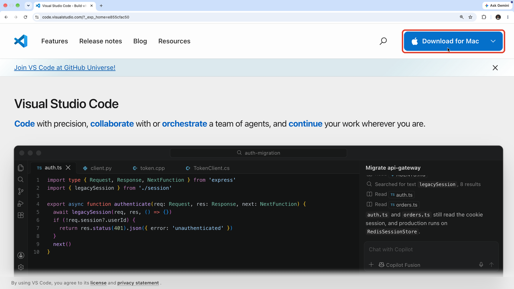

**2단계: Claude Code 확장 설치.** VS Code를 열고 왼쪽 막대의 확장(Extensions) 아이콘을 누릅니다(Mac은 **Cmd+Shift+X**, Windows/Linux는 **Ctrl+Shift+X**).

1. 검색창에 **claude code**를 입력합니다.
2. 게시자가 **Anthropic**(파란 인증 표시)인 **Claude Code for VS Code**를 찾아 **Install**을 누릅니다. 다른 게시자의 비슷한 확장도 목록에 나오니 게시자를 꼭 확인하세요.

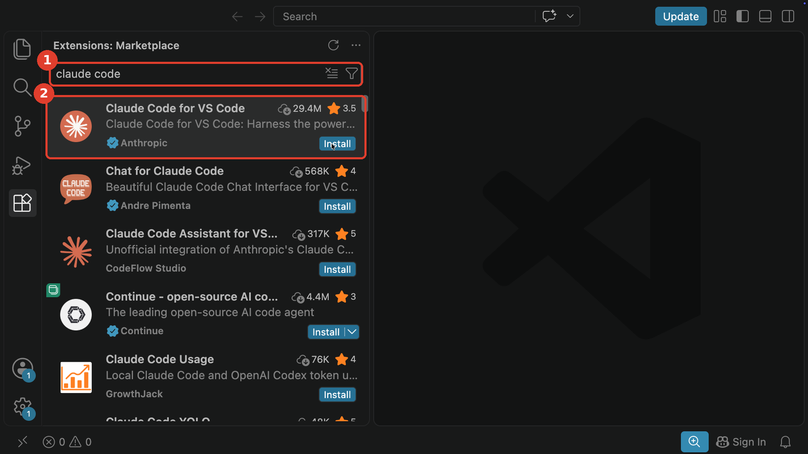

**3단계: 프로젝트 폴더 열기.**

1. 탐색기에서 **Open Folder**를 누릅니다(또는 **File → Open Folder…**).
2. 상위 폴더가 아니라 `ursotts` 폴더 자체를 선택합니다.
3. **Open**을 누릅니다.

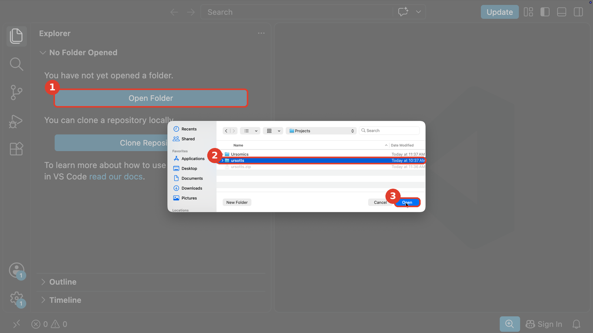

폴더를 처음 열면 VS Code가 이 폴더를 신뢰하는지 묻습니다. **Trust**를 누르세요. 제한 모드(Restricted Mode)에서는 Claude Code 같은 확장이 꺼지거나 제한됩니다. 내 프로젝트처럼 내용을 아는 폴더만 신뢰하세요.

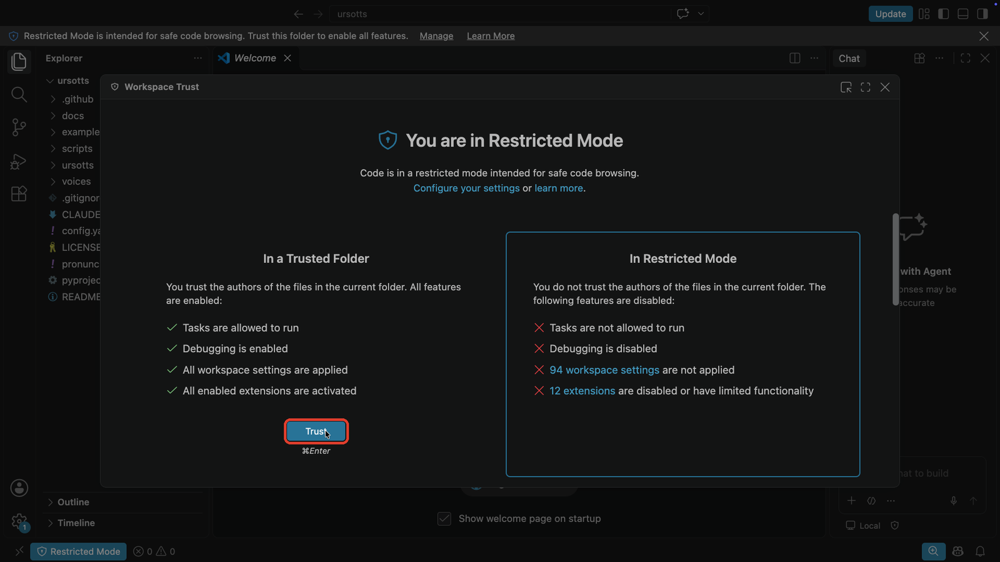

**4단계: Claude 패널 열기.** 아무 파일이나(예: `README.md`) 연 다음, 다음 중 하나를 씁니다:

1. 편집기 오른쪽 위의 **Spark 아이콘**(파일이 열려 있을 때만 보입니다).
2. 오른쪽 아래 상태 표시줄의 **✻ Claude Code**(파일이 없어도 됩니다).
3. 왼쪽 활동 막대의 **Spark 아이콘**.

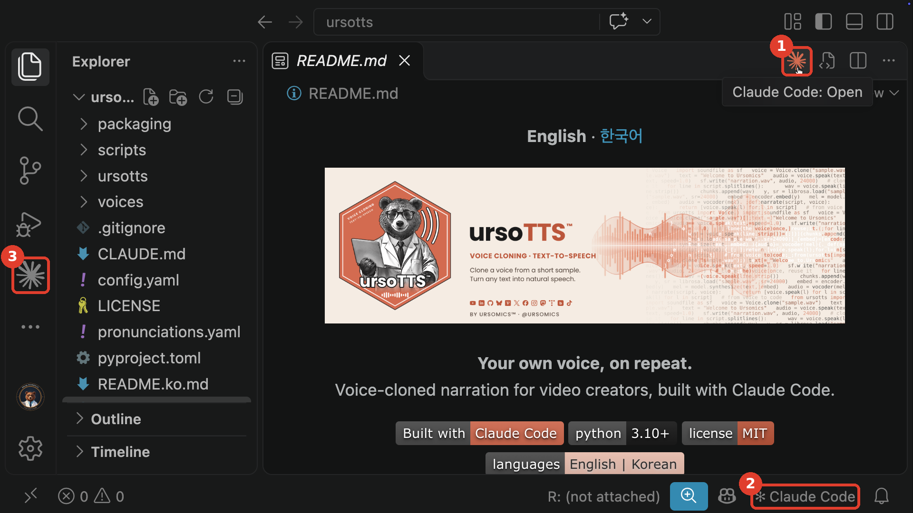

**5단계: 로그인(처음 한 번만).** 패널이 로그인 방법을 묻습니다. Pro, Max, Ultra, Team, Enterprise 요금제가 있으면 **Claude.ai Subscription**을 고르세요 (VS Code에서 Claude Code를 사용하여 로그인할 경우 "Max 이상 요금제만 가능"하다는 메시지가 뜰 수도 있는데, 이럴 경우 Claude Code 패널에 나와 있는 주소를 직접 복사하여 브라우저에서 로그인하면 Pro 요금제로도 사용 가능합니다; *Anthropic Console*은 사용량만큼 내는 API 요금, *Bedrock, Foundry, Vertex*는 회사 클라우드 계정용입니다.)

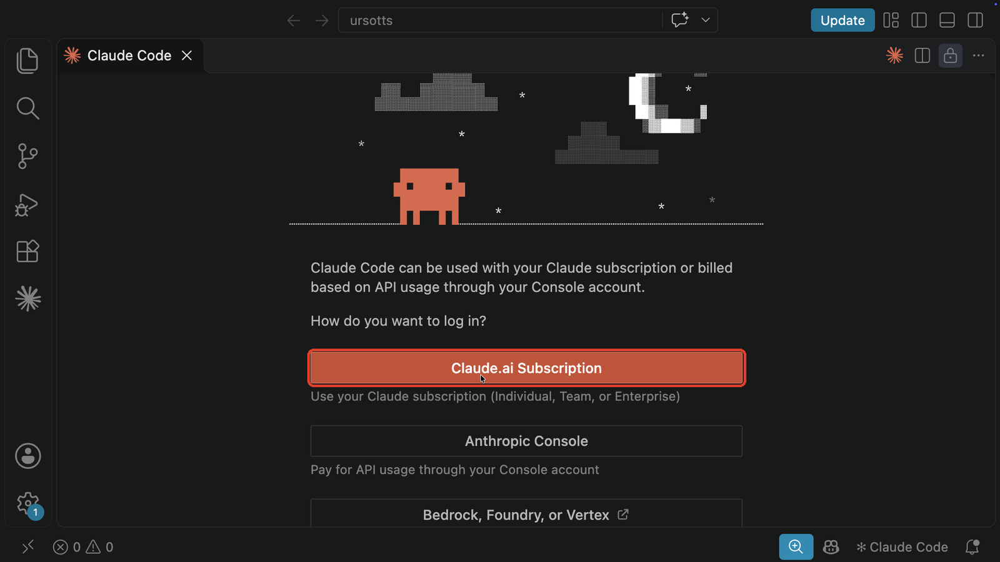

브라우저에 Claude 로그인 페이지가 열립니다. claude.ai에서 쓰는 계정으로 로그인하고 접근을 승인한 뒤 VS Code로 돌아옵니다.

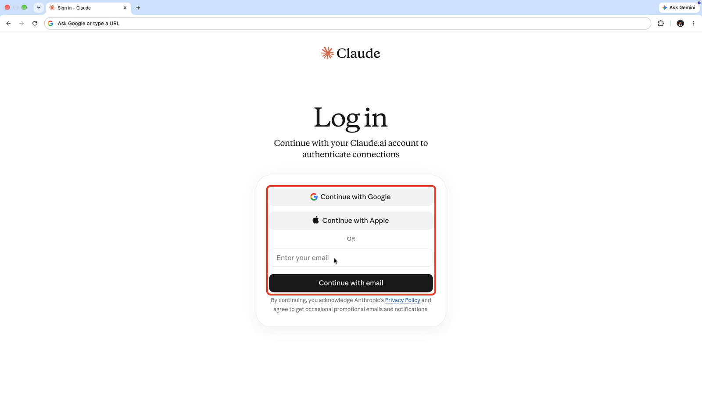

**6단계: 모드를 고르고 작업 시작.** 입력창에 요청을 쓰고 **Enter**를 누릅니다.

1. 현재 **모드**는 입력창 오른쪽 아래에 표시됩니다. 눌러서 바꿀 수 있습니다 (또는 **Shift+Tab**).
2. 메뉴에 모드 목록이 나옵니다. Claude가 편집할 때마다 물어보는 **Manual**이 익숙해지기 전까지 가장 안전합니다 ([4.3](#43-권한-모드-고르기) 참고). 같은 메뉴에서 Claude가 답하기 전에 얼마나 오래 생각할지 정하는 **Effort**도 설정합니다.

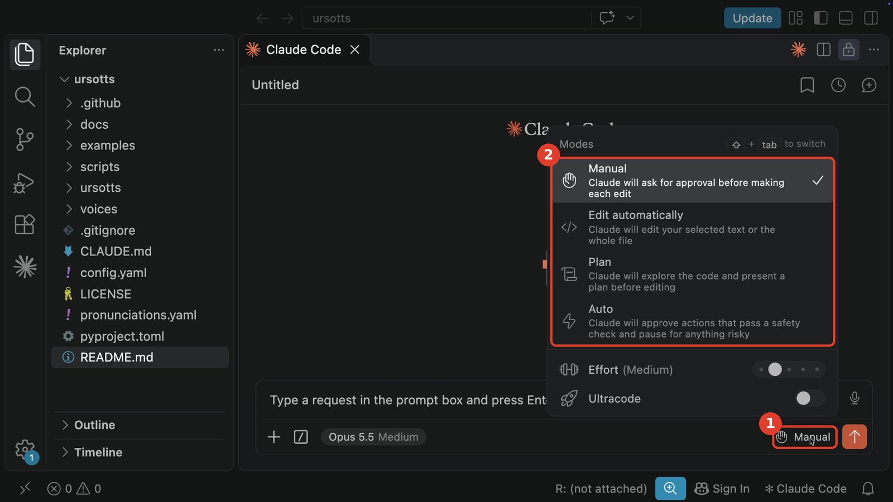

**7단계: Claude의 변경 내용 검토.** Manual 모드에서는 Claude가 편집하기 전에 제안한 내용을 보여 줍니다:

1. 편집기에 파일의 **기존 줄(빨강)과 새 줄(초록)**이 나란히 표시됩니다.
2. **"Make this edit…?"** 질문이 나옵니다. **Yes**, **Yes, allow all edits this session**, **No** 중에서 고르거나, Claude가 대신 할 일을 입력합니다.

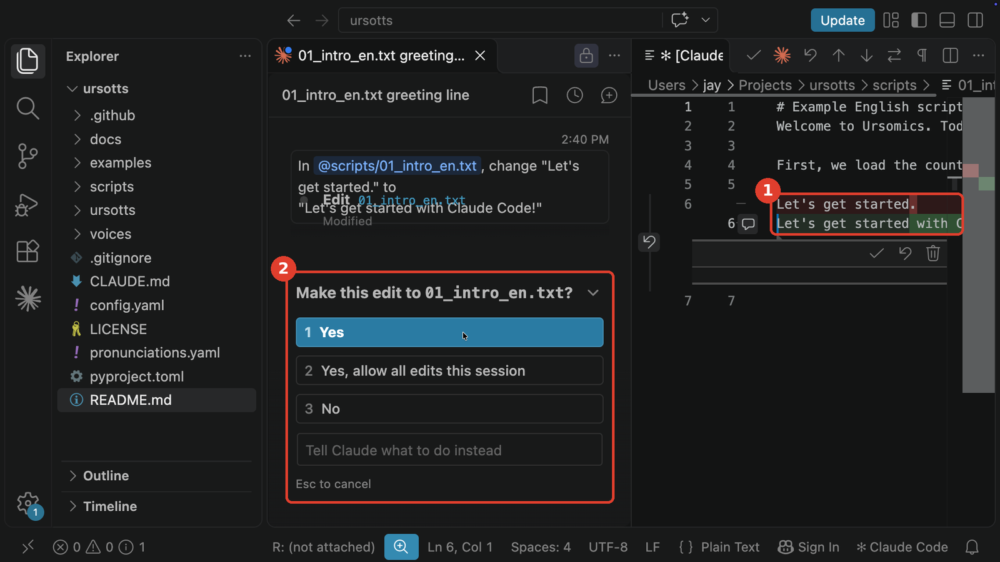

**알아 두면 좋은 점**
- 확장에는 Claude Code가 들어 있습니다. VS Code 터미널에서 `claude`를 입력하려면 별도의 CLI 설치가 추가로 필요합니다 ([5장](#5-claude-code-cli-쓰기) 참고).
- **한국어처럼 라틴 문자가 아닌 글자**는 터미널보다 Claude 패널에서 더 안정적으로 입력됩니다.
- Spark 아이콘이 없으면 먼저 파일을 열거나, 상태 표시줄의 **✻ Claude Code**를 쓰세요.
- 로그아웃하려면 입력창에 `/logout`을 입력하거나, 명령 팔레트(**Cmd+Shift+P**)에서 **Claude Code: Logout**을 실행합니다.

### 4.2 Claude Desktop 앱 설정하기 (Code 탭)

**링크**
- Claude Desktop 내려받기(macOS, Windows): <https://claude.ai/download>
- 데스크톱 앱의 Claude Code 공식 안내(영문): <https://code.claude.com/docs/en/desktop>

데스크톱 앱에는 Claude Code가 들어 있어서 CLI나 Node.js를 따로 설치하지 않아도 됩니다. Claude 유료 요금제(Pro, Max, Ultra, Team, Enterprise)가 필요합니다.

**1단계: 내려받아 설치.** 내려받기 페이지에서 **Download for macOS** (또는 Windows)를 누릅니다. 내려받은 파일을 열고, Mac에서는 *Claude*를 응용 프로그램 폴더로 끌어다 놓습니다.

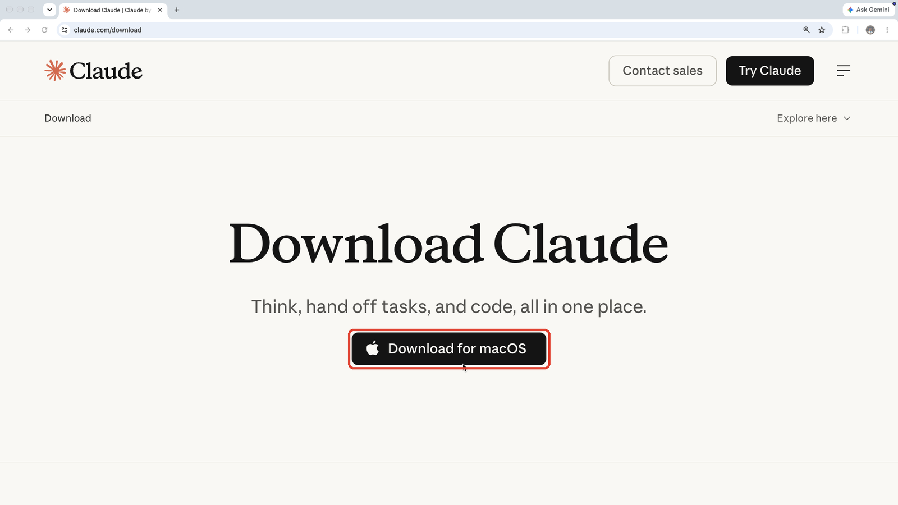

**2단계: 로그인.** 앱을 열고 claude.ai와 같은 계정으로, Google이나 이메일로 로그인합니다.

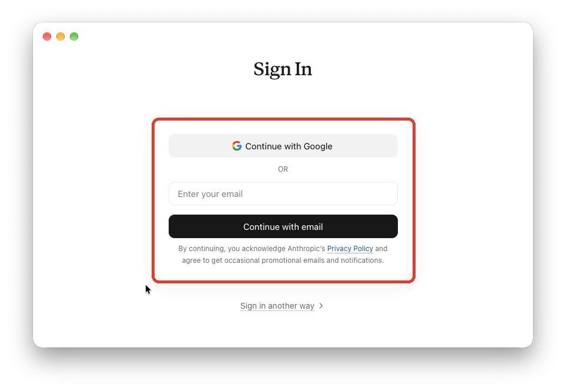

**3단계: Code 탭을 열고 프로젝트 폴더 선택.**

1. 사이드바 위쪽의 **Code**를 누르고, **New**로 세션을 시작합니다.
2. *Select folder for local session* 창이 뜨면 `ursotts` 폴더를 선택합니다.
3. **Open**을 누릅니다.

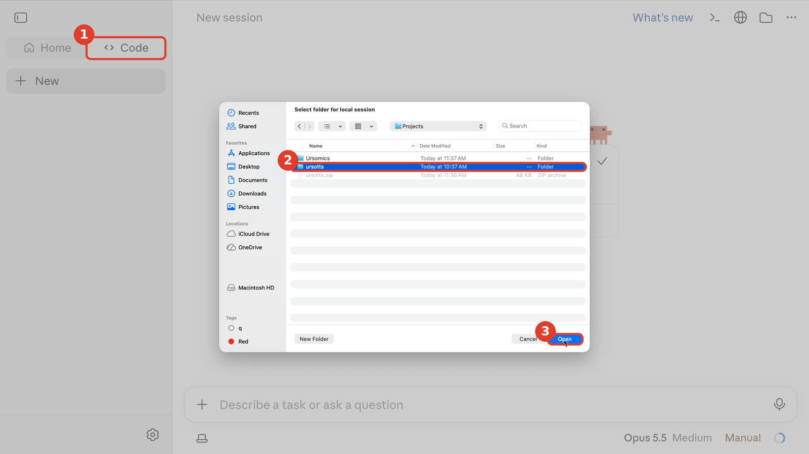

**4단계: 요청 입력.**

1. 세션이 **`ursotts`** 폴더로 설정됐는지 확인합니다(눌러서 폴더를 바꿀 수 있습니다).
2. 아래 입력창에 쓰고 **Enter**를 누릅니다. 파일을 가리킬 때는 `@`, 명령은 `/`를 입력합니다.
3. 현재 **모드**는 오른쪽 아래에 표시됩니다(여기서는 *Manual*). 눌러서 바꿀 수 있습니다.

아래 프롬프트를 입력하여 작동되는지 확인:

```
@README.md를 읽고, 이 프로젝트가 무엇을 하는지와 웹 UI를 시작하는 방법을
짧은 세 문장으로 설명해 줘.
```

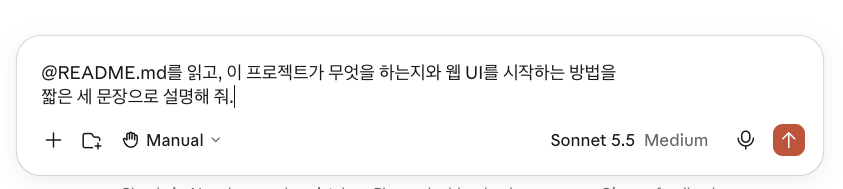

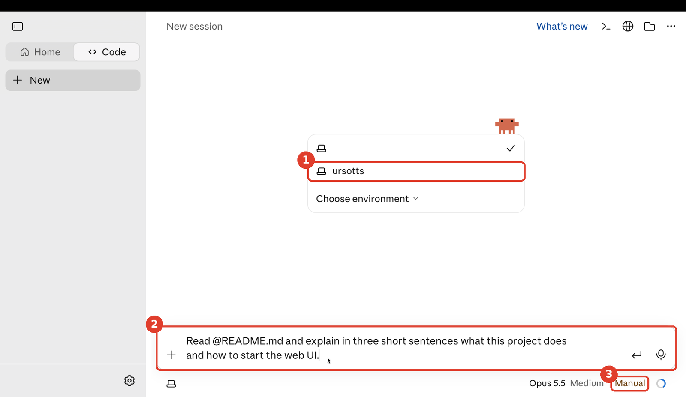

**5단계: 답변 읽기.**

1. **Code 탭:** 일반 채팅(*Home*)과 Claude Code 세션을 오갑니다.
2. **내 요청.** 가리킨 파일은 링크로 표시됩니다.
3. **Claude의 답변.** Manual 모드에서는 파일을 바꾸거나 명령을 실행하기 전에 먼저 물어봅니다.
4. **모드.** 옆에 모델 이름과 Effort 수준이 표시됩니다.

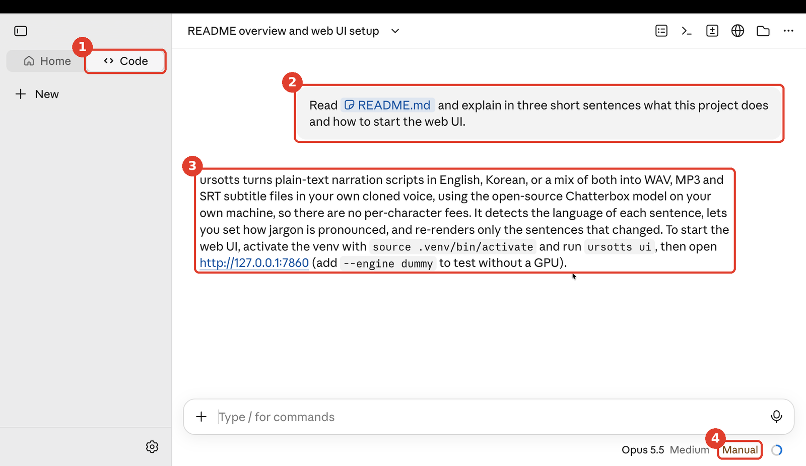

오른쪽 위 아이콘으로 세션의 작업 목록, 터미널, 변경 내용(diff), 브라우저 미리보기, 프로젝트 폴더를 엽니다. 지난 세션은 사이드바에 나옵니다. 화면을 공유할 때는 왼쪽 위 아이콘으로 사이드바를 접으세요.

### 4.3 권한 모드 고르기

모드는 입력창 아래쪽에 표시됩니다. 눌러서, 또는 **Shift+Tab**으로 바꿉니다.

| 모드 | 동작 | 적합한 상황 |
|---|---|---|
| **Manual** | 편집하거나 대부분의 명령을 실행하기 전에 승인을 요청합니다 | 사용법을 익히는 중일 때, 삭제·설치 작업을 할 때 |
| **Edit automatically** | 승인 없이 파일을 편집합니다. VS Code에서는 선택한 텍스트나 파일 전체를 편집합니다 | 나중에 검토할 수 있는 작고 위험이 적은 편집을 할 때 |
| **Plan** | 코드를 살펴보고 편집 전에 계획을 제시합니다 | 새로운 작업을 시작할 때 |
| **Auto** | 안전 검사를 통과한 작업은 자동으로 승인하고, 위험한 작업은 중단합니다 | 믿고 맡길 수 있는 반복 작업을 할 때 |

같은 메뉴에서 **Effort** 수준도 정합니다. Effort가 높을수록 Claude가 답하기 전에 오래 생각해서 어려운 문제에 도움이 되지만, 시간과 사용량이 더 듭니다. 목록은 VS Code와 데스크톱 앱에서 조금 다를 수 있습니다.

### 4.4 Claude에게 맥락 알려 주기

| 입력 | Claude가 참고하는 내용 |
|---|---|
| `@README.md` | 해당 파일 |
| `@ursotts/` | 폴더 전체(끝의 슬래시를 붙입니다) |
| `@ursotts/engine.py#30-60` | 30~60번째 줄 |
| `@terminal:zsh` | *zsh*라는 터미널의 출력. 오류 메시지를 직접 복사하지 않아도 됩니다 |

- 편집기에서 선택한 텍스트는 자동으로 전달됩니다. **Option+K**(Mac) 또는 **Alt+K**를 누르면 `@text.py#40-55` 같은 정확한 참조가 들어갑니다.
- 스크린샷은 입력창에 바로 붙여 넣으세요. 파일은 **Shift**를 누른 채 끌어다 놓으면 첨부됩니다.
- **Shift+Enter**는 줄 바꿈, **Enter**는 전송입니다.

**좋은 프롬프트는 무엇을, 어디서, 어떻게 확인할지를 말합니다:** "Y를 실행하면 잘 되도록 @file의 X를 고쳐 줘."

### 4.5 슬래시 명령어

입력창에 `/`를 입력하면 모든 명령어가 나옵니다. VS Code, 데스크톱 앱, CLI에서 똑같이 쓸 수 있습니다.

| 명령어 | 기능 | 사용하면 좋을 때 |
|---|---|---|
| `/init` | Claude가 세션을 시작할 때마다 읽는 메모인 `CLAUDE.md`를 만듭니다 | 새 프로젝트를 시작할 때(ursoTTS에는 이미 포함되어 있습니다) |
| `/clear` | 대화를 새로 시작합니다. `CLAUDE.md`는 유지됩니다 | 다른 작업으로 넘어갈 때 |
| `/compact` | 긴 대화를 요약해 대화 공간을 확보합니다 | 대화가 길어져 Claude가 앞 내용을 놓치기 시작할 때 |
| `/plan` | Plan 모드로 전환합니다 | 큰 변경을 하기 전에 계획부터 확인하고 싶을 때 |
| `/model` | 사용할 모델을 선택합니다 | 어려운 문제에 더 강력한 모델이 필요할 때 |
| `/usage` | 요금제 한도와 초기화 시점을 확인합니다 | 긴 작업을 시작하기 전에 |
| `/btw` | 본 대화의 흐름을 끊지 않고 곁가지 질문을 합니다 | `/btw cfg_weight가 뭐야?`처럼 간단한 질문이 있을 때 |
| `/logout` | 로그아웃합니다 | 계정을 바꿀 때 |
| `/help` | 명령어와 단축키 목록을 확인합니다 | 사용법이 헷갈릴 때 언제든지 |

### 4.6 안전장치

- **되감기 (Rewind):** 메시지에 마우스를 올리면 그 시점으로 파일을 되돌릴 수 있습니다.
- **세션 기록:** 패널 위쪽의 시계 버튼으로 지난 대화를 봅니다.
- **탭 나누기:** 다른 작업은 명령 팔레트 (**Cmd+Shift+P**)의 *Open in New Tab*으로 열어 대화가 섞이지 않게 합니다.

### 4.7 Claude Code로 ursoTTS 설치하기 (VS Code와 데스크톱 앱)

원하는 Claude Code 환경에서 `ursotts` 폴더를 열고, 아래 프롬프트를 순서대로 붙여 넣으세요. 명령마다 직접 승인하도록 먼저 **Manual** 모드로 바꿉니다.

**1단계: 내 규칙 추가**(선택)
```
@CLAUDE.md에 추가해 줘: 나는 Apple Silicon Mac을 쓴다. 나는 프로그래머가
아니니 쉽게 설명해 달라.
```

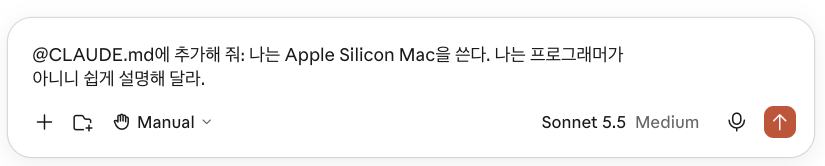

**2단계: 프로젝트 이해하기**(Plan 모드)
```
@README.md, @config.yaml, @ursotts/를 읽고 scripts/의 대본이 어떻게 MP3가
되는지 쉽게 설명해 줘. 아무것도 바꾸지 마.
```

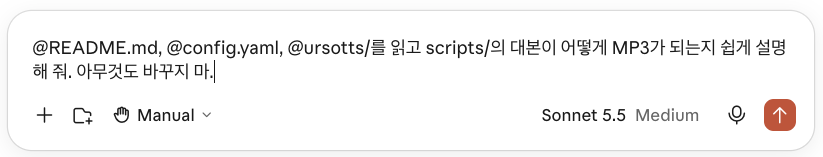

**3단계: 설치**
```
이 프로젝트를 설치해 줘: Python 3.10 이상이 있는지 확인하고(없으면 설치
방법을 알려 줘), .venv에 가상환경을 만들고, "all" 옵션으로 프로젝트를
설치한 다음, `ursotts check`를 실행해서 내 목소리 샘플 말고 빠진 것이 있으면
고쳐 줘.
```

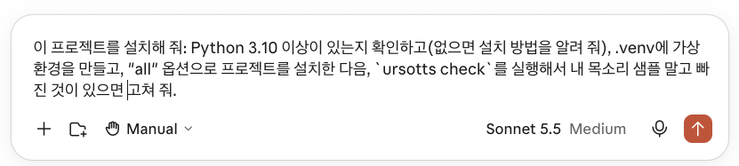

설치할 때 용량이 큰 PyTorch를 내려받으므로 시간이 좀 걸립니다.

끝나면 Claude가 남은 할 일을 정리해 주고, 새 터미널 창마다 실행할 두 줄도 알려 줍니다:

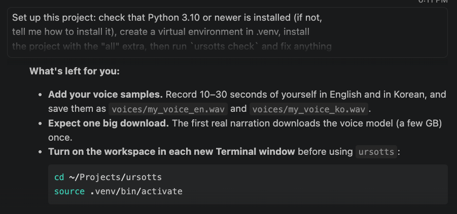

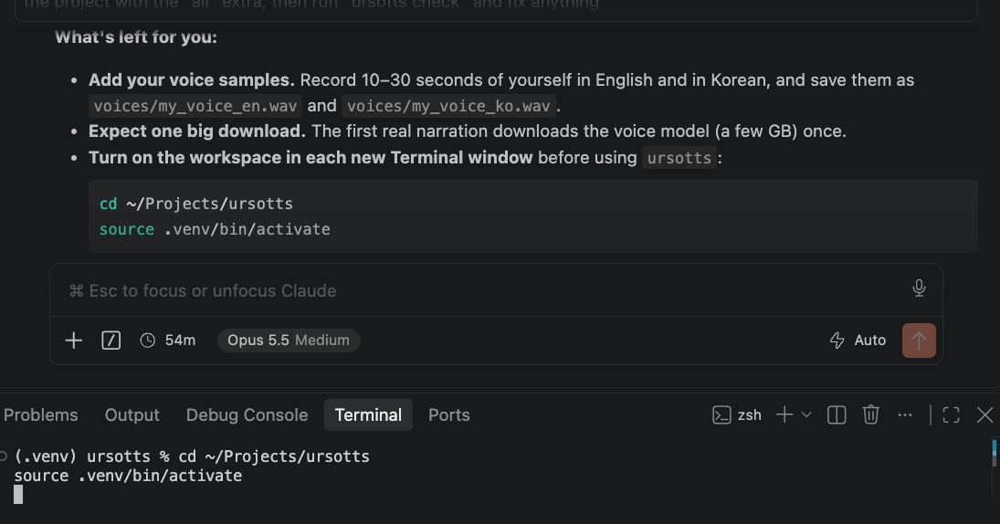

**4단계: 목소리 추가.** 샘플을 `voices/`에 넣은 다음 ([9.1](#91-목소리-샘플-녹음하기) 참고):
```
`ursotts check`를 다시 실행해서 두 목소리가 모두 OK로 나오는지 확인해 줘.
```

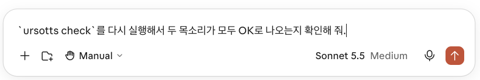

Claude가 녹음과 파일 이름 짓는 법을 알려 주고, `voices` 폴더에 두 샘플이 들어가면 확인 결과가 나옵니다:

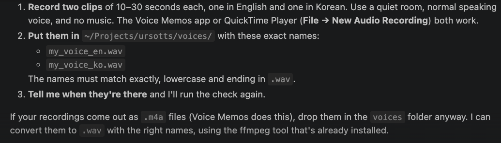

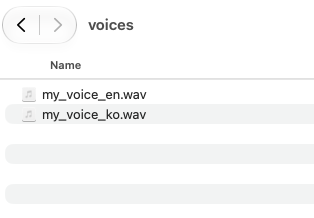

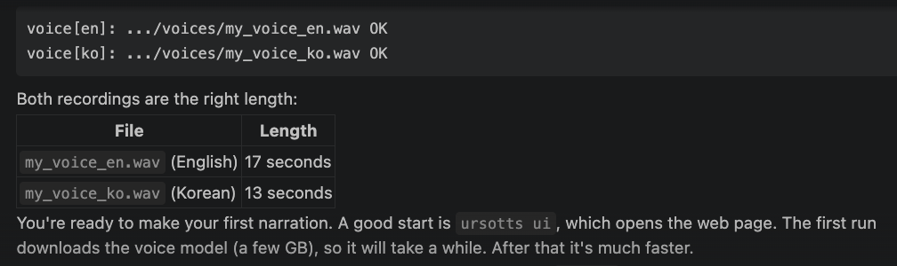

**5단계: 첫 테스트**
```
실행해 줘: ursotts say "Welcome. Today we analyze scRNA-seq data." -o output/test1.wav
실패하면 오류를 읽고 고친 다음 다시 실행해 줘.
```

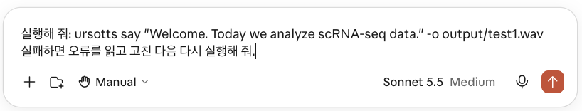

처음 실제로 실행할 때 Chatterbox 모델(몇 GB)을 내려받습니다. 그다음부터는 몇 초 만에 시작합니다.

**6단계: 웹 UI 열기**
```
`ursotts ui`로 웹 UI를 시작해 줘.
```


탭마다 쓰는 법은 [6장](#6-웹-ui-사용하기) 참고.

**문제가 생기면** 설명하지 말고, 가리키세요:
```
마지막 명령이 실패했어. @terminal:zsh를 보고 원인을 찾아서 고쳐 줘.
```

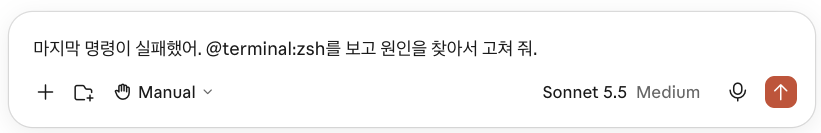

**발음이 이상하게 들리면** Claude Code에게 직접 고쳐 달라고 하세요 ([9.3](#93-발음-고치기) 참고):

```
테스트에서 "TCRs"가 "티커스"처럼 들려. pronunciations.yaml에 프로젝트 방식으로
항목을 추가하고, 같은 문장을 다시 만들어서 output/test2.wav로 저장해 줘.
```

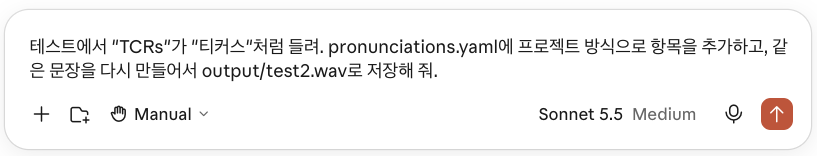

요청 요령:

- **어떤 단어가 어떻게 들렸는지** 적으세요. 예: "RNA-seq이 '알 … 엔 … 에이 … 섹'처럼 끊겨 들려."
- **원하는 소리**를 일상 단어로 설명하세요. 예: "NAN은 man처럼, og는 dog처럼, 한 단어로."
- **언어**를 알려 주세요. 영어 문장의 발음인지, 한국어 문장의 발음인지에 따라 들어가는 곳(`en:` / `ko:`)이 다릅니다.
- **고친 뒤 같은 문장을 다시 만들어** 전후를 비교해 달라고 하세요.
- 고칠 단어가 여러 개면 **한 번에 목록으로** 요청해도 됩니다.

### 4.8 새 버전으로 업데이트하기

처음부터 다시 할 필요는 없습니다. `.venv`, 내려받은 목소리 모델, 목소리 샘플은 그대로 두고 프로젝트 파일만 바꿉니다.

**zip 파일을 내려받았다면** `ursotts` 폴더를 연 Claude Code에 붙여 넣으세요:

```
새 ursotts.zip을 ~/Downloads에 내려받았어. 임시 폴더에 압축을 풀고 파일들을
이 프로젝트에 복사해 줘. 단, voices/ 폴더는 그대로 두고, pronunciations.yaml과
config.yaml은 합쳐 줘(내가 넣은 항목과 설정은 유지). 그다음 .venv에서
pip install -e ".[all]"을 실행하고 `ursotts check`를 실행해 줘.
```

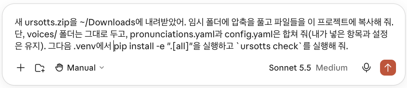

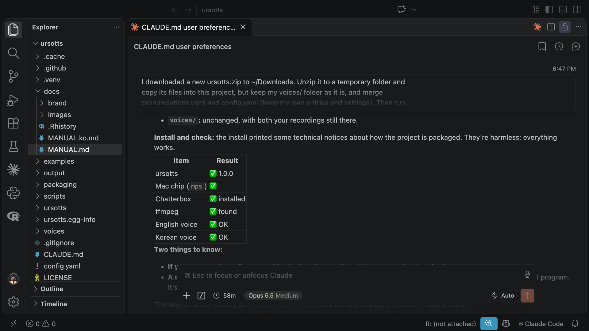

**GitHub에서 프로젝트를 받았다면(clone):**

```
git pull로 GitHub에서 이 프로젝트를 업데이트해 줘. voices/ 폴더와
pronunciations.yaml, config.yaml에 내가 넣은 항목은 유지해 줘. 그다음 .venv에서
pip install -e ".[all]"을 실행하고 `ursotts check`를 실행해 줘.
```

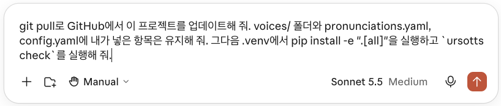

다시 설치하는 데는 잠깐이면 되고, 새 버전에 필요한 패키지도 함께 설치됩니다. 그다음 차례로 확인하세요: `ursotts check` → `ursotts ui` → `ursotts app`. 데스크톱 앱이 Tkinter가 없다고 하면 [7장](#7-ursotts-데스크톱-앱-쓰기)을 참고하세요.

<sub>[↑ 목차로](#목차)</sub>

## 5. Claude Code CLI 쓰기

Claude Code CLI는 [4장](#4-vs-code와-claude-desktop-앱에서-claude-code-쓰기)과 같은 Claude Code를 터미널 창 안에서 쓰는 것입니다. 여전히 말로 요청을 입력하고, 모드 ([4.3](#43-권한-모드-고르기) 참고), 슬래시 명령어 ([4.5](#45-슬래시-명령어) 참고), `CLAUDE.md`도 똑같이 작동합니다. 다른 점은 모습뿐입니다. 글자만 있고 버튼이나 나란히 보는 변경 내용이 없습니다.

**이럴 때 좋습니다:** SSH로 원격 컴퓨터(클라우드 GPU나 연구실 서버)에서 작업할 때, 키보드가 편할 때, 이미 터미널에서 작업 중일 때.

### 5.1 설치하기

공식 설치 안내(영문)를 따르세요: <https://code.claude.com/docs/en/setup>. 그다음 잘 설치됐는지 확인합니다:

```bash
claude --version
```

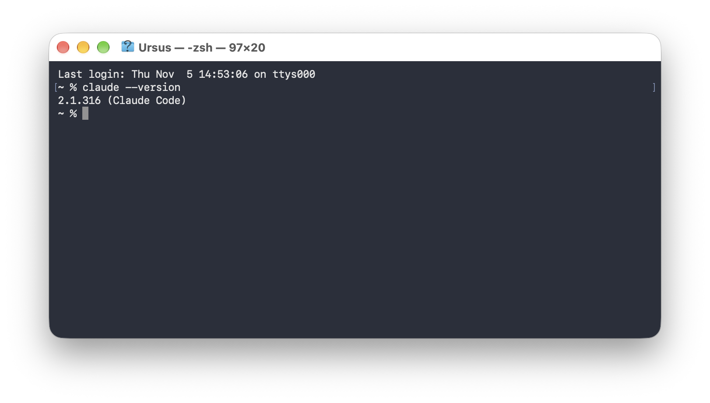

### 5.2 세션 시작하기

```bash
cd ~/Projects/ursotts      # 항상 프로젝트 폴더 안에서 시작
claude
```

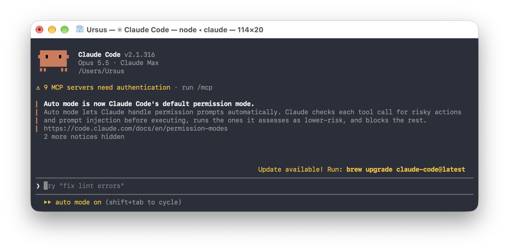

처음에는 로그인을 요청하고, 브라우저가 열리면 거기서 마칩니다. VS Code의 통합 터미널(**Ctrl+~**)에서도 `claude`를 실행할 수 있습니다.

### 5.3 대화하기

- 요청을 입력하고 **Enter**를 누릅니다. 이 매뉴얼의 모든 프롬프트를 여기서도 쓸 수 있습니다.
- 파일을 가리킬 때는 `@`, 슬래시 명령어는 `/`를 입력합니다.
- **Shift+Tab**으로 모드를 바꿉니다.
- **Esc**를 누르면 답변 중인 Claude를 멈춥니다.
- 여러 줄을 쓰려면 줄 끝에 `\`를 쓰고 **Enter**를 누릅니다.
- 한국어는 VS Code 패널이나 데스크톱 앱에서 입력하는 게 더 편합니다. CLI에 붙여 넣는 것은 잘 됩니다.

### 5.4 세션을 종료한 뒤 작업 이어 하기

| 작업 | 입력 |
|---|---|
| 세션 종료 | `/exit`, 또는 **Ctrl+C** 두 번 |
| 가장 최근 대화 이어 하기 | `claude --continue` |
| 이전 대화를 골라 이어 하기 | `claude --resume` |

<sub>[↑ 목차로](#목차)</sub>

## 6. 웹 UI 사용하기

웹 UI는 ursoTTS를 쓰는 두 번째 방법입니다. 터미널 명령과 기능은 같고, 명령을 입력하는 대신 브라우저의 버튼을 누릅니다. 같은 `config.yaml`, 목소리 샘플, `pronunciations.yaml`을 쓰므로 언제든 두 방법을 섞어 쓸 수 있습니다. 예를 들어 브라우저에서 단어 발음을 고치고, 터미널에서 폴더 전체를 생성하면 됩니다.

| 작업 | 웹 UI | 터미널 |
|---|---|---|
| 텍스트로 내레이션 만들기 | **Speak** 탭 | `ursotts say` |
| 목소리 선택·녹음 | **Speak** 탭 → *My saved voices* 또는 *Record or upload a new sample* | `config.yaml`의 `voices:` 항목 수정 |
| 말투 조정 | **Speak** 탭 → *Speaking style* 슬라이더 | `config.yaml` 수정 |
| 단어 발음 교정 | **Pronunciation** 탭 | `pronunciations.yaml` 수정 |
| 폴더 단위로 생성 | **Batch** 탭 | `ursotts batch` |

### 6.1 시작하고 끄기

Claude Code에서 **시작**하기:
```
`ursotts ui`로 웹 UI를 시작해 줘.
```

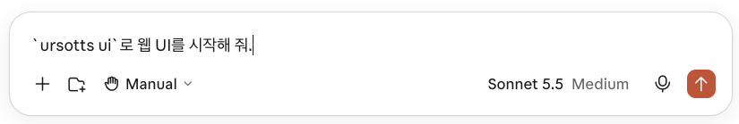

또는 터미널에서, 프로젝트 폴더 안에서 ([8장](#8-터미널에서-명령어-쓰기) 참고):
```bash
source .venv/bin/activate
ursotts ui
```

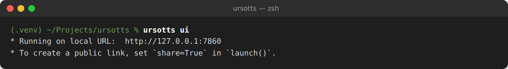

브라우저에 **http://127.0.0.1:7860** 이 열립니다. 이 페이지는 내 컴퓨터에서만 실행되며, 아무것도 외부로 업로드되지 않습니다. 시스템의 라이트/다크 모드를 따라갑니다.

- 처음 **Generate**를 누르면 목소리 모델을 불러오느라 잠시 걸립니다(맨 처음에는 내려받기까지 합니다). 그다음부터는 빠릅니다.
- 페이지를 쓰는 동안 **터미널(또는 Claude Code 세션)을 열어 두세요.** 닫으면 웹 UI도 꺼집니다.
- **끄려면** 그 터미널에서 **Ctrl+C**를 누르거나, Claude Code에게 "웹 UI를 꺼 줘"라고 말합니다.
- 페이지가 열리지 않으면 브라우저 주소창에 `http://127.0.0.1:7860`을 직접 입력하세요.

| 옵션 | 기능 |
|---|---|
| `ursotts ui --port 7861` | 기본 포트 7860을 사용할 수 없을 때 다른 포트로 실행합니다 |
| `ursotts ui --no-browser` | 브라우저 탭을 자동으로 열지 않습니다 |
| `ursotts ui --engine dummy` | 음성 모델 없이 페이지를 테스트합니다. 재생하면 신호음이 납니다 |
| `ursotts ui --share` | 임시 **공개 링크**를 만듭니다. 공개를 의도한 경우에만 사용하세요 |

### 6.2 Speak 탭: 내레이션 만들기

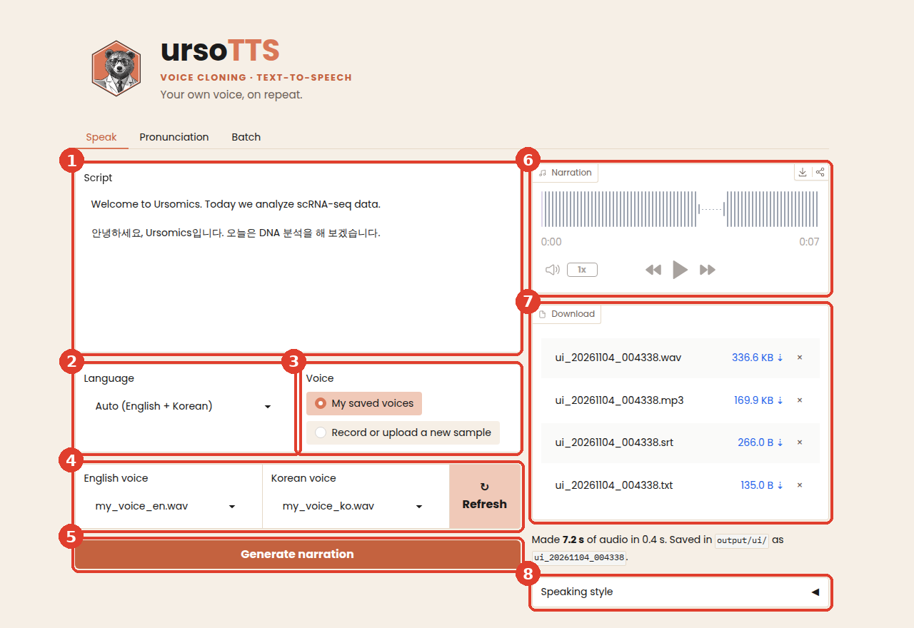

1. **Script:** 내레이션을 붙여 넣습니다. 대본 파일과 똑같이, 빈 줄은 문단 사이 쉼, `[pause 1.5]`는 쉼, `#`으로 시작하는 줄은 건너뜁니다 ([9.2](#92-대본-쓰기) 참고).
2. **Language:** *Auto*는 문장마다 영어인지 한국어인지 감지합니다. *English*나 *Korean*을 고르면 `@lang en` / `@lang ko`처럼 전체를 한 언어, 한 목소리로 읽습니다.
3. **Voice:** *My saved voices*는 `voices` 폴더의 샘플을 쓰고, *Record or upload a new sample*은 새 샘플을 씁니다 ([6.3](#63-다른-목소리-써-보기) 참고).
4. **English voice / Korean voice:** 언어마다 `voices` 폴더의 샘플 파일을 고릅니다. 폴더에 새 파일을 넣었다면 **Refresh**를 누르세요.
5. **Generate narration:** 오디오를 만듭니다.
6. **Narration:** 페이지에서 바로 결과를 들어 봅니다.
7. **Download:** WAV, MP3, SRT 자막, 텍스트로 된 대본입니다. 네 파일 모두 `output/ui/`에도 날짜와 시간 이름(예: `ui_20261103_142501.mp3`)으로 저장되므로, 페이지를 닫아도 잃어버리지 않습니다.
8. **Speaking style:** 누르면 소리를 조정하는 슬라이더가 열립니다 ([6.4](#64-speaking-style-말투) 참고).

### 6.3 다른 목소리 써 보기

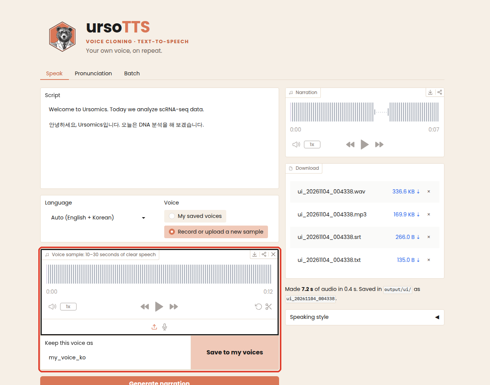

*Voice*에서 **Record or upload a new sample**을 고르면 녹음 상자가 나옵니다:

- **녹음:** *Record*를 누르고 **10~30초** 동안 자연스럽게 말한 뒤 멈춥니다. 처음에는 브라우저가 마이크 사용 권한을 물으니 *허용*을 누르세요.
- **업로드:** 업로드 아이콘을 누르고 오디오 파일(WAV, MP3, M4A 등)을 고릅니다.

ursoTTS가 샘플을 자동으로 변환하므로(모노, 24 kHz, 최대 30초) 어떤 녹음이나 파일도 쓸 수 있습니다. 3초보다 짧은 샘플은 받지 않습니다.

**목소리를 계속 쓰려면** **Keep this voice as**에 이름(예: `my_voice_ko`)을 쓰고 **Save to my voices**를 누르세요. `voices` 폴더에 저장되고, *My saved voices*의 English/Korean voice 목록에 나타납니다.

### 6.4 Speaking style (말투)

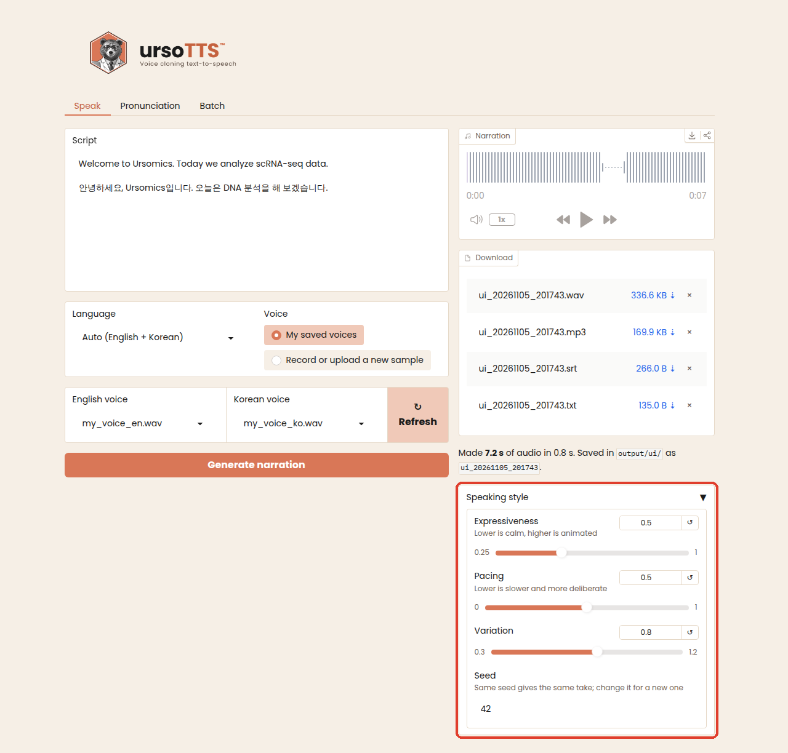

내려받기 목록 아래의 **Speaking style**을 눌러 슬라이더를 엽니다(Speak 탭 그림의 8):

| 슬라이더 | 효과 |
|---|---|
| **Expressiveness** | 값을 낮추면 강의처럼 차분하게, 높이면 더 생동감 있게 말합니다 |
| **Pacing** | 값을 낮추면 더 느리고 또박또박 말합니다 |
| **Variation** | 값을 높이면 말투가 더 다양해집니다 |
| **Seed** | 같은 값을 사용하면 같은 결과를 얻습니다. 값을 바꾸면 다른 버전을 들어볼 수 있습니다 |

바꾼 값은 다음 생성부터 적용되고, 웹 UI를 끌 때까지 유지됩니다. `config.yaml`에는 저장되지 않습니다. 마음에 드는 설정을 찾으면 Claude Code에게 옮겨 달라고 하세요:
```
@config.yaml에 exaggeration 0.4, cfg_weight 0.45, seed 7을 설정해 줘.
```

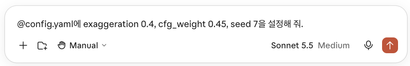

### 6.5 Pronunciation 탭: 단어 고치기

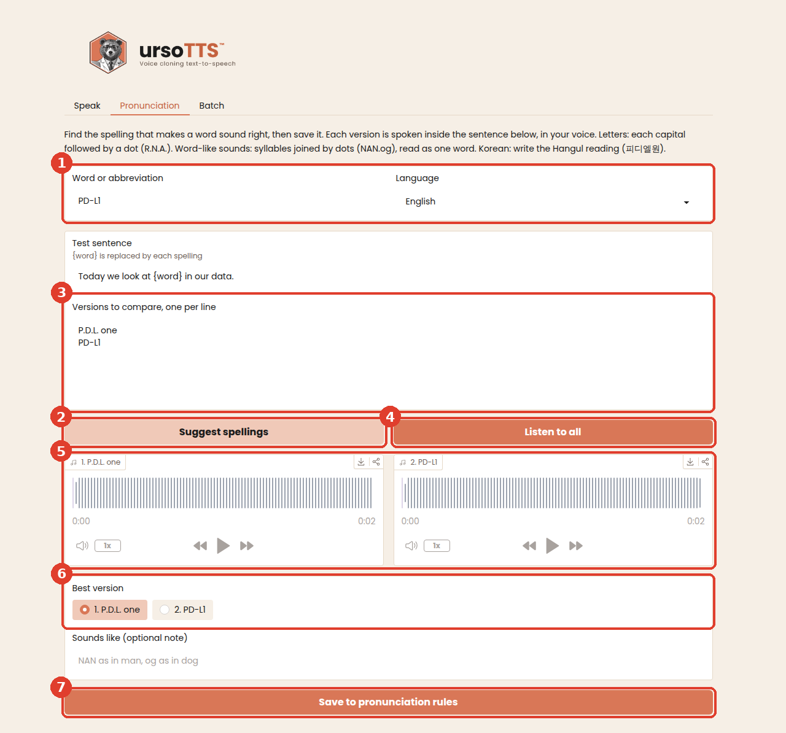

1. **단어**를 입력하고 **언어**를 고릅니다.
2. **Suggest spellings**를 누르면 프로젝트 방식의 버전 몇 개가 채워집니다.
3. **버전**을 고치거나 직접 한 줄에 하나씩 추가합니다.
4. **Listen to all**을 누릅니다.
5. 각 버전을 테스트 문장 안에서 내 목소리로 들려줍니다.
6. **가장 좋은 버전**을 고르고, 원하면 *Sounds like*에 설명을 씁니다.
7. **Save to pronunciation rules**를 누릅니다(`pronunciations.yaml`에 저장됩니다). 그 단어를 쓰는 모든 대본은 다음 batch 때 다시 만들어집니다.

자연스럽게 읽히도록 표기하는 방법은 [9.3절](#93-발음-고치기) 참고.

### 6.6 Batch 탭: 폴더 전체 생성

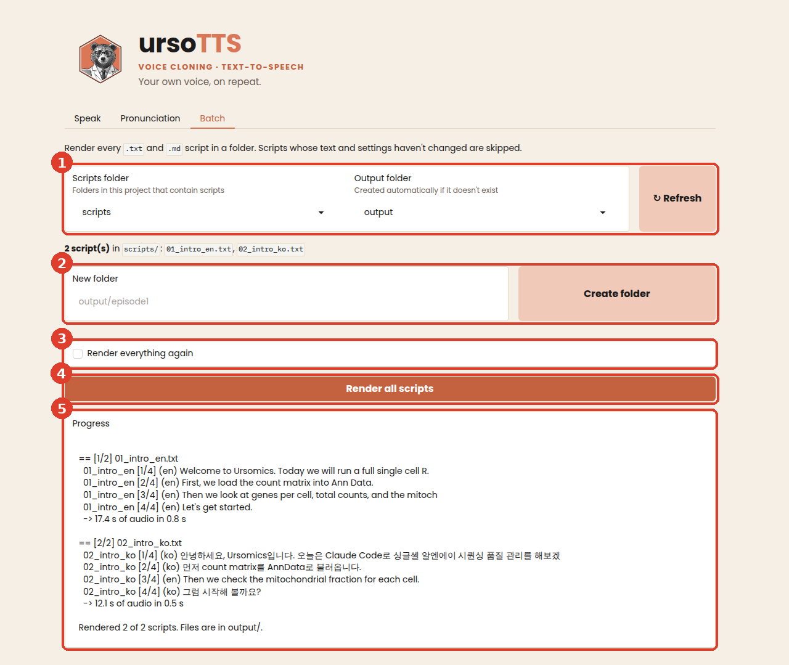

1. **Scripts folder**와 **Output folder:** 프로젝트 안의 폴더 목록에서 고릅니다. 고른 폴더의 대본 목록이 아래에 표시됩니다. 경로를 직접 입력해도 됩니다. 웹 UI 밖에서 폴더를 만들었다면 **Refresh**를 누르세요.
2. **New folder:** 이름(예: `output/episode1`)을 쓰고 **Create folder**를 누르면 새 폴더가 만들어지고 출력 폴더로 선택됩니다. 없는 출력 폴더는 생성할 때도 자동으로 만들어집니다.
3. **Render everything again:** 바뀌지 않은 대본도 다시 만들려면 체크합니다. 체크하지 않으면 건너뜁니다.
4. **Render all scripts:** batch를 시작합니다.
5. **Progress:** 대본과 문장을 만드는 과정을 보여 주고, 끝나면 요약을 보여 줍니다.

`ursotts batch`와 같은 파일을, 같은 건너뛰기 규칙으로 만듭니다 ([8.6](#86-폴더-생성-ursotts-batch) 참고).

<sub>[↑ 목차로](#목차)</sub>

## 7. ursoTTS 데스크톱 앱 쓰기

웹 UI와 같은 기능을 VS Code Dark 스타일의 일반 창에서 씁니다. Python 환경에서 실행하거나(`ursotts app`), Python 없이 설치할 수 있습니다 ([7.2](#72-python-없이-설치하기-dmg--exe) 참고).

### 7.1 데스크톱 앱 시작하기

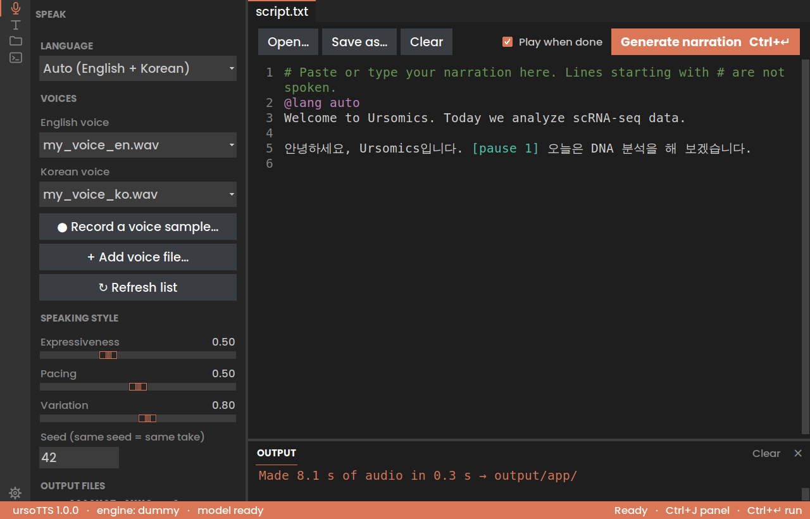

브라우저 탭보다 일반 창이 편하다면 데스크톱 앱을 쓰세요. 같은 기능을 VS Code Dark 스타일로 제공합니다.

Claude Code에서 **시작하기**:

```
`ursotts app`으로 데스크톱 앱을 시작해 줘.
```

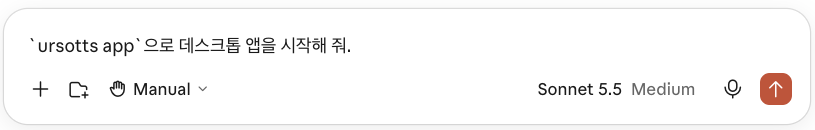

또는 터미널에서, 프로젝트 폴더 안에서 ([8장](#8-터미널에서-명령어-쓰기) 참고):

```bash
cd ~/Projects/ursotts
source .venv/bin/activate
ursotts app
```

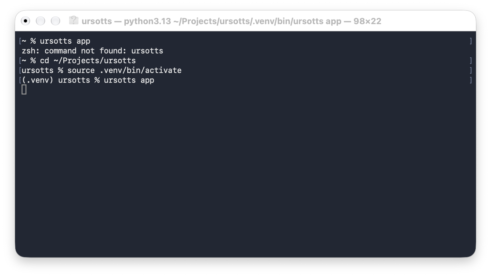

이 스크린샷의 첫 줄은 가장 흔한 실수입니다. 프로젝트 폴더로 이동해 환경을 켜기 전에는 `ursotts app`이 *command not found*로 나옵니다.

`.dmg`나 `.exe`로 설치했다면 ([7.2](#72-python-없이-설치하기-dmg--exe) 참고) 다른 앱처럼 **ursoTTS**를 열기만 하면 됩니다.

| 부분 | 기능 |
|---|---|
| **액티비티 바** (맨 왼쪽) | 마이크는 Speak, 텍스트는 Pronunciation, 폴더는 Batch, 터미널은 Claude Code 화면을 엽니다. 아래쪽 톱니바퀴를 누르면 `config.yaml`을 엽니다. 현재 선택한 화면은 코랄색으로 표시됩니다 |
| **사이드바** | 언어와 목소리를 선택하고 말투를 조정할 수 있습니다. **● Record a voice sample…**로 바로 녹음하거나 **+ Add voice file…**로 목소리 파일을 추가하고, 생성된 파일 목록도 확인할 수 있습니다. 가장자리를 끌어 너비를 조절합니다 |
| **편집기** | 대본을 편집합니다. 줄 번호가 표시되고 주석, `@lang`, `[pause]`가 색으로 구분됩니다. **Open…**, **Save as…**, **Generate narration** 버튼을 사용할 수 있습니다 |
| **OUTPUT 패널** | 시간이 표시되는 실시간 기록을 보여 줍니다. **⌘J**를 눌러 패널을 표시하거나 숨깁니다 |
| **상태 표시줄** | 버전, 엔진, 목소리 모델의 로드 상태를 보여 줍니다 |

<p>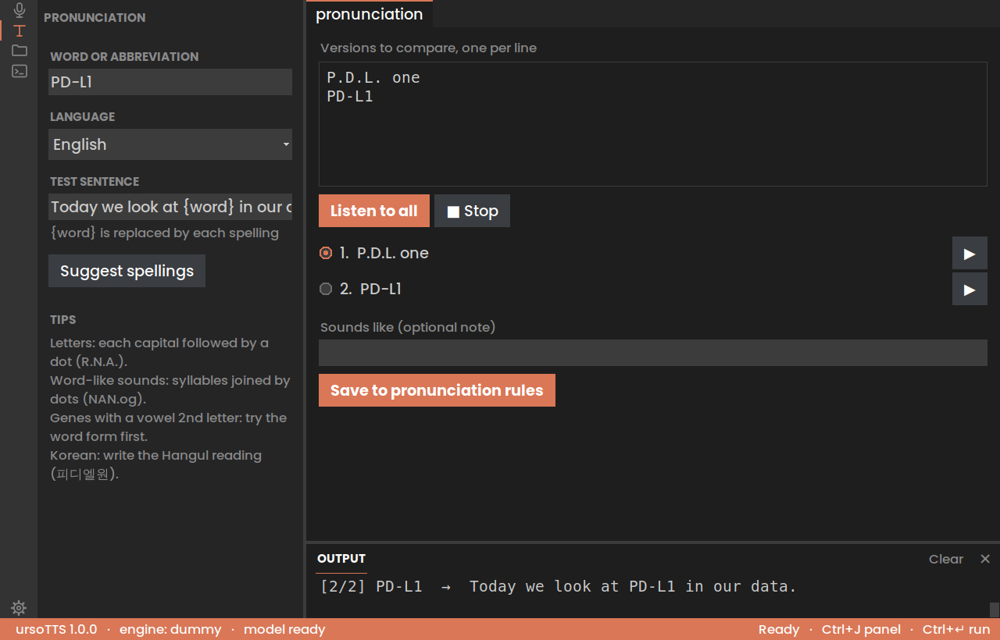 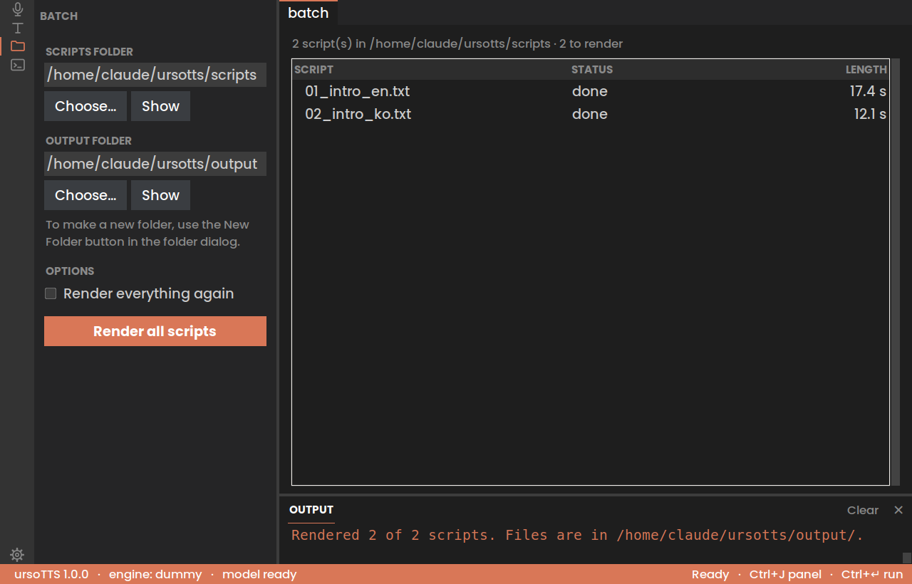</p>

단축키: **⌘↵** 현재 화면 실행, **⌘1–4** 화면 전환, **⌘O** 대본 열기, **⌘S** 저장(**⇧⌘S** 다른 이름으로 저장), **⌘+** / **⌘−** 확대·축소(70~160%), **⌘0** 원래 크기(100%), **⌘K ⌘T** 색상 테마 선택. Batch의 폴더 창에는 **New Folder** 버튼이 있습니다. 창 크기, 확대 수준, 패널, 마지막 화면, 대본, 폴더를 기억합니다.

데스크톱 앱은 Tkinter를 쓰며, python.org의 Python에는 기본으로 들어 있습니다. Homebrew의 Python이라면 `brew install python-tk@3.13`(내 Python 버전에 맞게)으로 한 번 설치하세요. 웹 UI는 어느 쪽이든 그대로 작동합니다.

**색상 테마.** **View → Color Theme**을 고르거나 VS Code처럼 **⌘K** 다음 **⌘T**를 누르세요. Dark+, Light+, ursoTTS Cream, Monokai, Solarized Dark, Solarized Light, High Contrast 중에서 고를 수 있습니다. 창이 1초 정도 만에 새 색으로 다시 시작되며, 대본·폴더·레이아웃은 그대로 유지됩니다. 저장하지 않은 변경 사항이 있으면 먼저 묻습니다.

**저장과 닫기.** 내레이션 파일은 만들어지는 즉시 `output/app/`에 저장되고, 편집기의 내용은 다음에 열 때 그대로 남아 있습니다. 열거나 저장한 파일의 대본이라면 탭의 **●** 표시가 저장하지 않은 변경 사항을 뜻하며, 닫기 전에 저장할지 묻습니다. 내레이션을 만드는 중에 끄려고 할 때도 먼저 확인합니다.

**터미널을 열어 두지 않고 쓰기.** `ursotts app`은 실행한 터미널 창이 열려 있어야 합니다. 두 가지 방법이 있습니다:

- `ursotts app --detach`는 앱을 백그라운드에서 시작합니다. 터미널은 바로 닫아도 됩니다.
- `ursotts make-launcher`(또는 앱의 **File → Create launcher…**)는 더블클릭으로 여는 실행 아이콘을 만듭니다. Mac은 홈 폴더의 응용 프로그램(Applications)에 **ursoTTS**가 생기고(원하면 Dock으로 끌어다 놓기), Windows는 바탕 화면과 시작 메뉴에 바로 가기가, Linux는 앱 메뉴에 항목이 생깁니다. 프로젝트 폴더 안에서 한 번만 실행하세요.

### 7.2 Python 없이 설치하기 (.dmg / .exe)

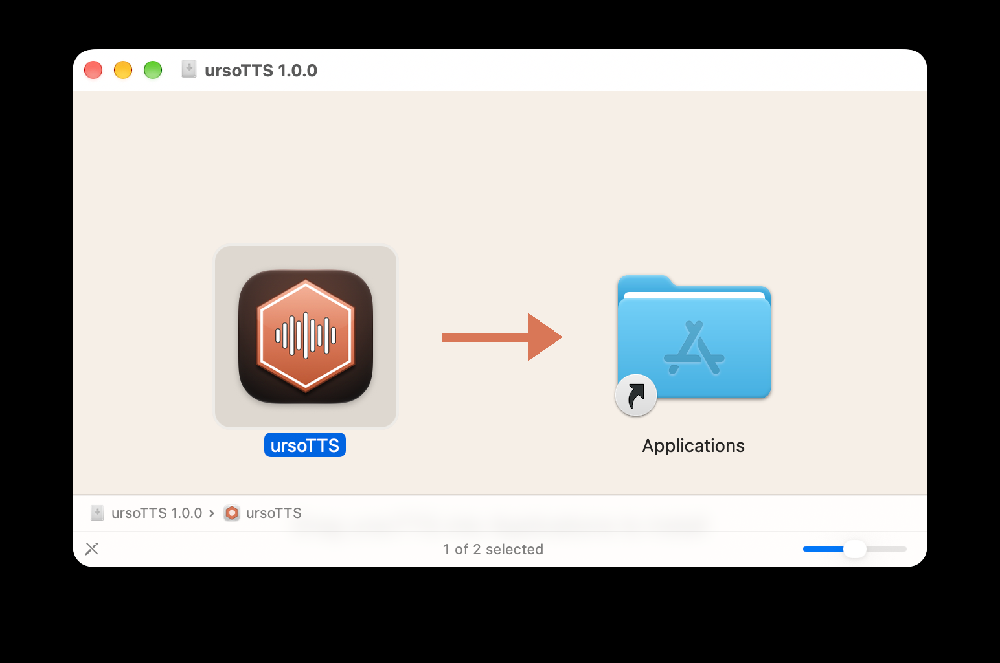

Python이나 터미널을 쓰고 싶지 않은 분을 위해 데스크톱 앱을 일반 설치 파일로도 제공합니다. [최신 릴리스](https://github.com/ursomics/ursotts/releases/latest)에서 받으세요. Apple Silicon Mac은 `ursoTTS-1.0.0-mac-arm64.dmg`(열고 ursoTTS를 응용 프로그램으로 끌어다 놓기), Windows는 `ursoTTS-1.0.0-windows-setup.exe`입니다. 파일 이름의 버전 번호는 릴리스마다 바뀝니다.

- **처음 열 때:** 설치 파일이 아직 유료 인증서로 서명되지 않아, 처음 한 번 직접 허용해야 합니다(아래 단계별 안내).
- **내 파일:** 설치한 앱은 홈 폴더의 **`ursoTTS`** 폴더에서 작업합니다. 처음 실행할 때 기본 설정과 예제 대본과 함께 만들어집니다. 목소리는 **● Record a voice sample…**로 녹음하거나 **+ Add voice file…**로 추가하고, 결과는 `output/`에 저장됩니다.
- **목소리 모델:** 첫 내레이션을 만들 때 한 번 내려받습니다(몇 GB, 인터넷 필요).
- **Claude Code 화면:** 설치한 앱에서는 앱 코드가 설치 파일 안에 봉인되어 있어 Ask 모드만 됩니다. 앱을 바꾸려면 소스 버전을 쓰세요.
- **MP3 내보내기**는 ffmpeg를 따로 설치하지 않아도 됩니다. 함께 들어 있습니다.

**Mac에서 처음 열 때.** macOS는 아직 확인되지 않은 개발자의 앱을 막습니다. 한 번만 허용하면 됩니다:

1. 응용 프로그램에서 **ursoTTS**를 엽니다. 앱을 확인할 수 없다는 메시지가 나오면 **완료**를 누릅니다.
2. **시스템 설정 → 개인정보 보호 및 보안**을 열고 아래쪽 **보안** 항목으로 내려갑니다.
3. *"ursoTTS"이(가) Mac을 보호하기 위해 차단되었습니다* 옆의 **그래도 열기**를 누릅니다.
4. 확인 창에서 다시 **그래도 열기**를 누르고, 암호나 Touch ID로 승인합니다.

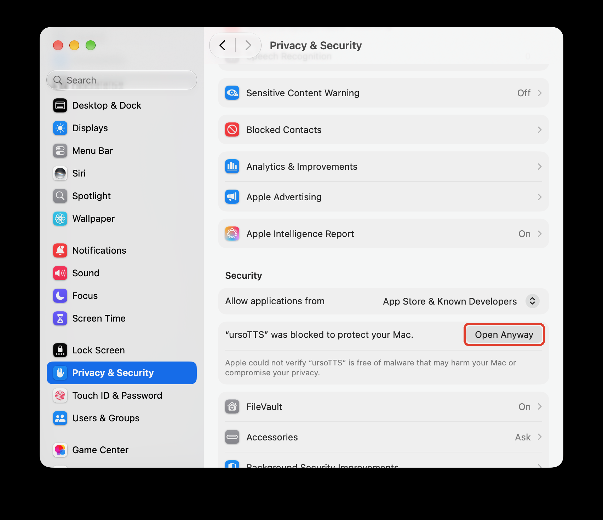

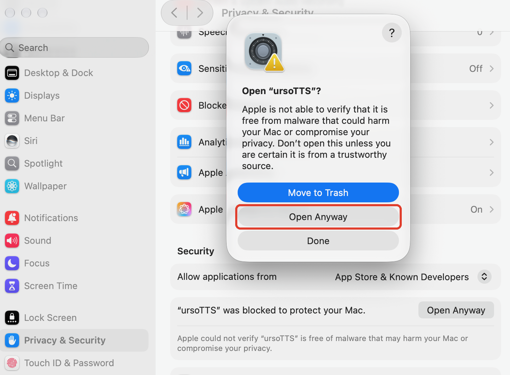

**Windows에서 처음 열 때.** 처음에는 Microsoft Defender SmartScreen이 설치 파일 실행을 막을 수 있습니다:

1. *Windows의 PC 보호* 창에서 **추가 정보**를 누릅니다.
2. 앱 이름이 **ursoTTS-1.0.0-windows-setup.exe**인지 확인한 뒤 **실행**을 누르고 설치 안내를 따릅니다.

<p>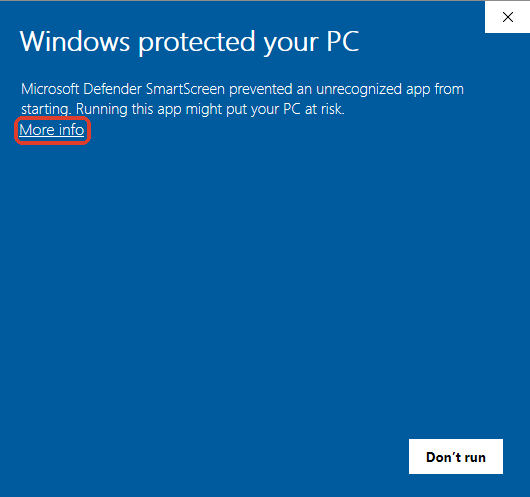 </p>

이 과정은 처음 한 번만 하면 됩니다. 그다음부터는 다른 앱처럼 바로 열립니다.

<p> </p>

처음 실행하면 목소리 목록이 비어 있습니다. **● Record a voice sample…**로 샘플을 녹음하거나(처음 한 번 macOS가 마이크 사용 권한을 묻습니다) **+ Add voice file…**로 파일을 추가하세요. **Help → About ursoTTS**에서 버전을 볼 수 있습니다.

### 7.3 Claude Code로 앱 바꾸기


**Claude Code** 화면(터미널 아이콘)에서는 "사이드바를 340 px로 넓혀 줘", "Speed 슬라이더를 추가해 줘"처럼 말로 요청해 앱 자체를 바꿀 수 있습니다. VS Code에서 쓰는 것과 같은 Claude 로그인으로 Claude Code 명령줄(`claude`)을 실행합니다.

1. 모드를 고릅니다: **Ask**(설명만, 아무것도 바꾸지 않음) 또는 **Edit the app**.
2. 요청을 입력하거나 **Ideas**에서 하나를 고른 뒤 **Send to Claude**(**⌘↵**)를 누릅니다. Claude가 무엇을 읽고 고치는지 기록에 보입니다.
3. **⟳ Restart app**을 누르면 바뀐 모습이 보입니다.
4. 마음에 들지 않으면 **↶ Undo last change**를 누르세요. 앱은 고치기 전마다 자기 파일을 백업하고(최근 다섯 개를 `.cache/claude_undo/`에 보관), 다시 시작하면 되돌아갑니다.

Edit 모드에서 Claude는 파일을 읽고 고치기만 할 수 있습니다. 터미널 명령이나 설치는 하지 않습니다. **Open in VS Code**는 프로젝트를 VS Code에서 열어 변경 내용을 확인하게 해 주고, **Copy request for VS Code**는 요청을 필요한 설명과 함께 복사해 VS Code의 Claude 패널에 붙여 넣을 수 있게 합니다. Claude 화면은 Claude Code 명령줄이 필요합니다([5.1](#51-설치하기) 참고). 없으면 복사 버튼을 쓰세요.

<sub>[↑ 목차로](#목차)</sub>

## 8. 터미널에서 명령어 쓰기

Claude 없이 `ursotts` 명령어를 직접 입력하는 방법입니다. 가장 직접적이고 빠른 반복 작업에 좋지만, 명령어를 정확히 입력해야 합니다. 명령이 실패하면 언제든 오류를 Claude Code에 붙여 넣어 도움을 받을 수 있습니다 ([4장](#4-vs-code와-claude-desktop-앱에서-claude-code-쓰기) 참고).

### 8.1 터미널 열고 준비하기

**터미널**을 엽니다(Mac: **Cmd+Space**를 누르고 *터미널* 또는 *Terminal*을 입력한 뒤 **Enter**). VS Code의 통합 터미널(**Ctrl+~**)은 이미 프로젝트 폴더에서 열립니다.

**ursoTTS는 항상 프로젝트 폴더 안에서 실행하세요.** ursoTTS는 지금 있는 폴더의 `config.yaml`(목소리 설정)을 읽습니다.

```bash
pwd                               # 지금 어디인가? /ursotts로 끝나야 함
cd ~/Projects/ursotts             # 프로젝트 폴더로 이동
ls                                # config.yaml, scripts, voices, ursotts가 보여야 함
source .venv/bin/activate         # 환경 켜기. 프롬프트에 (.venv)가 표시됨
```

새 터미널을 열 때마다 `cd`와 `source` 줄을 실행합니다. Windows에서는 `.venv\Scripts\activate`로 켭니다.

### 8.2 명령어 한눈에 보기

| 명령어 | 기능 |
|---|---|
| `ursotts check` | 설정을 확인합니다. GPU, 목소리 모델, ffmpeg, 목소리 샘플 상태를 점검합니다 |
| `ursotts preview 파일` | 음성을 생성하지 않고 대본을 어떻게 읽을지 미리 확인합니다 |
| `ursotts say "텍스트" -o 파일` | 한 문장이나 짧은 텍스트를 음성으로 생성합니다 |
| `ursotts batch 입력폴더 출력폴더` | 입력 폴더의 모든 대본을 음성으로 생성합니다 |
| `ursotts ui` | 웹 UI를 실행합니다 |
| `ursotts app` | 데스크톱 앱을 엽니다([7장](#7-ursotts-데스크톱-앱-쓰기) 참고). `--detach`를 붙이면 터미널을 닫아도 됩니다 |
| `ursotts make-launcher` | 데스크톱 앱을 더블클릭으로 여는 실행 아이콘을 만듭니다([7.1](#71-데스크톱-앱-시작하기) 참고) |
| `ursotts --help`, `ursotts batch --help` | 전체 명령어 목록이나 특정 명령어의 옵션을 확인합니다 |


### 8.3 설정 확인: `ursotts check`

```bash
ursotts check
```

설정이 잘 되어 있으면 이렇게 나옵니다:

```
ursotts 1.0.0
engine: chatterbox
torch 2.6.0 | best device: mps
chatterbox: installed
ffmpeg: /opt/homebrew/bin/ffmpeg
voice[en]: /Users/you/Projects/ursotts/voices/my_voice_en.wav OK
voice[ko]: /Users/you/Projects/ursotts/voices/my_voice_ko.wav OK
```

*NOT installed*, *not found*, *MISSING*으로 표시된 항목이 고쳐야 할 부분입니다.


*pkg_resources is deprecated* 같은 경고는 ursoTTS가 쓰는 라이브러리에서 나옵니다. 문제없으니 무시해도 됩니다.

### 8.4 대본 미리 보기: `ursotts preview`

```bash
ursotts preview scripts/02_intro_ko.txt
```

덩어리마다 언어와 목소리가 실제로 읽을 텍스트, 그리고 쉼을 몇 초 만에 보여 줍니다:

```
[ko] 안녕하세요, Ursomics입니다. 오늘은 Claude Code로 싱글셀 알엔에이 시퀀싱 품질 관리를 해보겠습니다.
   ... pause 0.7s
```


생성하기 전에 발음 표기 ([9.3](#93-발음-고치기) 참고)와 언어 감지를 확인할 때 쓰세요.

### 8.5 한 문장 만들기: `ursotts say`

```bash
ursotts say "Welcome to Ursomics." -o output/hello.wav
ursotts say "안녕하세요, Ursomics입니다." -o output/hello_ko.wav --lang ko
```

| 옵션 | 기능 |
|---|---|
| `-o 파일` | WAV 파일을 저장할 위치를 지정합니다. 기본값은 `say.wav`입니다 |
| `--lang en` / `--lang ko` | 전체 텍스트를 지정한 언어와 목소리 하나로 읽습니다. `@lang`을 사용하는 것과 같습니다 |
| `--engine dummy` | 목소리 모델 없이 테스트합니다. 재생하면 신호음이 납니다 |
| `-c 파일` | 사용할 설정 파일을 지정합니다. 기본값은 `config.yaml`입니다 |

텍스트는 따옴표로 감싸세요. 띄어쓰기나 한국어가 들어 있으면 특히 그렇습니다.

### 8.6 폴더 생성: `ursotts batch`

```bash
ursotts batch scripts output
```

`scripts/`의 모든 `.txt`, `.md` 대본을 만들고, 대본 `name.txt`마다 다음 파일을 씁니다:

```
output/name.wav   output/name.mp3   output/name.srt   output/batch_report.json
```

| 옵션 | 기능 |
|---|---|
| `--force` | 변경되지 않은 대본도 다시 생성합니다. 기본적으로는 건너뜁니다 |
| `--engine dummy` | 목소리 모델 없이 전체 과정을 테스트합니다 |
| `-c 파일` | 사용할 설정 파일을 지정합니다 |

다시 실행하면 텍스트와 설정이 바뀌지 않은 대본은 건너뛰고, `--force`를 붙여도 바뀐 문장만 새로 만듭니다. `batch_report.json`에 대본마다 길이가 적혀 있어 영상 타이밍을 확인할 때 편합니다.


처음 실행할 때는 목소리 모델을 불러오면서 몇 가지 경고(예: Hugging Face 토큰, 반복 토큰)가 나옵니다. 문제없으며 내레이션은 정상적으로 만들어집니다.

### 8.7 웹 UI 시작: `ursotts ui`

```bash
ursotts ui
```

| 옵션 | 기능 |
|---|---|
| `--port 7861` | 기본 포트 7860을 사용할 수 없을 때 다른 포트를 사용합니다 |
| `--no-browser` | 브라우저 탭을 자동으로 열지 않습니다 |
| `--engine dummy` | 목소리 모델 없이 페이지를 테스트합니다 |
| `--share` | 임시 **공개 링크**를 만듭니다. 공개를 의도한 경우에만 사용하세요 |

멈추려면 **Ctrl+C**를 누릅니다. 자세한 내용은 [6.1](#61-시작하고-끄기) 참고.

### 8.8 알아 두면 편한 키와 요령

| 키·요령 | 기능 |
|---|---|
| **↑** / **↓** | 이전 명령어를 다시 불러옵니다. 다시 입력할 필요가 없습니다 |
| **Tab** | 파일·폴더 이름을 자동 완성합니다. 예: `scripts/01`을 입력한 뒤 **Tab** |
| **Ctrl+C** | 실행 중인 명령을 중단합니다 |
| **Cmd+K** 또는 `clear` | 화면을 지웁니다 |
| 따옴표 `"…"` | 띄어쓰기나 한국어가 포함된 텍스트를 하나로 묶습니다 |

> **ffmpeg는 대시 하나:** `ffmpeg --version`이 아니라 `ffmpeg -version`입니다. 다른 도구들(`python --version`, `git --version`)은 대부분 대시 두 개입니다.

### 8.9 Windows와 서버

- **Windows:** 웹 UI, 데스크톱 앱, 터미널 명령어 모두 작동합니다. NVIDIA GPU가 가장 빠릅니다. ffmpeg는 `winget install ffmpeg`로 설치하고, 환경은 `.venv\Scripts\activate`로 켭니다. 데스크톱 앱은 Windows 내장 플레이어로 WAV를 재생하므로 ■ Stop도 작동합니다. Windows 설치 파일도 있습니다 ([7.2](#72-python-없이-설치하기-dmg--exe) 참고).
- **AWS EC2:** `ursotts batch`나 웹 UI를 쓰세요. 데스크톱 앱은 화면이 필요해서 EC2에서는 실행되지 않습니다. 웹 UI는 SSH 터널(`ssh -L 7860:localhost:7860 you@your-ec2-host`)로 연결한 뒤 내 컴퓨터에서 http://localhost:7860 을 엽니다. `--share`를 쓰거나 7860 포트를 인터넷에 열지 마세요.
- **S3:** ursoTTS는 일반 폴더를 쓰므로 `aws s3 sync`로 파일을 내려받고 올립니다:

```bash
aws s3 sync s3://your-bucket/scripts scripts/
ursotts batch scripts output
aws s3 sync output/ s3://your-bucket/narration/
```

<sub>[↑ 목차로](#목차)</sub>

## 9. 내레이션 만들기

### 9.1 목소리 샘플 녹음하기

- 영상과 같은 말투로 **10~30초** 동안 자연스럽게 말합니다.
- 조용한 방, 음악 없이, 한 사람만, 마이크와 일정한 거리.
- **언어마다 샘플 하나씩.** 한국어는 한국어 녹음으로 클로닝해야 가장 자연스럽습니다.
- `voices/my_voice_en.wav`와 `voices/my_voice_ko.wav`로 저장하거나, `config.yaml`에서 이름을 바꿉니다.

휴대폰 녹음을 변환하려면 Claude Code에게 요청하세요:
```
~/Desktop/my_voice_en.m4a를 voices/my_voice_en.wav로 변환해 줘: 모노, 24 kHz,
앞뒤 무음 제거. 최종 길이를 초 단위로 알려 줘.
```


웹 UI에서 바로 녹음하거나(**Speak** 탭 → *Record or upload a new sample*), 데스크톱 앱에서 녹음할 수도 있습니다(**● Record a voice sample…**, 이미 녹음한 파일은 **+ Add voice file…**).

**다른 TTS 서비스로 만든 샘플도 테스트에는 쓸 수 있지만**, 클론을 다시 클로닝하면 자연스러움이 조금 떨어집니다. 직접 녹음한 목소리가 가장 좋습니다.

### 9.2 대본 쓰기

```text
@lang ko
# #으로 시작하는 줄은 메모이며 읽지 않습니다.
안녕하세요. 오늘은 scRNA-seq 데이터를 분석해 보겠습니다.

새 문단은 조금 더 길게 쉽니다. [pause 1.5] 원하는 곳에 직접 쉼을 넣을 수 있습니다.
```

| 요소 | 효과 |
|---|---|
| `@lang en` / `@lang ko` | 파일 전체의 언어와 목소리 샘플을 지정한 언어로 고정합니다 |
| `@lang auto`(기본값) | 문장마다 영어와 한국어를 자동으로 감지합니다 |
| 빈 줄 | 문단 사이에 쉼을 넣습니다. 길이는 설정 파일의 `pauses.paragraph` 값으로 정합니다 |
| `[pause 1.5]` | 1.5초 동안 쉽니다. `[pause]`만 쓰면 1초 쉽니다 |
| `# ...` | 메모로 처리하며, 소리 내어 읽지 않습니다 |

**언어를 고정해야 할 때:** 한국어 대본에 영어 문장이 통째로 들어 있으면(예: 논문 제목) `auto`는 그 문장에서 영어 목소리 샘플로 바꿉니다. 한국어 억양으로 영어를 읽는 한 가지 목소리를 원하면 맨 위에 `@lang ko`를 쓰세요. 자세한 내용은 [한영 혼합 대본의 발음](#한영-혼합-대본의-발음)을 보세요.

### 9.3 발음 고치기

유전자 이름과 약어는 그대로 두면 제대로 읽히는 경우가 드뭅니다. ursoTTS는 흔한 경우를 자동으로 처리하고, 나머지는 `pronunciations.yaml`에 한 번만 정해 두면 됩니다. 그러면 모든 영상에 적용됩니다. 자막은 항상 원래 표기를 유지합니다.

#### 자동: 약어

2~6글자 대문자 단어는 글자마다 자연스럽게 이어 읽습니다:

| 대본 | 영어 목소리 | 한국어 목소리 |
|---|---|---|
| DNA | D.N.A. | 디엔에이 |
| HLA, MHC | H.L.A., M.H.C. | 에이치엘에이, 엠에이치씨 |
| DNA를 | — | 디엔에이를(한국어 조사를 적절하게 붙일 수 있습니다) |

`config.yaml`에서 `spell_acronyms: false`로 끌 수 있습니다. 사전 항목이 항상 우선하므로, 단어처럼 읽는 대문자 단어(UMAP, FACS, NANOG)는 항목만 추가하면 됩니다.

#### 내 사전: 소리를 적는 법

영어 문장의 용어는 `en:`, 한국어 문장의 용어는 `ko:` 아래에 적습니다. 영어 발음은 아래의 글자·음절 방식으로, 한국어 발음은 한글로 적습니다.

| 용어 종류 | 표기 방법 | 예 |
|---|---|---|
| 글자 이름으로 읽는 약어 | 대문자 하나마다 **점**을 찍습니다 | `CD8: C.D. eight`, `TCRs: T.C.R.s`, `RNA-seq: R.N.A. seek` |
| 단어처럼 읽는 약어 | 둘 이상의 음절을 점으로 나눕니다. 대문자는 강세를 표시합니다 | `NANOG: NAN.og`(목소리는 "nanog"으로 읽습니다) |
| 그대로 읽을 이름 | 별도 표기 없이 원래 철자대로 씁니다 | `Ursomics: Ursomics` |
| 한국어식으로 읽을 용어 | 발음대로 한글로 씁니다 | `GATA6: 가타식스`, `KIR: 컬` |

**띄어쓰기나 하이픈 대신 점을 쓰세요.** `R N A`, `R-N-A`, `Ur-SOH-mics`처럼 쓰면 끊어지는 곳마다 쉬어서 뚝뚝 끊깁니다. `R.N.A.`는 자연스럽게 이어지는 글자로, `ur.SOH.miks`는 한 단어로 매끄럽게 읽힙니다.

헷갈리기 쉬운 소리에는 메모를 붙이세요. 목소리는 무시하지만, 나와 협업자, 그리고 Claude에게 정확히 어떤 소리인지 알려 줍니다:

```yaml
en:
  NANOG: {say: NAN.og, like: "NAN as in man, og as in dog, one smooth word"}
```

프로젝트에는 영어와 한국어 생물정보학 용어 약 60개가 들어 있습니다. *tested* 표시는 직접 들어 확인한 것이고, *starter* 표시는 확인이 필요한 추정값입니다.

#### 한영 혼합 대본의 발음

한국어 영상의 대본은 대부분 영어 용어가 섞여 있습니다. 발음이 정해지는 규칙을 알면 대부분의 문제를 미리 막을 수 있습니다.

**핵심 규칙: 발음은 단어가 아니라 문장의 언어로 정해집니다.** 문장마다 언어가 정해지면, 그 문장 전체에 그 언어의 목소리와 규칙이 적용됩니다.

| 문장의 언어 | 목소리 | 사전 | 대문자 약어 |
|---|---|---|---|
| 한국어 | 한국어 샘플 | `ko:` 항목 | 한글 이름(DNA → 디엔에이) |
| 영어 | 영어 샘플 | `en:` 항목 | 점 철자(DNA → D.N.A.) |

**한국어 대본에는 `@lang ko`를 쓰세요.** `@lang auto`는 한글이 글자의 25% 미만인 문장을 영어 문장으로 판단합니다. 그래서 영어 용어가 많은 한국어 문장은 그 문장만 영어 목소리로 바뀔 수 있습니다:

```
대본:      PD-1, PD-L1, CTLA-4, TNF-alpha 분석.
auto     → [en] P.D. one, P.D.L. one, C.T.L.A. four, T.N.F. alpha 분석.
@lang ko → [ko] 피디원, 피디엘원, 씨티엘에이포, 티엔에프 알파 분석.
```

**`@lang ko`에서 영어 단어는 이렇게 읽힙니다:**

| 대본 속 영어 | 읽는 방식 | 할 일 |
|---|---|---|
| 대문자 약어(DNA, HLA) | 자동으로 한글 이름(디엔에이, 에이치엘에이) | 없음. 단어처럼 읽을 것만 항목 추가(`UMAP: 유맵`) |
| `ko:` 사전에 있는 용어 | 사전의 한글 읽기 | 없음 |
| 숫자나 소문자가 섞인 용어(CD45, GATA6, Foxp3) | 쓴 그대로. 한국어 목소리가 어색하게 읽을 수 있음 | `ko:` 항목 추가(`CD45: 씨디포티파이브`) |
| 일반 영어 단어와 문장(Python, controls lineage choice) | 한국어 목소리가 한국어 억양의 영어로 그대로 읽음 | 보통 그대로 둠. 어색하면 `ko:` 항목 추가 |

**같은 용어라도 영어와 한국어 항목을 따로 둡니다.** 영어 문장에는 `en:`, 한국어 문장에는 `ko:` 항목이 쓰이므로, 두 언어 대본에 모두 나오는 용어는 양쪽에 적어 두세요:

```yaml
en:
  NANOG: NAN.og
  CD45: C.D. forty-five
ko:
  NANOG: 나녹
  CD45: 씨디포티파이브
```

**조사는 한국어 읽기에 맞추세요.** 조사가 붙어도 사전 항목은 그대로 적용되지만, 조사 자체는 쓴 대로 읽힙니다. "RNA-seq을"(시퀀싱, 받침 있음), "DNA를"(디엔에이, 받침 없음), "GATA6와"(가타식스, 받침 없음)처럼 한글로 읽었을 때 자연스러운 조사를 고르세요.

**영어 문장을 통째로 넣을 때(예: 논문 제목):**
- `@lang ko`에서는 한국어 목소리가 한국어 억양의 영어로 읽습니다. 대문자 약어는 한글로 읽히고, `ko:` 항목이 적용됩니다(NANOG → 나녹).
- 원어민 발음의 영어로 읽히게 하려면 그 문장을 별도 파일로 나누고 첫 줄에 `@lang en`을 쓰세요. 슬라이드마다 파일을 나눠 쓴다면 제목 슬라이드만 `@lang en`으로 두면 됩니다.

**확인은 `preview`로.** 덩어리마다 판단된 언어(`[ko]`/`[en]`)와 실제로 읽을 텍스트를 보여 줍니다. 소리를 만들지 않으니 몇 초면 끝납니다:

```bash
ursotts preview scripts/02_intro_ko.txt
```

#### 유전자 이름: 먼저 단어로, 필요하면 글자로

1. **두 번째 글자가 모음이면**(NANOG, GATA, SOX, KIR) 먼저 **단어처럼** 읽습니다: `NANOG: NAN.og`, `GATA4: GAH.tah FOUR`, `SOX17: saaks SEV.en.teen`, `KIR: kur`.
2. **그렇게 해서 발음이 어색할 때만** 글자를 점으로 읽습니다: `NANOG: N.A.N.O.G.`
3. **두 번째 글자가 자음이면**(CD8, TP53, IL2RA) 글자로 읽습니다: `TP53: T.P. fifty-three`.

Pronunciation 탭도 같은 순서를 따릅니다. 두 번째 글자가 모음인 유전자는 단어 형태를 먼저 제안합니다.

#### 귀로 확인하기

`examples/`에 유전자 이름과 약어가 가득한 테스트 대본 두 개(영어, 한국어·영어 혼합)가 용어 종류별로 정리되어 있습니다:

```bash
ursotts batch examples output/pron_test
```

MP3를 들으면서 SRT 파일을 열어 두세요. 자막에 지금 어느 문장이 나오는지 보이므로, 어색한 단어를 정확히 찾을 수 있습니다.

#### 단어 고치기: Pronunciation 탭

`ursotts ui`를 열고 **Pronunciation** 탭으로 갑니다:

1. 용어(예: `PD-L1`)를 입력하고 언어를 고릅니다.
2. **Suggest spellings**를 누릅니다. 첫 제안은 프로젝트 방식을 따릅니다(영어는 `P.D.L. one`, 한국어는 `피디엘원`). 고치거나 직접 한 줄에 하나씩 추가하세요.
3. **Listen to all**을 누릅니다. 각 버전을 테스트 문장 안에서 내 목소리로 읽어 줍니다.
4. 가장 좋은 것을 고르고, 원하면 **Sounds like**에 설명을 쓴 뒤 **Save to pronunciation rules**를 누릅니다. 파일 안의 주석은 그대로 남습니다.

단어만 따로 들으면 다르게 들리니, 항상 문장 안에서 판단하세요.

#### Claude에게 소리 설명하기

채팅이나 Claude Code에서 Claude에게 발음 추가나 수정을 부탁할 때는 이 형식을 쓰세요. 추측할 여지가 없어집니다:

```
pronunciations.yaml에 추가해 줘 (영어):
용어: 프로젝트 방식의 표기. 소리: 부분마다 일상 단어로 설명.

예:
CD45: C.D. forty-five. 소리: "see-dee" 다음에 "forty-five".
NANOG: NAN.og. 소리: "man"의 NAN, "dog"의 og, 한 단어로 매끄럽게.
KIR: kur. 소리: "fur"와 운이 맞음.

pronunciations.yaml에 추가해 줘 (한국어):
CD45: 씨디포티파이브
```


### 9.4 말투 조정하기

| config.yaml | 웹 UI | 효과 |
|---|---|---|
| `exaggeration` | Expressiveness | 0.3이면 차분하게, 0.5가 기본값이며, 0.7 이상이면 생동감 있게 말합니다 |
| `cfg_weight` | Pacing | 값을 낮추면 더 느리고 또박또박 말합니다 |
| `temperature` | Variation | 값을 높이면 말투가 더 다양해집니다 |
| `seed` | Seed | 값을 바꾸면 같은 텍스트도 다른 버전으로 생성됩니다 |

Claude Code에게 문제를 말로 설명하면 잘 됩니다:
```
테스트가 너무 빠르고 조금 밋밋해. @config.yaml을 조정해서 더 느리고 조금
더 생동감 있게 만든 다음, output/test1.wav를 다시 만들어 줘.
```


<sub>[↑ 목차로](#목차)</sub>

## 10. 문제 해결

| 증상 | 원인과 해결 방법 |
|---|---|
| `Voice sample(s) missing` | 프로젝트 폴더 밖에서 실행했거나(`pwd`로 확인), `voices/` 폴더의 파일 이름이 `config.yaml`의 이름과 다릅니다 |
| 내레이션 목소리가 샘플과 다르게 들림 | 목소리 샘플이 너무 짧거나 잡음이 많을 수 있습니다. 또는 `@lang auto`가 다른 언어의 샘플을 선택했을 수 있습니다. 잡음이 적은 10~30초 분량의 음성을 사용하고 `ursotts preview`로 확인하세요 |
| `command not found: ursotts` | 가상 환경이 활성화되지 않았습니다. `source .venv/bin/activate`를 실행하세요 |
| 폴더를 옮기거나 이름을 바꾼 뒤 오류가 발생함 | `.venv`가 손상됐을 수 있습니다. 삭제한 뒤 설치 3단계를 다시 진행하세요([4.7절](#47-claude-code로-ursotts-설치하기-vs-code와-데스크톱-앱) 참고) |
| `Unrecognized option '-version'` | `ffmpeg --version`이 아니라 `ffmpeg -version`을 입력하세요 |
| 첫 실행이 매우 느림 | 용량이 큰 모델을 내려받고 있기 때문입니다. 다운로드가 끝나면 다음 실행부터는 빨라집니다 |
| 문장마다 몇 초씩 걸리고 기록에 "…/1000"이 보임 | 정상입니다. 목소리 모델은 음성을 작은 조각(오디오 1초당 약 25개)으로 만들기 때문에, Apple Silicon Mac에서 5초 문장은 10초 정도 걸리고 CPU만 쓰면 더 걸립니다. 1000은 최댓값일 뿐이며, 문장이 끝나면 바로 멈춥니다 |
| 설정을 바꿨는데 다시 생성되지 않음 | 현재 실행 중인 폴더의 `config.yaml`을 수정했는지 확인하세요 |
| Chatterbox를 불러올 때 `No module named pkg_resources` 오류 | `pip install -e ".[all]"`로 다시 설치하세요. Chatterbox의 워터마크 모듈에 필요한 `setuptools<81`이 설치됩니다 |
| 최신 Python에서 설치 실패 | 일부 패키지는 최신 Python을 아직 지원하지 않을 수 있습니다. Python 3.11~3.13을 사용해 보세요 |
| Claude Code 패널에 Spark 아이콘이 없음 | 먼저 파일을 열어 보거나 상태 표시줄의 **✻ Claude Code** 버튼을 사용하세요 |
| 약어나 이름이 끊겨 들림(“R … N … A”, “Ur … So … mics”) | `pronunciations.yaml`에서 글자 사이를 띄우거나 하이픈으로 나누지 않았는지 확인하세요. 글자 이름은 점으로(`R.N.A.`), 단어처럼 읽을 음절은 점으로 연결해(`ur.SOH.miks`) 표기하세요. [9.3절](#93-발음-고치기)을 참고하세요. |
| 그 밖의 문제 | Claude Code에서 “실패했어. `@terminal:zsh`를 보고 원인을 찾아서 고쳐 줘.”라고 요청하세요. |

---

<p align="center">
  <br>
  <sub>ursoTTS · © 2026 Ursus (@ursomics)</sub>
</p>
