<p align="center">
  <b>English</b> · <a href="MANUAL.ko.md">한국어</a>
</p>

<p align="center">
  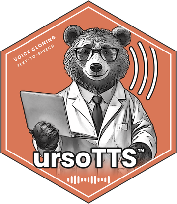
</p>

<h1 align="center">ursoTTS™ manual</h1>

<p align="center">
  <b>From an empty folder to finished narration, step by step.</b><br>
  <sub>Voice cloning · text-to-speech · English and Korean</sub>
</p>

---

This manual takes you from an empty folder to finished narration for real videos. It assumes no programming experience: wherever a step needs code, it shows how to let **Claude Code** do it for you.

> **📖 Reading this manual**
>
> - **Easiest:** read it [on GitHub](https://github.com/ursomics/ursotts/blob/main/docs/MANUAL.md), where everything displays exactly as intended.
> - **On your computer:** open it in **VS Code** and press **Cmd+Shift+V** (Windows: **Ctrl+Shift+V**) for the preview, or **Cmd+K** then **V** to see it side by side. Open it from inside your `ursotts` folder so the screenshots show.
> - **Other apps:** Typora (reading and editing in one view), Obsidian (free), or QLMarkdown (free; select the file in Finder and press **Space**).
> - A few details, like the light/dark banner and some centering, only look exactly right on GitHub.

## Two kinds of boxes

| Box | What it is | Where to type it |
|---|---|---|
| Marked `bash` | A terminal command | The normal Terminal prompt (`%`) or VS Code's terminal (**Ctrl+~**), inside the `ursotts` folder. Not inside a Claude session. |
| No label | A prompt for Claude, or example output to look at | The Claude Code chat: the VS Code panel, the Claude Desktop app, or the Claude Code CLI |

- The `bash` label only colors the text. On a Mac, Terminal uses **zsh**, and the commands work exactly the same.
- The **Claude Code CLI** also runs in a terminal window, but it's a chat with Claude, started by typing `claude`. A command typed there goes to Claude as a message; type `/exit` first to get back to the normal prompt.

## What you can use it for

- **YouTube tutorials and lectures:** narrate screen recordings and slides in your own voice.
- **Paper summaries and journal clubs:** short videos or audio summaries of articles.
- **Online courses and lab training:** e-learning modules, protocol and SOP walkthroughs, onboarding for new lab members.
- **Presentations:** voice-over for slides, recorded conference talks, poster pitches, or a lab meeting you can't attend.
- **Rehearsal:** hear your talk script before presenting and check its timing.
- **Podcasts and audio versions:** turn blog posts, newsletters or your own writing into audio.
- **Bilingual content:** English and Korean versions of the same video from one set of visuals.
- **Short-form video:** narration for YouTube Shorts, Instagram Reels and TikTok.
- **Product and app demos:** demo videos, walkthroughs and release announcements.
- **Accessibility:** audio versions of documents, with subtitles for viewers who read along.

Only clone your own voice, or a voice you have permission to use.

## Contents

1. [What you need](#1-what-you-need)
2. [Get the project onto your computer](#2-get-the-project-onto-your-computer)
3. [Ways to use ursoTTS](#3-ways-to-use-ursotts)
4. [Using Claude Code in VS Code and the Claude Desktop app](#4-using-claude-code-in-vs-code-and-the-claude-desktop-app)
5. [Using the Claude Code CLI](#5-using-the-claude-code-cli)
6. [Using the web UI](#6-using-the-web-ui)
7. [Using the ursoTTS desktop app](#7-using-the-ursotts-desktop-app)
8. [Using the command line in the terminal](#8-using-the-command-line-in-the-terminal)
9. [Making narration](#9-making-narration)
10. [Troubleshooting](#10-troubleshooting)

---

## 1. What you need

| Item | Notes |
|---|---|
| A computer | A Mac with Apple Silicon, or a PC with an NVIDIA GPU, works best. CPU-only works but is slow. |
| Python 3.10 or newer | Tested on Python 3.13. Claude Code can install it for you. |
| ffmpeg | Needed for MP3 export. On a Mac, install it with `brew install ffmpeg`. Without ffmpeg you still get WAV and subtitles. |
| A Claude paid plan | Claude Code needs Pro, Max, Ultra, Team or Enterprise (not available on the Free plan). |
| Your voice samples | 10–30 seconds of clear speech per language is needed (see [9.1](#91-record-your-voice-samples)). |

<sub>[↑ Back to contents](#contents)</sub>

## 2. Get the project onto your computer

1. **Download** `ursotts.zip`, or clone the repository from GitHub.
2. **Unzip it.** You get a folder called `ursotts`.
3. **Move the folder somewhere that isn't cloud-synced**, for example `~/Projects/ursotts`.

**Why not iCloud, OneDrive or Dropbox?** The project creates a `.venv` folder with thousands of small files, plus a cache of audio files. Syncing them slows the sync service down and can corrupt the environment. GitHub is a better backup for code.

> **Mac tip:** your Documents and Desktop folders are synced if *iCloud → Drive → Desktop & Documents Folders* is turned on in System Settings. If it is, use a folder like `~/Projects` instead. Don't switch the setting off just for this: macOS would leave your existing files in iCloud Drive and give you an empty local folder.

> **Don't rename or move the folder after setup.** A virtual environment stores its own full path and breaks when moved. If you do move it, delete `.venv` and create it again (see [4.7](#47-install-ursotts-with-claude-code-vs-code-and-desktop-app), step 3).

<sub>[↑ Back to contents](#contents)</sub>

## 3. Ways to use ursoTTS

ursoTTS can be used in four ways. All four share the same settings, voice samples and pronunciation rules, so you can mix them freely.

| Way | What you do | Best for | Chapter |
|---|---|---|---|
| **Claude Code** | Ask Claude in plain words; it runs ursoTTS for you and fixes problems | Setup, changes, fixing pronunciation, anything you'd rather not type | [4](#4-using-claude-code-in-vs-code-and-the-claude-desktop-app), [5](#5-using-the-claude-code-cli) |
| **Web UI** | Click buttons in your browser | Trying sentences, recording voices, comparing pronunciations | [6](#6-using-the-web-ui) |
| **ursoTTS desktop app** | The same features in a normal window; also available as an installer without Python | Everyday narration, people who'd rather not use a browser or Python | [7](#7-using-the-ursotts-desktop-app) |
| **Terminal** | Type `ursotts` commands yourself | Quick repeated runs, remote computers | [8](#8-using-the-command-line-in-the-terminal) |

**Claude Code runs in three places.** It's the same Claude Code everywhere, sharing settings, skills and `CLAUDE.md`, so you can switch at any time:

| Where | How it looks | Chapter |
|---|---|---|
| **VS Code extension** (recommended) | A chat panel beside your files and changes | [4](#4-using-claude-code-in-vs-code-and-the-claude-desktop-app) |
| **Claude Desktop app** (Code tab) | An all-in-one app with a chat box | [4](#4-using-claude-code-in-vs-code-and-the-claude-desktop-app) |
| **Claude Code CLI** | The same chat, inside a terminal window | [5](#5-using-the-claude-code-cli) |

> The Claude Code CLI is still a conversation with Claude in plain words; it only looks like a terminal. Typing `ursotts` commands yourself, without Claude, is [chapter 8](#8-using-the-command-line-in-the-terminal).

<sub>[↑ Back to contents](#contents)</sub>

## 4. Using Claude Code in VS Code and the Claude Desktop app

VS Code and the desktop app both show Claude in a chat box where you type requests in plain words. Set up the one you prefer (see [4.1](#41-set-up-claude-code-in-vs-code-recommended) or [4.2](#42-set-up-the-claude-desktop-app-code-tab)); everything from [4.3](#43-choose-a-permission-mode) on works the same in both, and in the CLI (see [chapter 5](#5-using-the-claude-code-cli)).

### 4.1 Set up Claude Code in VS Code (recommended)

**Links**
- Download VS Code (free, macOS/Windows/Linux): <https://code.visualstudio.com/>
- Claude Code extension in the VS Code Marketplace: <https://marketplace.visualstudio.com/items?itemName=anthropic.claude-code>
- Official guide to Claude Code in VS Code: <https://code.claude.com/docs/en/vs-code>

**Step 1: install VS Code.** Open the VS Code website and click **Download for Mac** (or the version for your system). Open the downloaded file; on a Mac, drag *Visual Studio Code* into your Applications folder.

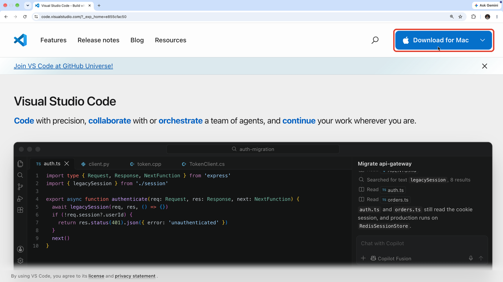

**Step 2: install the Claude Code extension.** Open VS Code and click the Extensions icon in the left bar (or press **Cmd+Shift+X** on Mac, **Ctrl+Shift+X** on Windows/Linux).

1. Type **claude code** in the search box.
2. Find **Claude Code for VS Code** published by **Anthropic** (with the blue verified check) and click **Install**. Several look-alike extensions by other publishers appear in the list, so check the publisher.

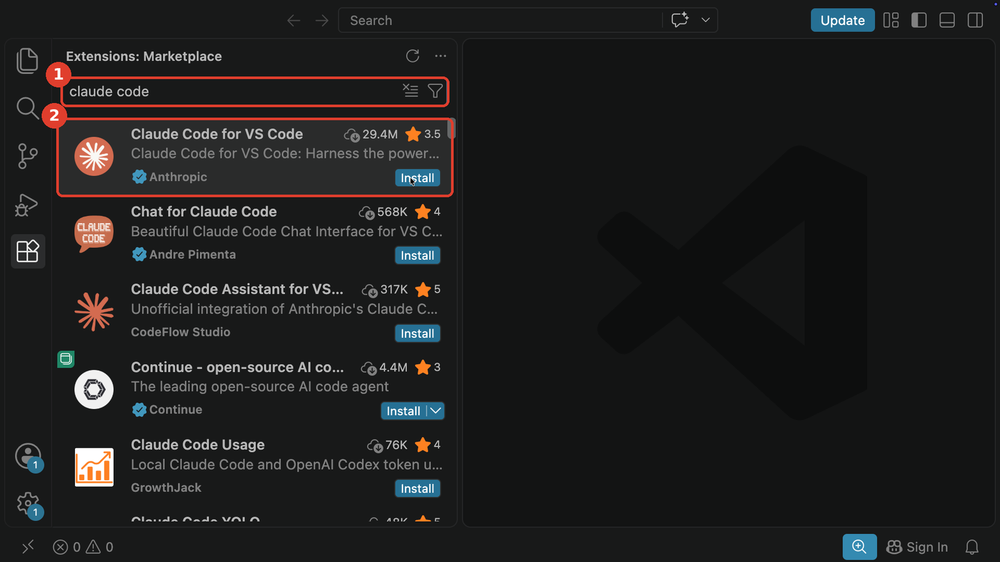

**Step 3: open the project folder.**

1. Click **Open Folder** in the Explorer (or choose **File → Open Folder…**).
2. Select the `ursotts` folder itself, not its parent.
3. Click **Open**.

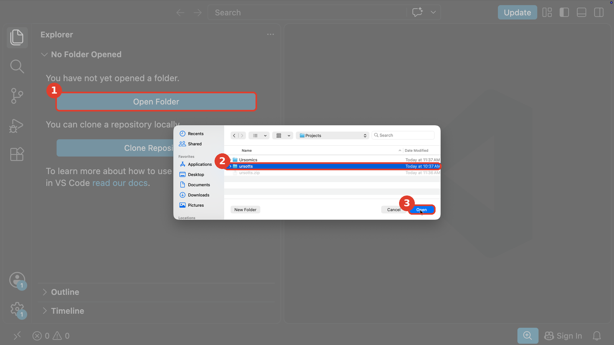

The first time you open a folder, VS Code asks whether you trust it. Click **Trust**. In Restricted Mode, extensions such as Claude Code are disabled or limited. Only trust folders whose contents you know, like your own projects.

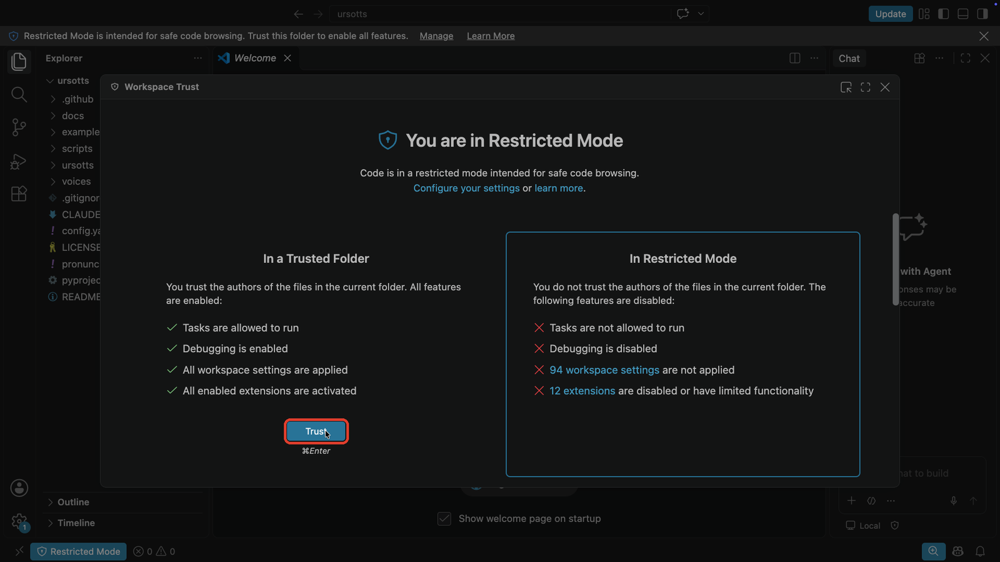

**Step 4: open the Claude panel.** Open any file, for example `README.md`, then use any of these:

1. The **Spark icon** at the top right of the editor (it appears only when a file is open).
2. **✻ Claude Code** in the bottom-right status bar (works even with no file open).
3. The **Spark icon** in the left Activity Bar.

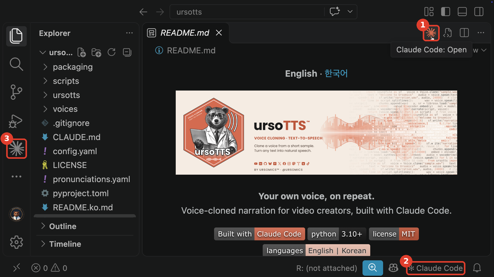

**Step 5: sign in (first time only).** The panel asks how you want to log in. Choose **Claude.ai Subscription** if you have a Pro, Max, Ultra, Team or Enterprise plan. (When you sign in from Claude Code in VS Code, a message may say that only Max or higher plans are supported. In that case, copy the address shown in the Claude Code panel, open it in your browser and sign in there; this works with a Pro plan too. *Anthropic Console* is for pay-as-you-go API billing; *Bedrock, Foundry, Vertex* is for company cloud accounts.)

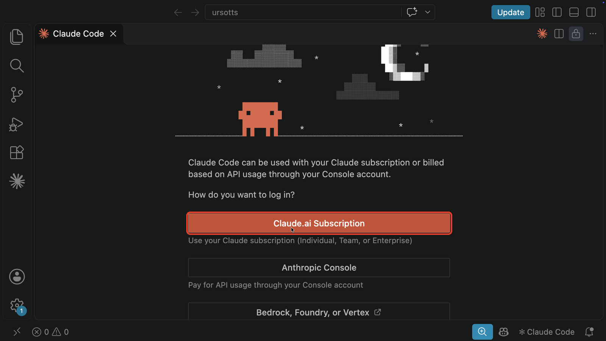

Your browser opens the Claude log-in page. Sign in with the same account you use on claude.ai, approve access, then return to VS Code.

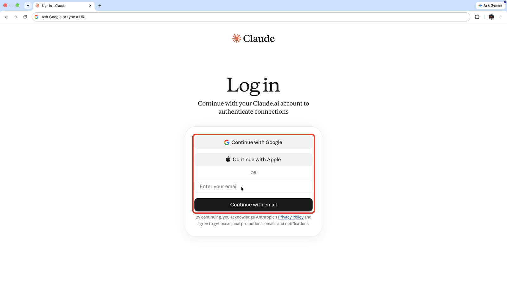

**Step 6: choose a mode and start working.** Type a request in the prompt box and press **Enter**.

1. The current **mode** is shown at the bottom right of the prompt box. Click it to change it (or press **Shift+Tab**).
2. The menu lists the modes. **Manual**, where Claude asks before each edit, is the safest while you're learning (see [4.3](#43-choose-a-permission-mode)). The same menu sets the **Effort** level, meaning how long Claude thinks before answering.

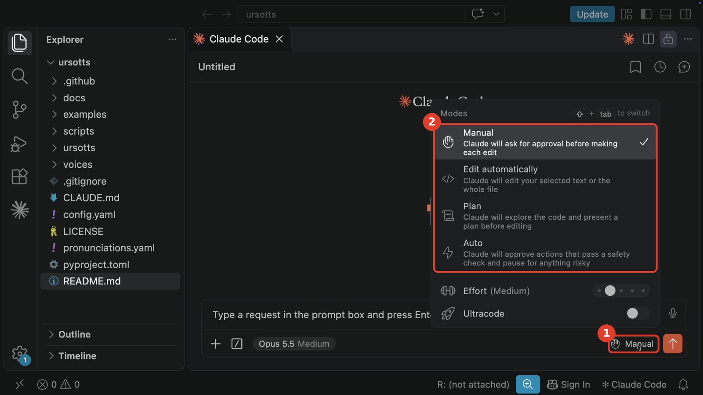

**Step 7: review Claude's changes.** In Manual mode, Claude shows each proposed edit before making it:

1. The file's **old line (red) and new line (green)**, side by side in the editor.
2. The question **"Make this edit…?"** Choose **Yes**, **Yes, allow all edits this session**, or **No**, or type what Claude should do instead.

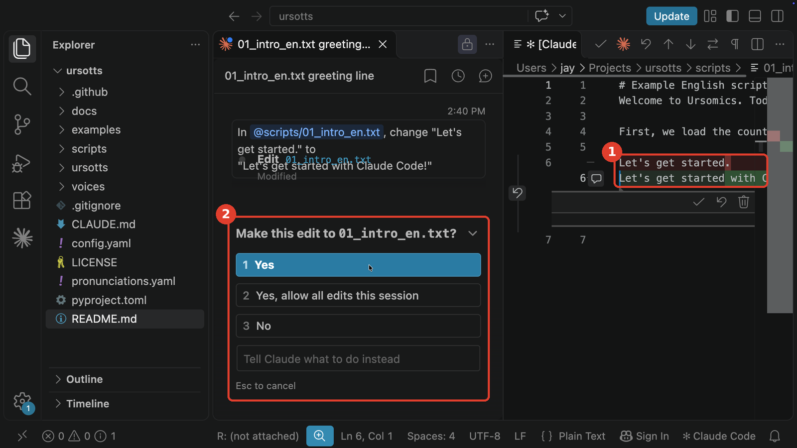

**Good to know**
- The extension includes its own copy of Claude Code. Typing `claude` in VS Code's terminal additionally needs the standalone CLI install (see [chapter 5](#5-using-the-claude-code-cli)).
- **Typing Korean or other non-Latin text** works more reliably in the Claude panel than in a terminal.
- If the Spark icon is missing, open a file first, or use **✻ Claude Code** in the status bar.
- To sign out, type `/logout` in the prompt box, or run **Claude Code: Logout** from the Command Palette (**Cmd+Shift+P**).

### 4.2 Set up the Claude Desktop app (Code tab)

**Links**
- Download Claude Desktop (macOS and Windows): <https://claude.ai/download>
- Official guide to Claude Code in the desktop app: <https://code.claude.com/docs/en/desktop>

The desktop app includes Claude Code, so you don't need to install the CLI or Node.js separately. It needs a paid Claude plan (Pro, Max, Ultra, Team or Enterprise).

**Step 1: download and install.** Open the download page and click **Download for macOS** (or Windows). Open the downloaded file; on a Mac, drag *Claude* into your Applications folder.

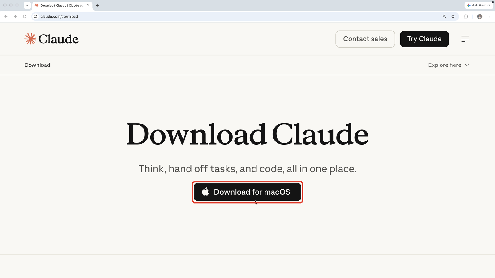

**Step 2: sign in.** Open the app and sign in with Google or your email, using the same account as on claude.ai.

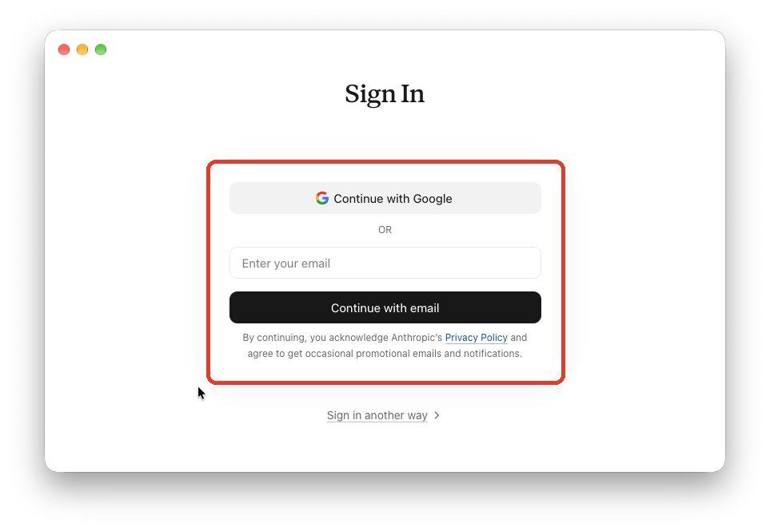

**Step 3: open the Code tab and choose the project folder.**

1. Click **Code** at the top of the sidebar, then **New** to start a session.
2. When asked to *Select folder for local session*, select your `ursotts` folder.
3. Click **Open**.

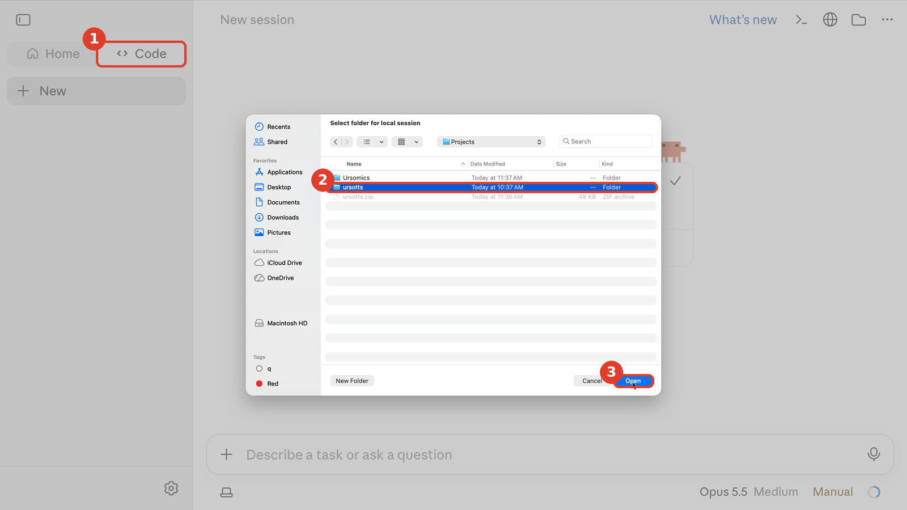

**Step 4: type a request.**

1. Check that the session is set to your **`ursotts`** folder (click it to switch folders).
2. Type in the prompt box at the bottom and press **Enter**. Type `@` to point at a file, or `/` for commands.
3. The current **mode** is shown at the bottom right (here *Manual*); click it to change it.

Type the prompt below to check that it works:

```
Read @README.md and explain in three short sentences what this project does
and how to start the web UI.
```

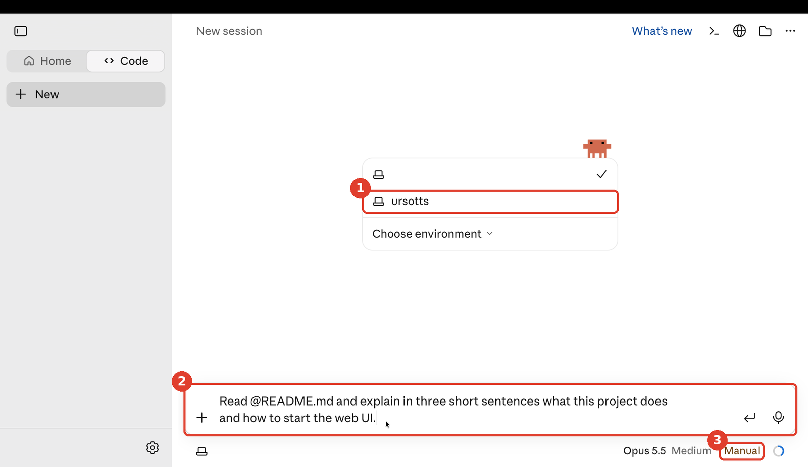

**Step 5: read the response.**

1. **Code tab:** switches between ordinary chat (*Home*) and Claude Code sessions.
2. **Your request**, with the file you pointed at shown as a link.
3. **Claude's answer.** In Manual mode, Claude asks you before changing a file or running a command.
4. **Mode**, with the model name and effort level beside it.

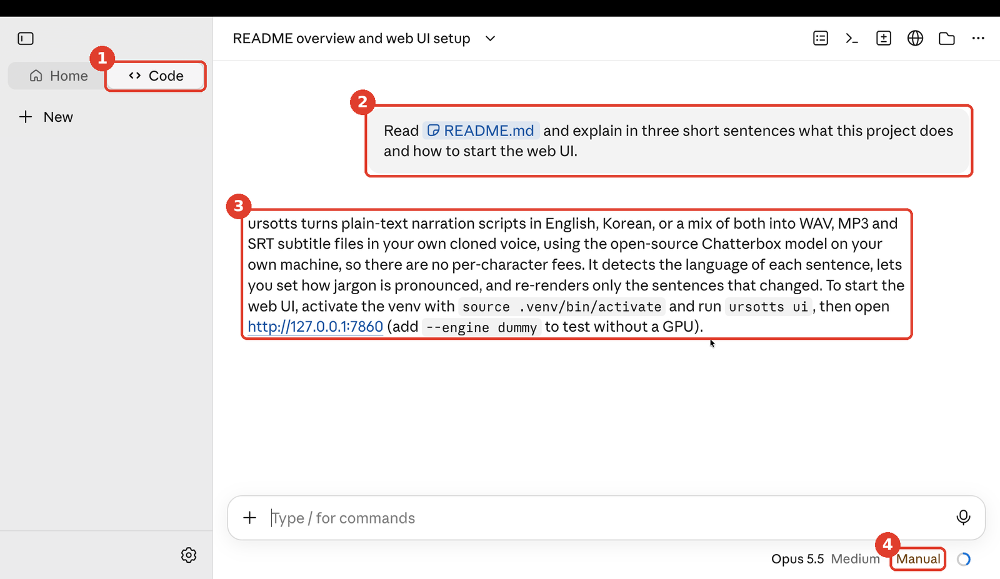

The icons at the top right open the session's task list, terminal, changes (diffs), browser preview and project folder. Past sessions are listed in the sidebar; collapse the sidebar with the icon at the top left when you share your screen.

### 4.3 Choose a permission mode

The mode is shown at the bottom of the prompt box. Click it, or press **Shift+Tab**, to change it.

| Mode | What happens | Use it when |
|---|---|---|
| **Manual** | Claude asks for approval before each edit and most commands | Learning, or anything that deletes or installs |
| **Edit automatically** | Claude edits files without asking (in VS Code: your selected text or the whole file) | Small, low-risk edits you'll review afterwards |
| **Plan** | Claude explores the code and presents a plan before editing | Starting something new |
| **Auto** | Claude approves actions that pass a safety check and pauses for anything risky | Routine work you trust |

The same menu sets the **Effort** level: higher effort means Claude thinks longer before answering, which helps on hard problems but takes more time and usage. The exact list can differ slightly between VS Code and the desktop app.

### 4.4 Give Claude context

| You type | Claude gets |
|---|---|
| `@README.md` | that file |
| `@ursotts/` | the whole folder (note the trailing slash) |
| `@ursotts/engine.py#30-60` | only lines 30–60 |
| `@terminal:zsh` | the output of the terminal named *zsh*, so you don't have to copy errors |

- Text you highlight in the editor is sent automatically. Press **Option+K** (Mac) or **Alt+K** to insert an exact reference such as `@text.py#40-55`.
- Paste screenshots straight into the prompt box. Hold **Shift** while dragging files in to attach them.
- **Shift+Enter** adds a new line; **Enter** sends.

**A good prompt says what, where and how you'll know it's done:** "Fix X in @file so that running Y works."

### 4.5 Slash commands

Type `/` in the prompt box to see every command. They work the same in VS Code, the desktop app and the CLI.

| Command | What it does | When to use it |
|---|---|---|
| `/init` | Creates `CLAUDE.md`, the notes Claude reads at the start of every session | Starting a project of your own (ursoTTS already ships with one) |
| `/clear` | Starts a fresh conversation; `CLAUDE.md` is kept | Switching to an unrelated task |
| `/compact` | Summarizes a long conversation to free up space | When a session gets long and Claude starts losing track of earlier details |
| `/plan` | Switches to Plan mode | Before a big change, to see Claude's plan first |
| `/model` | Chooses the model | A hard problem that needs a stronger model |
| `/usage` | Shows your plan limits and when they reset | Before a long session |
| `/btw` | Asks a side question without cluttering the main conversation | `/btw what does cfg_weight do?` |
| `/logout` | Signs out | Switching accounts |
| `/help` | Lists all commands and shortcuts | Whenever you're unsure |

### 4.6 Safety nets

- **Rewind:** hover over any message to roll your files back to that point.
- **Session history:** the clock button at the top of the panel lists past conversations.
- **Separate tabs:** use *Open in New Tab* from the Command Palette (**Cmd+Shift+P**) for a separate task, so the conversations don't mix.

### 4.7 Install ursoTTS with Claude Code (VS Code and desktop app)

Open the `ursotts` folder in your Claude Code surface of choice and paste these prompts in order. Switch to **Manual** mode first so you approve each command.

**Step 1: add your own rules** (optional)
```
Add to @CLAUDE.md: I use a Mac with Apple Silicon. Explain things simply,
I'm not a programmer.
```

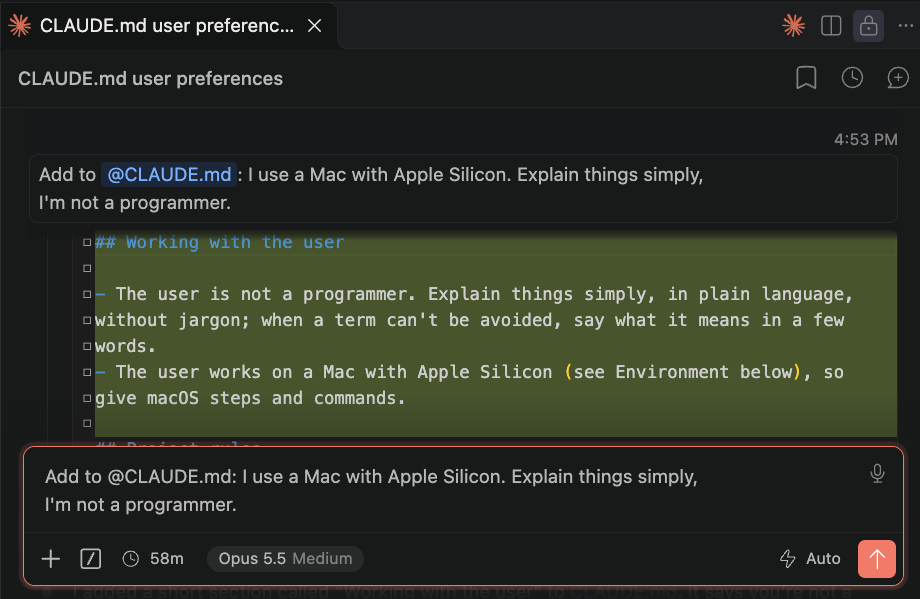

**Step 2: understand the project** (Plan mode)
```
Read @README.md, @config.yaml and @ursotts/ and explain in simple terms how a
script in scripts/ becomes an MP3. Don't change anything.
```

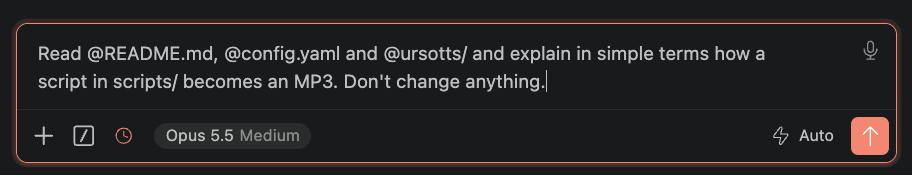

**Step 3: install**
```
Set up this project: check that Python 3.10 or newer is installed (if not,
tell me how to install it), create a virtual environment in .venv, install
the project with the "all" extra, then run `ursotts check` and fix anything
it reports as missing except my voice samples.
```

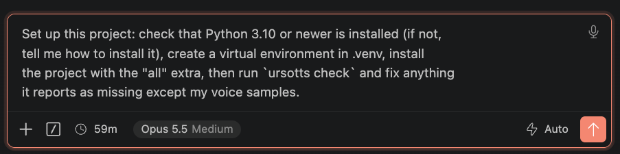

The install downloads PyTorch, which is large, so it takes a while.

When it's done, Claude sums up what's left for you, including the two lines to run in each new terminal window:

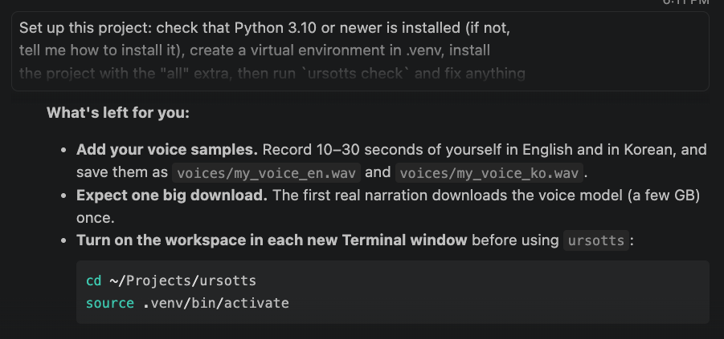

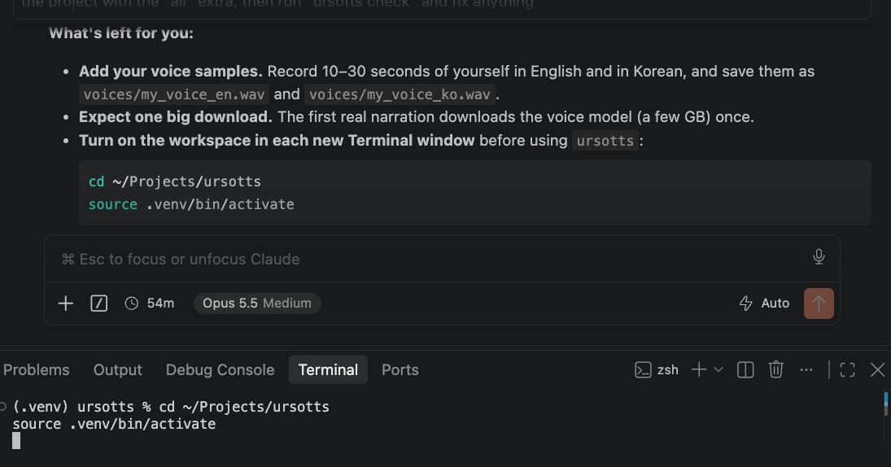

**Step 4: add your voices.** Put your samples into `voices/` (see [9.1](#91-record-your-voice-samples)), then:
```
Run `ursotts check` again and confirm both voices show OK.
```

Claude explains how to record and name the files; your `voices` folder should then hold both samples, and the check confirms them:

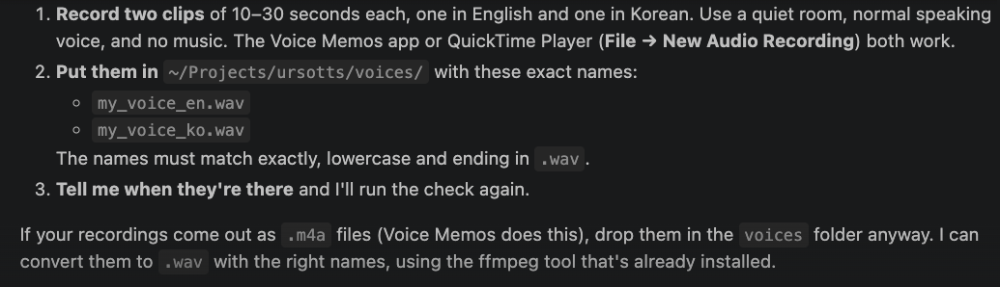

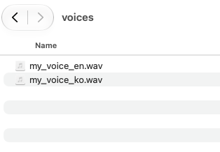

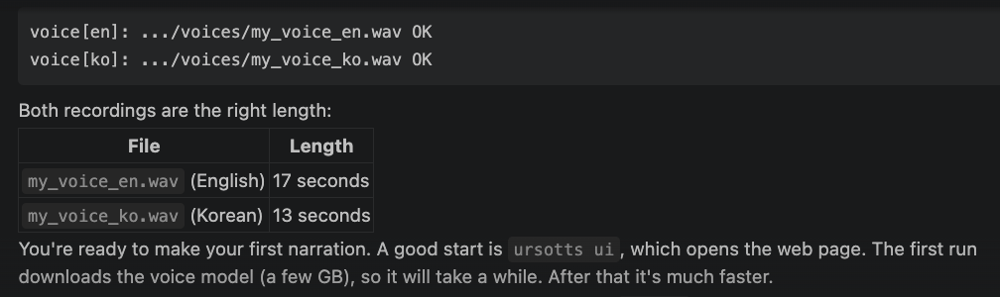

**Step 5: first test**
```
Run: ursotts say "Welcome. Today we analyze scRNA-seq data." -o output/test1.wav
If it fails, read the error, fix it, and run it again.
```

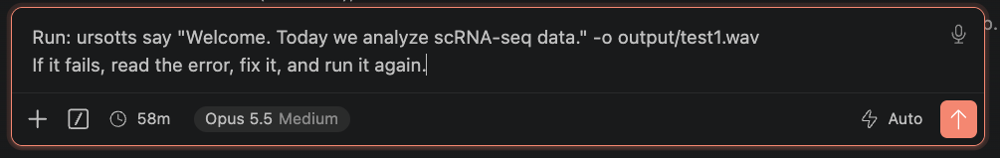

The first real run downloads the Chatterbox model (a few GB). After that it starts in seconds.

**Step 6: open the web UI**
```
Start the web UI with `ursotts ui`.
```
How to use each tab is explained in [chapter 6](#6-using-the-web-ui).

**When something breaks**, don't describe it, point at it:
```
The last command failed. Look at @terminal:zsh, find the cause, and fix it.
```

**If a word sounds wrong**, ask Claude Code to fix it directly (see [9.3](#93-fix-pronunciation)):

```
In the test, "TCRs" sounds like "tickers". Add an entry to pronunciations.yaml
in the project style, then render the same sentence again as output/test2.wav.
```

Tips for asking:

- **Say which word sounded wrong and how.** Example: "RNA-seq sounds choppy, like 'R … N … A … sek'."
- **Describe the sound you want** in everyday words. Example: "NAN as in man, og as in dog, one smooth word."
- **Say which language** the sentence is in. English and Korean entries go in different places (`en:` / `ko:`).
- **Ask for the same sentence again** after the fix, so you can compare before and after.
- Several words? **List them all in one request.**

### 4.8 Update to a new version

You don't need to start over. Your `.venv`, the downloaded voice model and your voice samples stay as they are; only the project files are replaced.

**If you downloaded a zip**, paste this into Claude Code with the `ursotts` folder open:

```
I downloaded a new ursotts.zip to ~/Downloads. Unzip it to a temporary folder and
copy its files into this project, but keep my voices/ folder as it is, and merge
pronunciations.yaml and config.yaml (keep my own entries and settings). Then run
pip install -e ".[all]" in .venv and `ursotts check`.
```

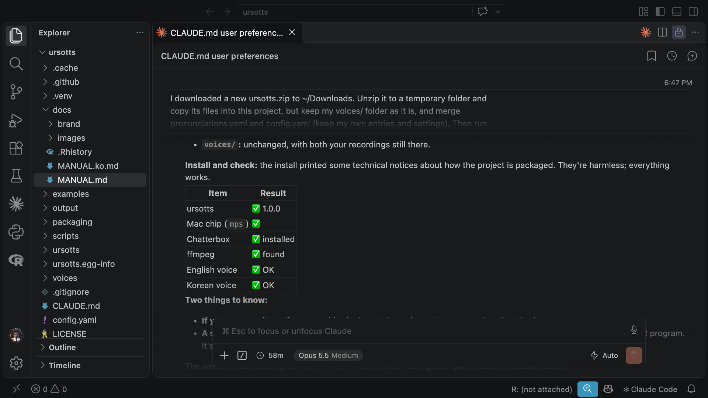

**If you cloned the project from GitHub:**

```
Update this project from GitHub with git pull. Keep my voices/ folder and my own
entries in pronunciations.yaml and config.yaml. Then run pip install -e ".[all]"
in .venv and `ursotts check`.
```

Reinstalling only takes a moment and picks up any new packages a version needs. Then check them in order: `ursotts check` → `ursotts ui` → `ursotts app`. If the desktop app reports that Tkinter is missing, see [chapter 7](#7-using-the-ursotts-desktop-app).

<sub>[↑ Back to contents](#contents)</sub>

## 5. Using the Claude Code CLI

The Claude Code CLI is the same Claude Code as in [chapter 4](#4-using-claude-code-in-vs-code-and-the-claude-desktop-app), inside a terminal window. You still type requests in plain words, and the modes (see [4.3](#43-choose-a-permission-mode)), slash commands (see [4.5](#45-slash-commands)) and `CLAUDE.md` work the same. Only the look is different: text only, no buttons or side-by-side diffs.

**When it's useful:** working on a remote computer over SSH (a cloud GPU or a lab server), when you prefer the keyboard, or when you're already in a terminal.

### 5.1 Install it

Follow the official setup guide: <https://code.claude.com/docs/en/setup>. Then check that it works:

```bash
claude --version
```

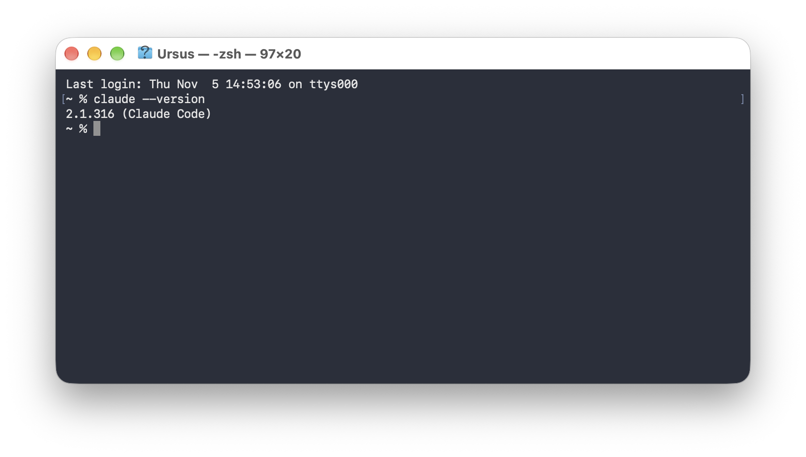

### 5.2 Start a session

```bash
cd ~/Projects/ursotts      # always start inside the project folder
claude
```

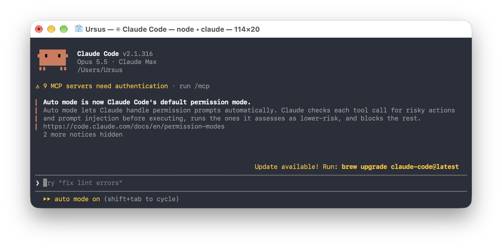

The first time, Claude asks you to sign in and opens your browser to finish. You can also run `claude` in VS Code's integrated terminal (**Ctrl+~**).

### 5.3 Chat

- Type a request and press **Enter**. Every prompt in this manual works here too.
- Type `@` to point at a file, and `/` for slash commands.
- Press **Shift+Tab** to switch modes.
- Press **Esc** to stop Claude in the middle of an answer.
- To write several lines, end a line with `\` and press **Enter**.
- Korean text is easier to type in the VS Code panel or the desktop app; pasting it into the CLI works.

### 5.4 Leave and come back

| To | Type |
|---|---|
| Leave | `/exit`, or press **Ctrl+C** twice |
| Continue your most recent conversation | `claude --continue` |
| Choose an earlier conversation | `claude --resume` |

<sub>[↑ Back to contents](#contents)</sub>

## 6. Using the web UI

The web UI is a second way to use ursoTTS: the same features as the terminal commands, with buttons in your browser instead of typed commands. It uses the same `config.yaml`, voice samples and `pronunciations.yaml`, so you can switch between the two at any time. For example, fix a word in the browser, then render a whole folder in the terminal.

| Task | Web UI | Terminal |
|---|---|---|
| Make narration from text | **Speak** tab | `ursotts say` |
| Choose or record a voice | **Speak** tab → *My saved voices* or *Record or upload a new sample* | change `voices:` in `config.yaml` |
| Adjust the speaking style | **Speak** tab → *Speaking style* sliders | edit `config.yaml` |
| Fix a word's pronunciation | **Pronunciation** tab | edit `pronunciations.yaml` |
| Render a whole folder | **Batch** tab | `ursotts batch` |

### 6.1 Start and stop it

**Start** it from Claude Code:
```
Start the web UI with `ursotts ui`.
```
Or from a terminal, inside the project folder (see [chapter 8](#8-using-the-command-line-in-the-terminal)):
```bash
source .venv/bin/activate
ursotts ui
```

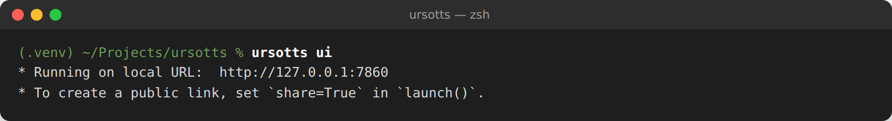

Your browser opens **http://127.0.0.1:7860**. The page runs only on your computer; nothing is uploaded. It follows your system's light or dark mode.

- The first **Generate** loads the voice model, which takes a little while (and downloads it on the very first run). After that, it's quick.
- **Keep the terminal (or the Claude Code session) open** while you use the page. Closing it stops the web UI.
- **To stop it,** press **Ctrl+C** in that terminal, or tell Claude Code "Stop the web UI."
- If the page doesn't open, type `http://127.0.0.1:7860` into your browser yourself.

| Option | What it does |
|---|---|
| `ursotts ui --port 7861` | Use another port, if 7860 is already in use |
| `ursotts ui --no-browser` | Don't open a browser tab automatically |
| `ursotts ui --engine dummy` | Test the page without the voice model (plays a tone) |
| `ursotts ui --share` | Create a temporary **public** link; only use it when you mean to |

### 6.2 Speak tab: make narration

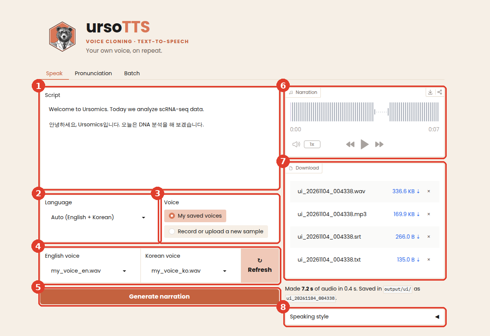

1. **Script:** paste your narration. Blank lines become paragraph pauses, `[pause 1.5]` adds a pause, and lines starting with `#` are skipped, exactly as in a script file (see [9.2](#92-write-scripts)).
2. **Language:** *Auto* detects English or Korean sentence by sentence. Choose *English* or *Korean* to read everything in one language and one voice, like `@lang en` / `@lang ko`.
3. **Voice:** *My saved voices* uses the samples in your `voices` folder; *Record or upload a new sample* lets you use a new one (see [6.3](#63-try-a-different-voice)).
4. **English voice / Korean voice:** pick a sample file for each language from the `voices` folder. Click **Refresh** after adding new files to the folder.
5. **Generate narration:** creates the audio.
6. **Narration:** play the result right in the page.
7. **Download:** the WAV, MP3, SRT subtitles and the script as text. All four are also saved in `output/ui/`, named by date and time (for example `ui_20261103_142501.mp3`), so nothing is lost when you close the page.
8. **Speaking style:** click it to open the sliders that shape how it sounds (see [6.4](#64-speaking-style)).

### 6.3 Try a different voice

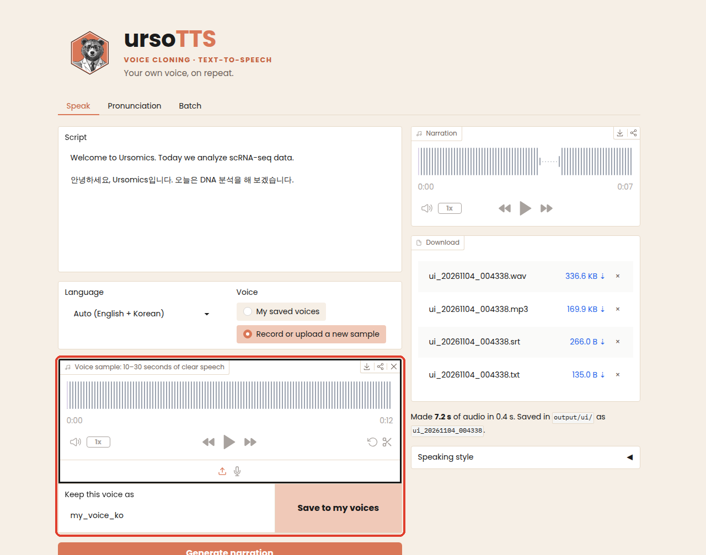

Choose **Record or upload a new sample** under *Voice*. A recording box appears:

- **Record:** click *Record*, speak naturally for **10–30 seconds**, then stop. The first time, your browser asks for permission to use the microphone; click *Allow*.
- **Upload:** click the upload icon and choose an audio file (WAV, MP3, M4A and others).

ursoTTS converts the sample automatically (mono, 24 kHz, at most 30 seconds), so any recording or file works. Samples shorter than 3 seconds are refused.

**To keep the voice**, type a name under **Keep this voice as** (for example `my_voice_ko`) and click **Save to my voices**. It's saved in your `voices` folder and appears in the English and Korean voice lists under *My saved voices*.

### 6.4 Speaking style

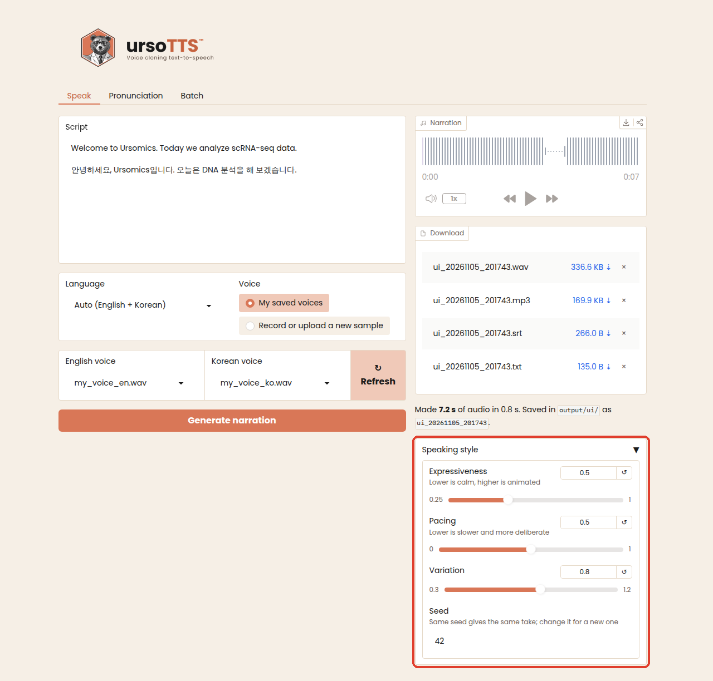

Click **Speaking style** under the download list (8 in the Speak tab picture) to open the sliders:

| Slider | Effect |
|---|---|
| **Expressiveness** | Lower is calm, like a lecture; higher is more animated |
| **Pacing** | Lower is slower and more deliberate |
| **Variation** | Higher gives more varied speech |
| **Seed** | The same seed gives the same take; change it to hear a different version |

Changes apply to the next generation and last until you stop the web UI. They aren't written to `config.yaml`. When you find settings you like, ask Claude Code to copy them there:
```
Set exaggeration 0.4, cfg_weight 0.45 and seed 7 in @config.yaml.
```

### 6.5 Pronunciation tab: fix a word

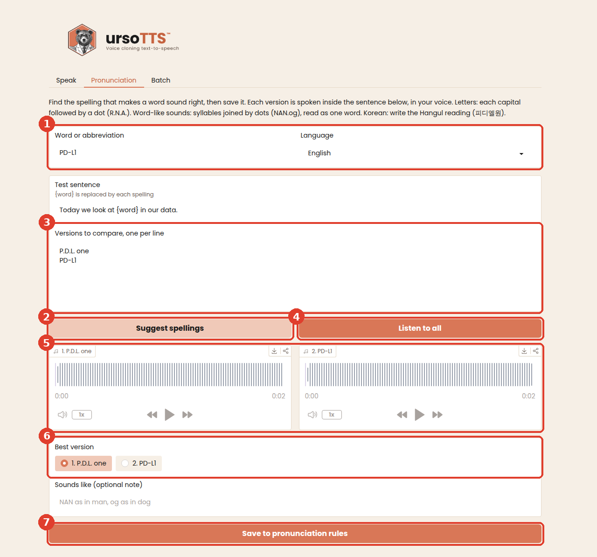

1. Type the **word** and choose the **language**.
2. Click **Suggest spellings** to fill in a few versions in the project style.
3. Edit the **versions** or add your own, one per line.
4. Click **Listen to all**.
5. Each version plays inside the test sentence, in your voice.
6. Choose the **best version**, and optionally describe it under *Sounds like*.
7. Click **Save to pronunciation rules** (it saves to `pronunciations.yaml`). Every script that uses the word is re-rendered on the next batch.

How to write spellings that sound smooth is explained in [9.3](#93-fix-pronunciation).

### 6.6 Batch tab: render a whole folder

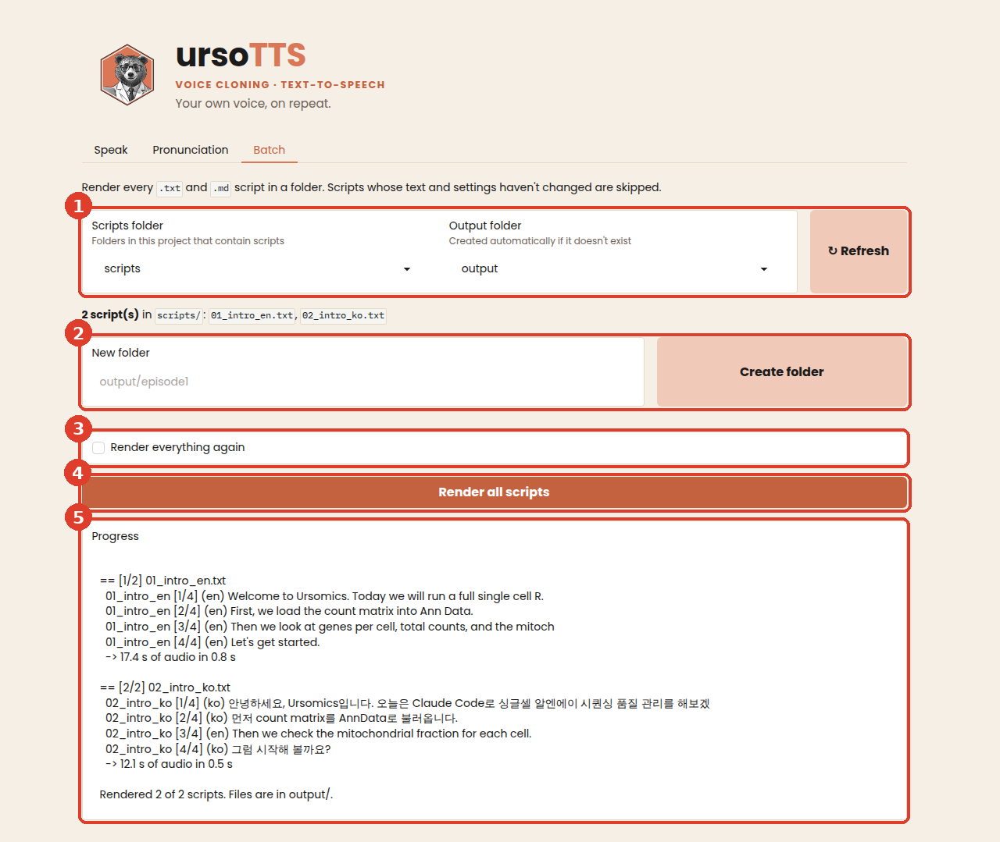

1. **Scripts folder** and **Output folder:** choose from the folders in the project. The scripts in the chosen folder are listed below. You can also type a path. Click **Refresh** after adding folders outside the web UI.
2. **New folder:** type a name (for example `output/episode1`) and click **Create folder**. The new folder becomes the output folder. An output folder that doesn't exist yet is also created automatically when you render.
3. **Render everything again:** tick it to redo scripts that haven't changed. Otherwise they're skipped.
4. **Render all scripts:** starts the batch.
5. **Progress:** shows each script and sentence as it's made, then a summary.

This does exactly what `ursotts batch` does, with the same files and the same skipping rules (see [8.6](#86-render-a-folder-ursotts-batch)).

<sub>[↑ Back to contents](#contents)</sub>

## 7. Using the ursoTTS desktop app

The same features as the web UI in a normal window, styled like VS Code Dark. Use it from your Python setup (`ursotts app`) or install it without Python (see [7.2](#72-install-without-python-dmg--exe)).

### 7.1 Start the desktop app

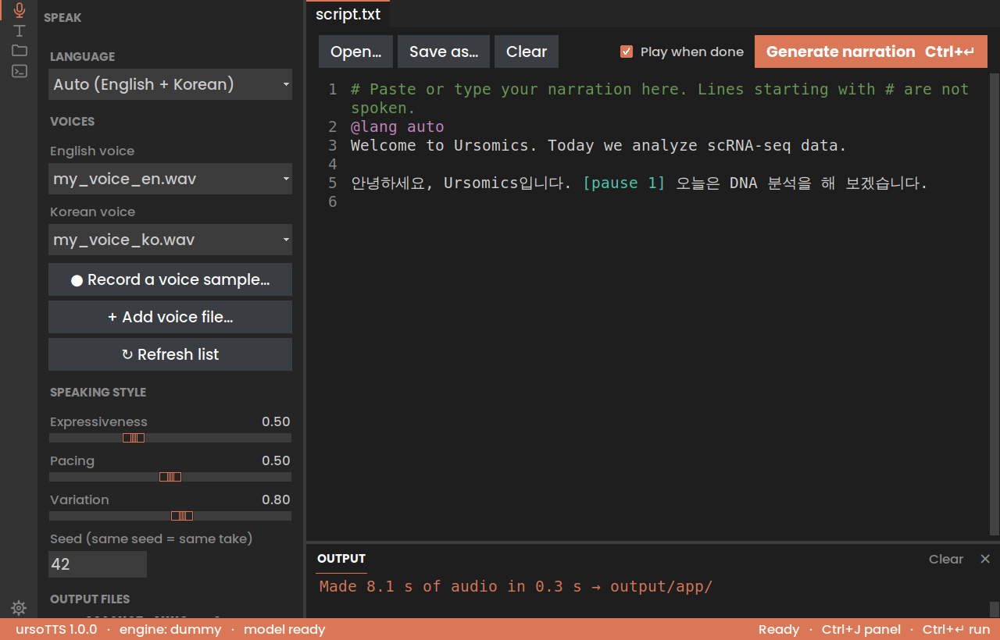

Prefer a normal window over a browser tab? The desktop app has the same features, styled like VS Code Dark.

**Start** it from Claude Code:

```
Start the desktop app with `ursotts app`.
```

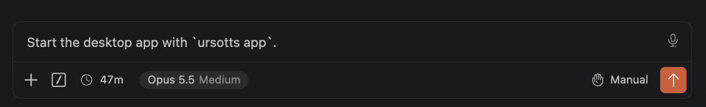

Or from a terminal, inside the project folder (see [chapter 8](#8-using-the-command-line-in-the-terminal)):

```bash
cd ~/Projects/ursotts
source .venv/bin/activate
ursotts app
```

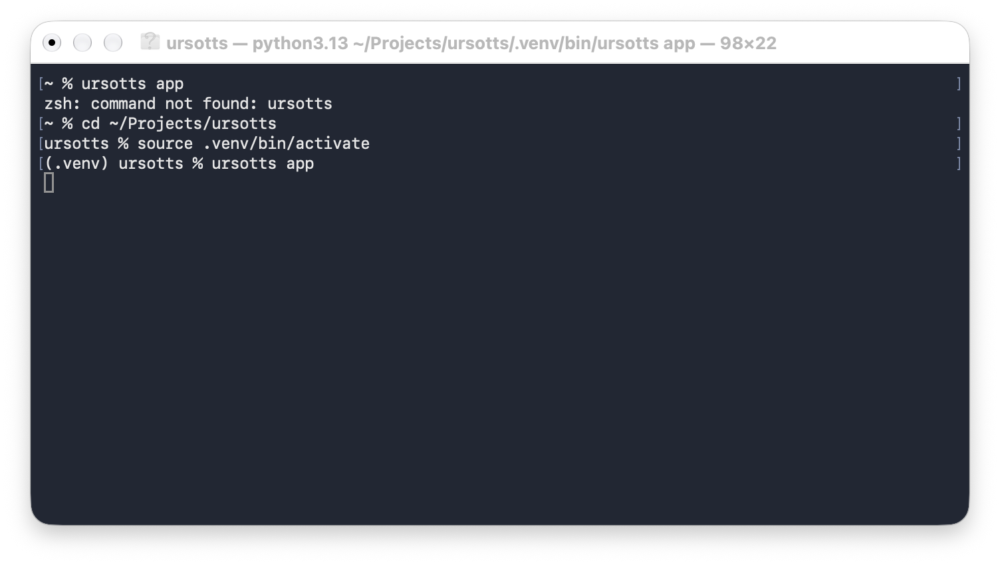

The first line in this screenshot shows the most common mistake: `ursotts app` gives *command not found* until you go to the project folder and turn on the environment.

Installed it from a `.dmg` or `.exe` (see [7.2](#72-install-without-python-dmg--exe))? Just open **ursoTTS** like any other app.

| Part | What it does |
|---|---|
| **Activity bar** (far left) | Microphone = Speak · Text = Pronunciation · Folder = Batch · Terminal = Claude Code · Gear (bottom) opens `config.yaml`; the selected view is coral |
| **Sidebar** | Language, voices (with **● Record a voice sample…** and **+ Add voice file…**), speaking style and the list of output files; drag its edge to resize |
| **Editor** | Your script with line numbers and colors (comments, `@lang`, `[pause]`); **Open…**, **Save as…** and **Generate narration** |
| **OUTPUT panel** | The live log with timings; **⌘J** shows or hides it |
| **Status bar** | Version, engine and whether the voice model is loaded |

<p>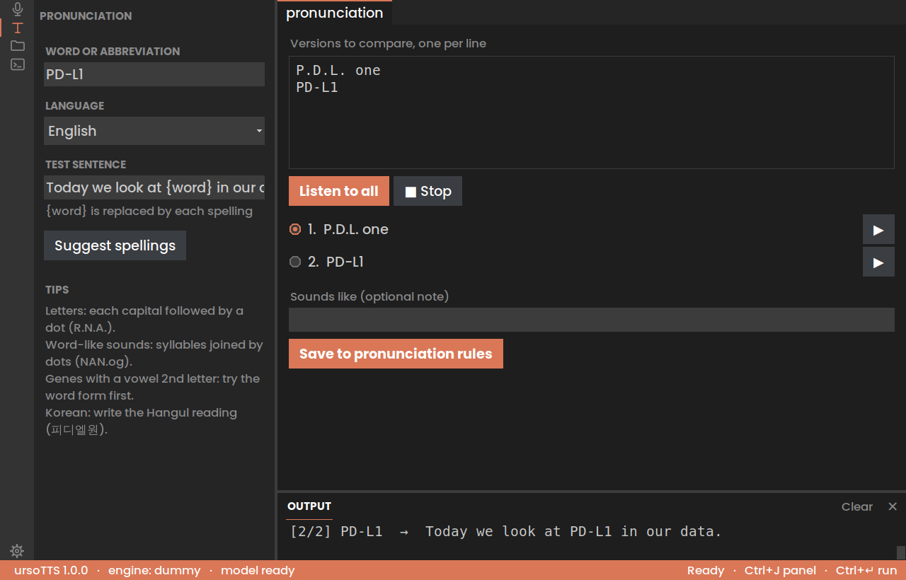 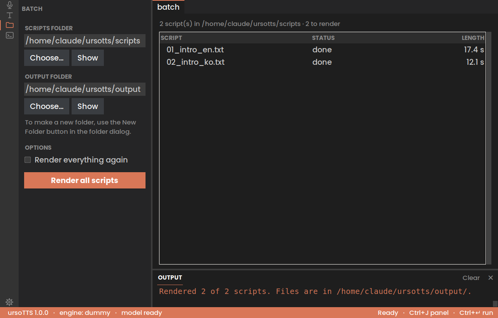</p>

Shortcuts: **⌘↵** runs the current view, **⌘1–4** switch views, **⌘O** opens a script, **⌘S** saves it (**⇧⌘S** saves under a new name), **⌘+** / **⌘−** zoom in and out (70–160%), **⌘0** returns to 100%, **⌘K ⌘T** chooses a color theme. In Batch, the folder dialog has a **New Folder** button. The window remembers its size, zoom, panels, last view, script and folders.

The desktop app uses Tkinter, which comes with Python from python.org. With Homebrew's Python, install it once with `brew install python-tk@3.13` (match your Python version). The web UI keeps working either way.

**Color themes.** Choose **View → Color Theme** (or press **⌘K** then **⌘T**, as in VS Code): Dark+, Light+, ursoTTS Cream, Monokai, Solarized Dark, Solarized Light or High Contrast. The window restarts in a second with the new colors; your script, folders and layout are kept, and it asks first if there are unsaved changes.

**Saving and closing.** Narration files are saved as soon as they're made (in `output/app/`), and the editor's text is kept for next time. When the script belongs to a file you opened or saved, a **●** in the tab means unsaved changes, and the app asks before closing. It also asks before quitting while narration is still being made.

**Without keeping a terminal open.** `ursotts app` needs its terminal window to stay open. Two ways around that:

- `ursotts app --detach` starts the app in the background; you can close the terminal right away.
- `ursotts make-launcher` (or **File → Create launcher…** in the app) creates a double-click launcher: **ursoTTS** in your home folder's Applications on a Mac (drag it to the Dock if you like), a Desktop and Start-menu shortcut on Windows, or a menu entry on Linux. Run it once, from inside the project folder.

### 7.2 Install without Python (.dmg / .exe)

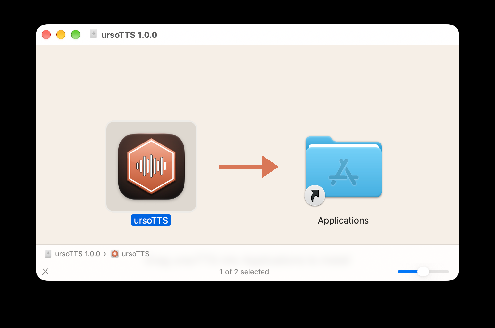

The desktop app is also available as a normal installer, for people who don't want to use Python or the terminal. Download it from the [latest release](https://github.com/ursomics/ursotts/releases/latest): `ursoTTS-1.0.0-mac-arm64.dmg` for a Mac with Apple Silicon (open it and drag ursoTTS into Applications), or `ursoTTS-1.0.0-windows-setup.exe` for Windows. The version number in the name changes with each release.

- **First open:** the installers aren't signed with a paid certificate yet, so your computer asks you to confirm once (step by step below).
- **Your files:** the installed app works in a **`ursoTTS`** folder in your home folder, created on first launch with the default settings and example scripts. Add your voice with **● Record a voice sample…** or **+ Add voice file…**; results go to `output/`.
- **Voice model:** downloaded once with your first narration (a few GB, internet needed).
- **Claude Code view:** in the installed app it works in Ask mode only, because the app's own code is sealed inside the installer. To change the app, use the source version.
- **MP3 export** works without installing ffmpeg; a copy is included.

**First open on a Mac.** macOS blocks apps from developers it doesn't know yet. You confirm once:

1. Open **ursoTTS** from Applications. macOS says it can't verify the app; click **Done**.
2. Open **System Settings → Privacy & Security** and scroll down to **Security**.
3. Next to *"ursoTTS" was blocked to protect your Mac*, click **Open Anyway**.
4. In the confirmation, click **Open Anyway** again and approve with your password or Touch ID.

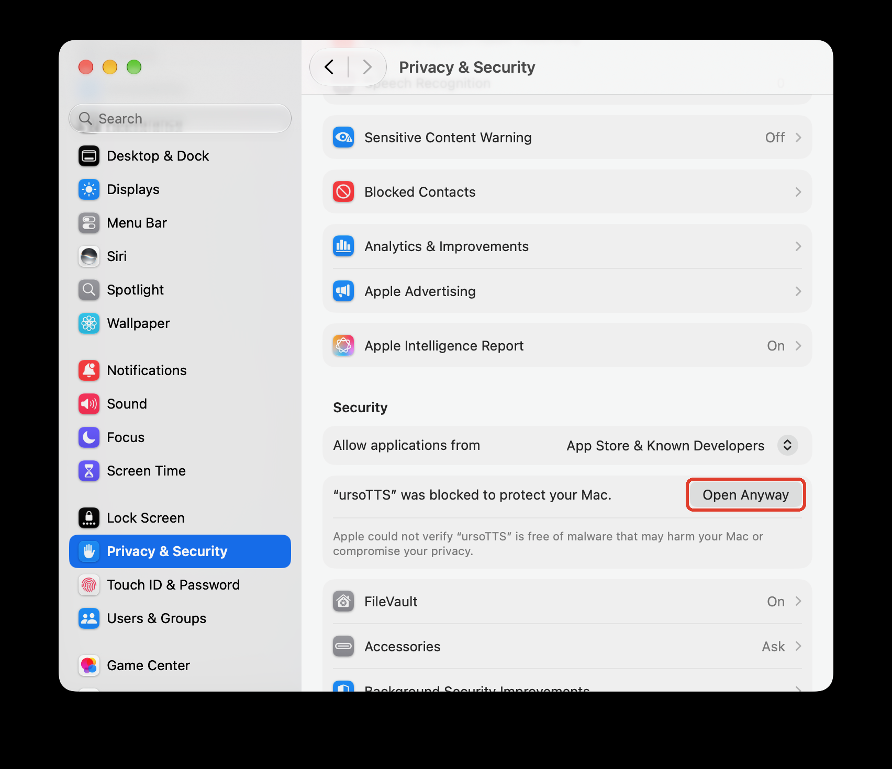

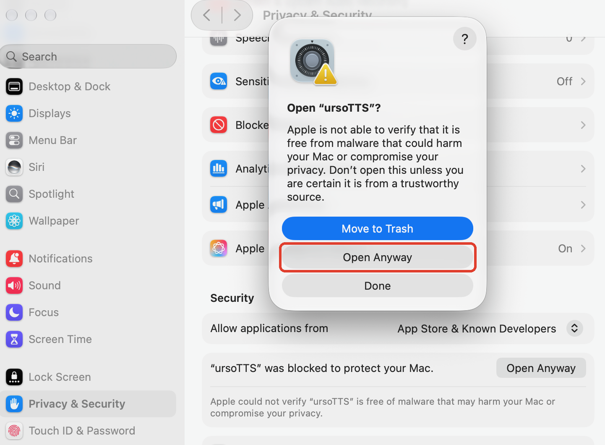

**First open on Windows.** Microsoft Defender SmartScreen may stop the installer the first time:

1. In *Windows protected your PC*, click **More info**.
2. Check that the app is **ursoTTS-1.0.0-windows-setup.exe**, then click **Run anyway** and follow the installer.

<p>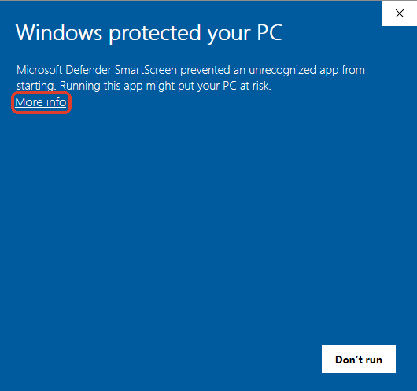 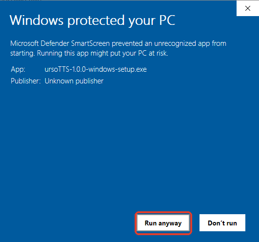</p>

These steps are needed only once, the first time. After that, ursoTTS opens like any other app.

<p>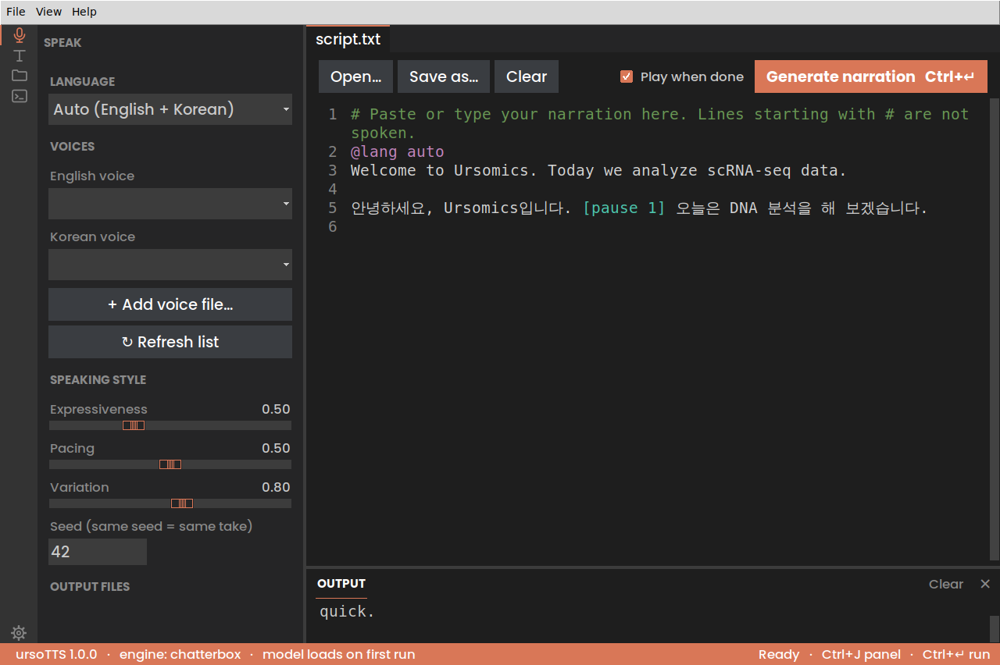 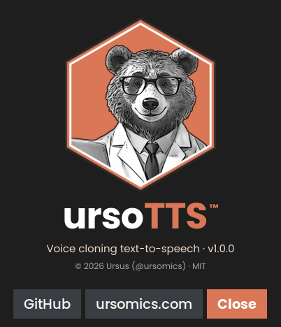</p>

On first launch the voice lists are empty: record your sample with **● Record a voice sample…** (macOS asks once for microphone access) or add a file with **+ Add voice file…**. **Help → About ursoTTS** shows the version.

### 7.3 Change the app with Claude Code

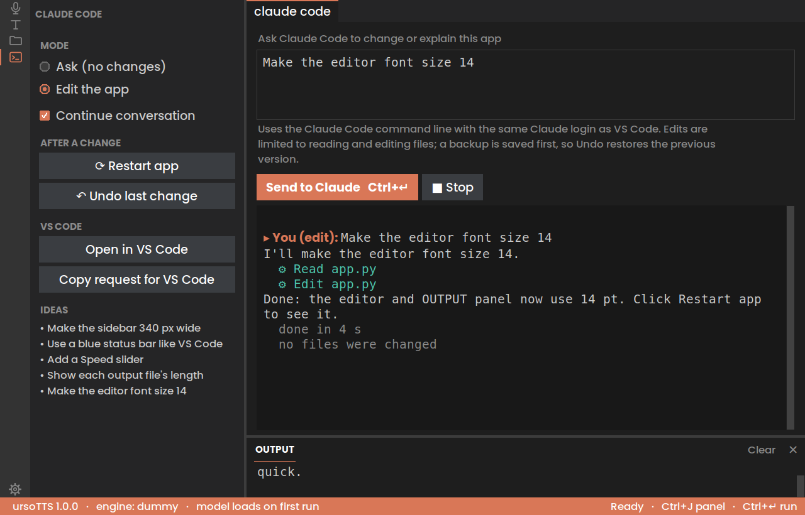

The **Claude Code** view (the terminal icon) lets you change the app itself by asking in plain words, for example "Make the sidebar 340 px wide" or "Add a Speed slider". It runs the Claude Code command line (`claude`) with the same Claude login you use in VS Code.

1. Choose a mode: **Ask** (Claude explains and changes nothing) or **Edit the app**.
2. Type your request, or pick one of the **Ideas**, and click **Send to Claude** (**⌘↵**). The transcript shows what Claude reads and edits.
3. Click **⟳ Restart app** to see the change.
4. Don't like it? Click **↶ Undo last change**. The app saves a backup of its own files before every edit (the last five are kept in `.cache/claude_undo/`), then restart again.

In Edit mode, Claude can only read and edit files: no terminal commands or installs. **Open in VS Code** opens the project there so you can review the changes; **Copy request for VS Code** copies your request, with the right context, for the Claude panel in VS Code. The Claude view needs the Claude Code command line (see [5.1](#51-install-it)); without it, use the copy button.

<sub>[↑ Back to contents](#contents)</sub>

## 8. Using the command line in the terminal

Here you type `ursotts` commands yourself, without Claude. It's the most direct way and great for quick, repeated runs, but the commands must be typed exactly. If a command fails, you can always paste the error into Claude Code (see [chapter 4](#4-using-claude-code-in-vs-code-and-the-claude-desktop-app)).

### 8.1 Open a terminal and get ready

Open **Terminal** (on a Mac: press **Cmd+Space**, type *Terminal*, press **Enter**), or the integrated terminal in VS Code (**Ctrl+~**), which already opens in the project folder.

**Always run ursoTTS from inside the project folder.** ursoTTS reads `config.yaml` (your voice settings) from the folder you're in.

```bash
pwd                               # where am I? should end in /ursotts
cd ~/Projects/ursotts             # go to the project folder
ls                                # should list config.yaml, scripts, voices, ursotts
source .venv/bin/activate         # turn on the environment; the prompt shows (.venv)
```

Run the `cd` and `source` lines every time you open a new terminal. On Windows, activate with `.venv\Scripts\activate`.

### 8.2 Commands at a glance

| Command | What it does |
|---|---|
| `ursotts check` | Checks your setup: GPU, voice model, ffmpeg, voice samples |
| `ursotts preview FILE` | Shows how a script will be read, without making audio |
| `ursotts say "TEXT" -o FILE` | Makes one sentence or short text |
| `ursotts batch IN_FOLDER OUT_FOLDER` | Makes every script in a folder |
| `ursotts ui` | Starts the web UI |
| `ursotts app` | Opens the desktop app (see [chapter 7](#7-using-the-ursotts-desktop-app)); add `--detach` to close the terminal afterwards |
| `ursotts make-launcher` | Creates a double-click launcher for the desktop app (see [7.1](#71-start-the-desktop-app)) |
| `ursotts --help`, `ursotts batch --help` | Lists every command, or one command's options |

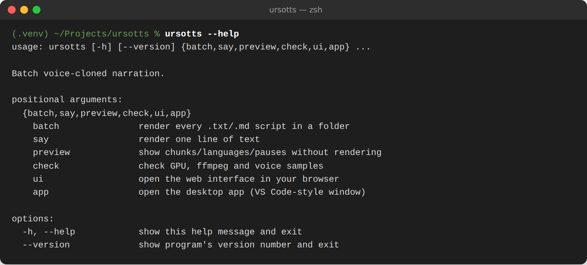

### 8.3 Check your setup: `ursotts check`

```bash
ursotts check
```

A healthy setup looks like this:

```
ursotts 1.0.0
engine: chatterbox
torch 2.6.0 | best device: mps
chatterbox: installed
ffmpeg: /opt/homebrew/bin/ffmpeg
voice[en]: /Users/you/Projects/ursotts/voices/my_voice_en.wav OK
voice[ko]: /Users/you/Projects/ursotts/voices/my_voice_ko.wav OK
```

Anything marked *NOT installed*, *not found* or *MISSING* tells you what to fix.

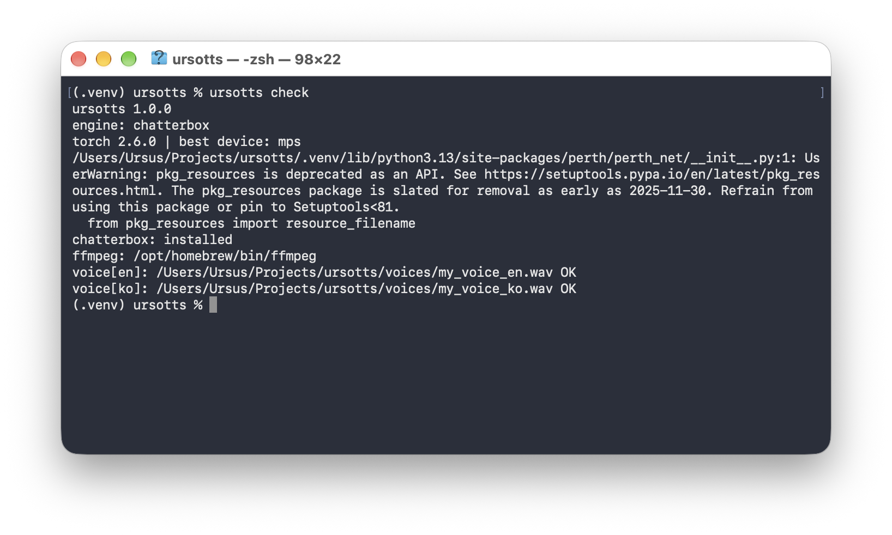

Warnings such as *pkg_resources is deprecated* come from libraries ursoTTS uses. They're harmless and can be ignored.

### 8.4 Preview a script: `ursotts preview`

```bash
ursotts preview scripts/01_intro_en.txt
```

Shows each chunk with its language and the exact text the voice will read, plus the pauses, in a few seconds:

```
[en] Welcome to Ursomics. Today we will run a full single cell R.N.A. seek quality-control workflow.
   ... pause 0.7s
[en] First, we load the count matrix into Ann Data.
```

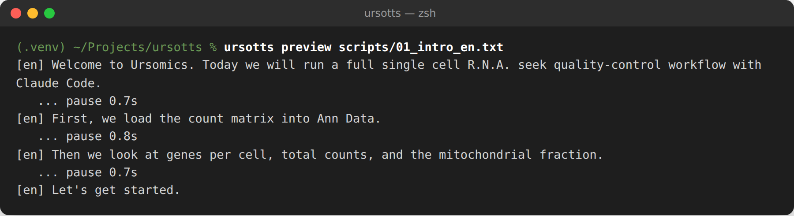

Use it to check pronunciation spellings (see [9.3](#93-fix-pronunciation)) and language detection before rendering.

### 8.5 Make one sentence: `ursotts say`

```bash
ursotts say "Welcome to Ursomics." -o output/hello.wav
ursotts say "안녕하세요, Ursomics입니다." -o output/hello_ko.wav --lang ko
```

| Option | Meaning |
|---|---|
| `-o FILE` | Where to save the WAV (default: `say.wav`) |
| `--lang en` / `--lang ko` | Read everything in one language and voice, like `@lang` |
| `--engine dummy` | Test without the voice model (plays a tone) |
| `-c FILE` | Use another config file (default: `config.yaml`) |

Put the text in quotes, especially when it contains spaces or Korean.

### 8.6 Render a folder: `ursotts batch`

```bash
ursotts batch scripts output
```

This makes every `.txt` and `.md` script in `scripts/` and writes, for each script `name.txt`:

```
output/name.wav   output/name.mp3   output/name.srt   output/batch_report.json
```

| Option | Meaning |
|---|---|
| `--force` | Redo scripts that haven't changed (normally they're skipped) |
| `--engine dummy` | Test the whole run without the voice model |
| `-c FILE` | Use another config file |

Running `batch` again skips scripts whose text and settings haven't changed, and even with `--force` only the changed sentences are generated again. `batch_report.json` lists each script's length, which is handy for checking video timing.

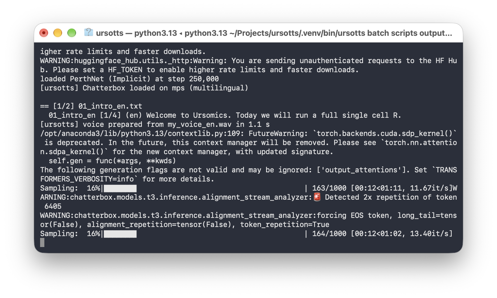

The first run loads the voice model and prints some warnings (for example about a Hugging Face token or repeated tokens). They're harmless; the narration is still made correctly.

### 8.7 Start the web UI: `ursotts ui`

```bash
ursotts ui
```

| Option | Meaning |
|---|---|
| `--port 7861` | Use another port if 7860 is busy |
| `--no-browser` | Don't open a browser tab automatically |
| `--engine dummy` | Test the page without the voice model |
| `--share` | Create a temporary **public** link; only when you mean to |

Press **Ctrl+C** to stop it. Details are in [6.1](#61-start-and-stop-it).

### 8.8 Handy keys and tips

| Key or tip | What it does |
|---|---|
| **↑** / **↓** | Bring back earlier commands, so you don't retype them |
| **Tab** | Completes file and folder names (`scripts/01` + Tab) |
| **Ctrl+C** | Stops the running command |
| **Cmd+K** or `clear` | Clears the screen |
| Quotes `"…"` | Keep text with spaces or Korean together |

> **ffmpeg uses a single dash:** `ffmpeg -version`, not `ffmpeg --version`. Most other tools (`python --version`, `git --version`) use two.

### 8.9 Windows and servers

- **Windows:** the web UI, the desktop app and the terminal commands all work. An NVIDIA GPU is fastest; install ffmpeg with `winget install ffmpeg` and activate with `.venv\Scripts\activate`. The desktop app plays WAV files with Windows' built-in player, so ■ Stop works. A Windows installer is also available (see [7.2](#72-install-without-python-dmg--exe)).
- **AWS EC2:** use `ursotts batch` or the web UI; the desktop app needs a screen, so it doesn't run there. Open the web UI through an SSH tunnel, `ssh -L 7860:localhost:7860 you@your-ec2-host`, then go to http://localhost:7860 on your own computer. Don't use `--share` or open port 7860 to the internet.
- **S3:** ursoTTS works with ordinary folders, so copy files in and out with `aws s3 sync`:

```bash
aws s3 sync s3://your-bucket/scripts scripts/
ursotts batch scripts output
aws s3 sync output/ s3://your-bucket/narration/
```

<sub>[↑ Back to contents](#contents)</sub>

## 9. Making narration

### 9.1 Record your voice samples

- **10–30 seconds** of natural speech in the style of your videos.
- A quiet room, no music, one speaker, a steady distance from the microphone.
- **One sample per language.** Your Korean sounds best when cloned from your Korean.
- Save them as `voices/my_voice_en.wav` and `voices/my_voice_ko.wav`, or change the names in `config.yaml`.

To convert a phone recording, ask Claude Code:
```
Convert ~/Desktop/my_voice_en.m4a to voices/my_voice_en.wav: mono, 24 kHz,
trim silence at the start and end. Tell me the final length in seconds.
```

You can also record a sample directly in the web UI (**Speak** tab → *Record or upload a new sample*) or in the desktop app (**● Record a voice sample…**, or **+ Add voice file…** for an existing recording).

**A sample made by another TTS service works for testing**, but cloning a clone loses some naturalness. Your own recording gives the best result.

### 9.2 Write scripts

```text
@lang en
# Lines starting with # are notes and are not spoken.
Welcome to Ursomics. Today we analyze scRNA-seq data.

A new paragraph gets a slightly longer pause. [pause 1.5] You can also add pauses wherever you like.
```

| Element | Effect |
|---|---|
| `@lang en` / `@lang ko` | Force one language (and one voice sample) for the whole file |
| `@lang auto` (default) | Detect English or Korean sentence by sentence |
| blank line | Paragraph pause (`pauses.paragraph` in config) |
| `[pause 1.5]` | Pause for 1.5 seconds; `[pause]` alone is 1 second |
| `# ...` | Note, not spoken |

**When to force the language:** in a Korean script that contains whole English sentences (a paper title, for example), `auto` switches to the English voice sample for those sentences. If you want one consistent voice reading English with your Korean accent, put `@lang ko` at the top.

### 9.3 Fix pronunciation

Gene names and abbreviations rarely sound right on their own. ursoTTS handles the common case automatically and lets you define everything else once, in `pronunciations.yaml`. Every video then uses it. Subtitles always keep the original spelling.

#### Automatic: abbreviations

All-caps words of 2–6 letters are read letter by letter, smoothly:

| In your script | The voice reads |
|---|---|
| DNA | D.N.A. |
| HLA, MHC | H.L.A., M.H.C. |

Turn it off with `spell_acronyms: false` in `config.yaml`. Dictionary entries always win, so an all-caps word said as a word (UMAP, FACS, NANOG) just needs an entry.

#### Your dictionary: how to write a sound

| Kind of term | Write it like this | Example |
|---|---|---|
| Letters | Each capital followed by a **dot** | `CD8: C.D. eight`, `TCRs: T.C.R.s`, `RNA-seq: R.N.A. seek` |
| A word-like sound | Syllables of two or more letters joined by **dots**; CAPS mark the stress | `NANOG: NAN.og` (voice reads "nanog") |
| As written | Nothing special | `Ursomics: Ursomics` |

**Use dots, not spaces or hyphens.** `R N A`, `R-N-A` and `Ur-SOH-mics` make the voice stop at each break and sound choppy. `R.N.A.` is read as natural, flowing letters, and `ur.SOH.miks` as one smooth word.

Add a note when the sound is easy to get wrong. The voice ignores it, but it tells you, a collaborator or Claude exactly what you meant:

```yaml
en:
  NANOG: {say: NAN.og, like: "NAN as in man, og as in dog, one smooth word"}
```

The project ships with about 60 bioinformatics terms. Entries marked *tested* have been checked by ear; *starter* entries are good guesses to verify.

#### Gene names: word first, letters if needed

1. **If the second letter is a vowel** (NANOG, GATA, SOX, KIR), start by reading the gene **as a word**: `NANOG: NAN.og`, `GATA4: GAH.tah FOUR`, `SOX17: saaks SEV.en.teen`, `KIR: kur`.
2. **Only if that sounds wrong**, spell the letters with dots: `NANOG: N.A.N.O.G.`
3. **Otherwise** (CD8, TP53, IL2RA), spell the letters: `TP53: T.P. fifty-three`.

The Pronunciation tab follows the same order: for a gene whose second letter is a vowel, it suggests the word form first.

#### Test by ear

`examples/` contains two test scripts packed with gene names and abbreviations (English, and Korean–English), organized by type of term:

```bash
ursotts batch examples output/pron_test
```

Listen to each MP3 with its SRT file open; the subtitles show which sentence is playing, so you can find the exact word that sounds off.

#### Fix a word: the Pronunciation tab

Open `ursotts ui` and go to **Pronunciation**:

1. Type the term, for example `PD-L1`, and choose the language.
2. Click **Suggest spellings**. The first suggestion follows the project style (`P.D.L. one`); edit it or add your own, one per line.
3. Click **Listen to all**. Each version is spoken inside a test sentence, in your voice.
4. Choose the best one, optionally describe it in **Sounds like**, and click **Save to pronunciation rules**. Your comments in the file are kept.

Always judge inside a sentence, since a word on its own sounds different.

#### Describing a sound to Claude

When you ask Claude (in chat or in Claude Code) to add or fix a pronunciation, use this format. It leaves no room for guessing:

```
Add to pronunciations.yaml (English):
TERM: spelling in the project style. Sounds like: everyday words for each part.

Examples:
CD45: C.D. forty-five. Sounds like: "see-dee" then "forty-five".
NANOG: NAN.og. Sounds like: NAN as in "man", og as in "dog", one smooth word.
KIR: kur. Sounds like: rhymes with "fur".
```

### 9.4 Tune the speaking style

| config.yaml | Web UI | Effect |
|---|---|---|
| `exaggeration` | Expressiveness | 0.3 calm … 0.5 default … 0.7+ animated |
| `cfg_weight` | Pacing | lower is slower and more deliberate |
| `temperature` | Variation | higher is more varied |
| `seed` | Seed | change it for a different take of the same text |

Describing the problem to Claude Code works well:
```
The test sounds too fast and a little flat. Adjust @config.yaml to make it
slower and slightly more expressive, then re-render output/test1.wav.
```

<sub>[↑ Back to contents](#contents)</sub>

## 10. Troubleshooting

| What you see | Cause and fix |
|---|---|
| `Voice sample(s) missing` | You're not in the project folder (`pwd`), or the files in `voices/` don't match the names in `config.yaml`. |
| The narration sounds like a stranger | The voice sample is too short or noisy, or `@lang auto` switched to the other language's sample. Use 10–30 s of clean speech and check `ursotts preview`. |
| `command not found: ursotts` | The environment isn't active: run `source .venv/bin/activate`. |
| Strange errors after moving or renaming the folder | The `.venv` broke. Delete it and run step 3 of [4.7](#47-install-ursotts-with-claude-code-vs-code-and-desktop-app) again. |
| `Unrecognized option '-version'` | You typed `ffmpeg --version`; use `ffmpeg -version`. |
| First run is very slow | It's downloading the model (a few GB). Later runs are fast. |
| Each sentence takes several seconds; the log shows "…/1000" | Normal. The voice model writes speech in small pieces (about 25 per second of audio), so a 5-second sentence takes roughly 10 seconds on an Apple Silicon Mac, and longer on CPU only. 1000 is only the maximum: it stops as soon as the sentence ends. |
| Settings changed but nothing re-rendered | Check that you edited the `config.yaml` in the folder you run from. |
| `No module named pkg_resources` when Chatterbox loads | Reinstall with `pip install -e ".[all]"`; it pins `setuptools<81`, which Chatterbox's watermarker still needs. |
| Install fails on a very new Python | Some dependencies lag behind new Python releases. Try Python 3.11–3.13. |
| Claude Code's panel shows no Spark icon | Open a file first, or use the **✻ Claude Code** button in the status bar. |
| Abbreviations or names sound choppy ("R … N … A", "Ur … So … mics") | A respelling in `pronunciations.yaml` separates letters with spaces or hyphens. Write letters with dots (`R.N.A.`) and word-like sounds as dot-joined syllables (`ur.SOH.miks`). See [9.3](#93-fix-pronunciation). |
| Anything else | In Claude Code: "That failed. Look at @terminal:zsh, find the cause, and fix it." |

---

<p align="center">
  <br>
  <sub>ursoTTS · © 2026 Ursus (@ursomics)</sub>
</p>
